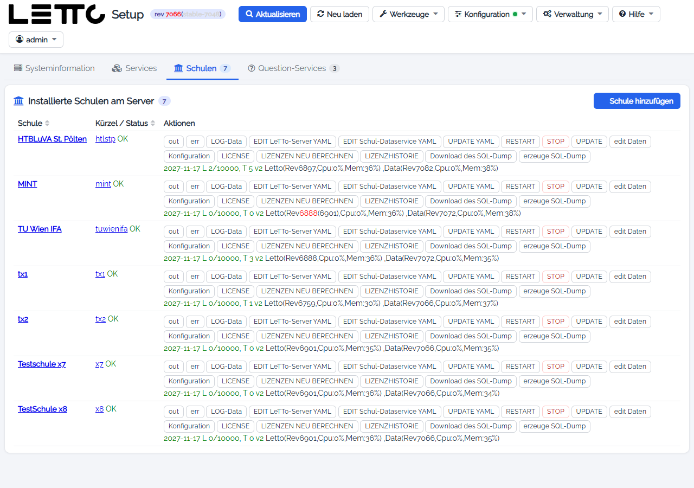

# Lizenzvergabe (Version 1.3)

Ab Version 1.3 bekommt jeder LeTTo-Server seine Lizenzen als **signiertes Lizenz-Token** vom Lizenzserver. Das Token ist
fälschungssicher: Es ist mit einem Schlüssel des Lizenzservers unterschrieben, den nur der Lizenzserver besitzt. Der
LeTTo-Server prüft die Unterschrift selbst und braucht dafür keine Verbindung. Die frühere Lizenz (ein mit einem festen
Passwort verschlüsselter Text und ein „Restkey“) lässt sich im Gegensatz dazu nachbauen und wird nicht mehr zur
Durchsetzung verwendet.

> **Stand:** Die neue Lizenzvergabe läuft zurzeit am Testlizenzserver `t1.letto.at` (Entwicklungsrechner und Tests). Für
> den Lizenzserver `license.letto.at` wird sie nach dem Praxistest freigeschaltet. Bis dahin arbeiten alle
> Produktivserver unverändert mit der bisherigen Lizenz. Ältere Server (Version 1.2 und früher) funktionieren
> weiterhin und werden vom Lizenzserver wie bisher bedient.

## Überblick

| Thema | Regel |
|---|---|
| Anmeldung des Servers | Beim ersten Durchlauf (etwa 2 Minuten nach dem Start des Setup-Service) meldet sich der Server mit seinem eigenen Schlüsselpaar am Lizenzserver an. Hat der Server einen Restkey, wird die bisherige Lizenz **automatisch umgestellt**, ohne dass der Administrator etwas tun muss. |
| Neue Schule, neuer Server | bekommt automatisch eine **Demolizenz**: 30 Tage, **keine Schüler**, wenige Lehrer. Schüler können sich erst anmelden, wenn der Lizenzserver-Betreiber die Lizenz freischaltet. |
| Pflichtcheck | Jeder Server muss mindestens alle **14 Tage** beim Lizenzserver anfragen. Das Setup tut das automatisch alle 6 Stunden. |
| Karenz | Wurde 14 Tage nicht geprüft, läuft alles **7 Tage** weiter, die Anzeige wird orange. Danach ist die Lizenz **gesperrt**: Schüler werden abgewiesen, Lehrer und Administratoren können weiter arbeiten. Sobald der Lizenzserver wieder erreichbar ist, gilt die Lizenz sofort wieder. |
| Servername | Das Token gilt nur für den **Servernamen** (`SERVER_NAME` in der `.env`, mit `LETTO_PUBLIC_HOST` übersteuerbar). Bei einem anderen Namen ist es ungültig. Ein Namenswechsel braucht einen [Transfer-Code](../Setup-Service/Lizenz-Umzug/index.md). |
| Erreichbarkeit | Für **produktive** Lizenzen muss der Server unter seinem Namen aus dem Internet erreichbar sein (siehe unten). Ausnahme: reine Intranetserver, die der Lizenzserver-Betreiber freigeschaltet hat. |
| Identität des Servers | Das Schlüsselpaar des Servers liegt in `/opt/letto/docker/storage/setup/lizenz` und ist Teil der Datensicherung von `/opt/letto/docker`. **Diese Dateien nie weitergeben oder in Dumps und Berichte kopieren.** |

## Anzeige im Setup-Service

Auf der [Hauptseite](../Setup-Service/Hauptseite/index.md) steht bei jeder Schule in der Lizenzspalte ein Kürzel **v2**. Die
Farbe zeigt den Zustand der Lizenz, der Tooltip nennt Einzelheiten (Typ, nächster Pflichtcheck, Lizenzende).

| Farbe | Bedeutung |
|---|---|
| grün | Token gültig |
| orange | Pflichtcheck versäumt, der Server erreicht den Lizenzserver nicht. Es läuft noch bis zum Ende der Karenz alles weiter. |
| rot | gesperrt (Pflichtcheck und Karenz versäumt), abgelaufen, noch nicht gültig, ungültig oder der Lizenzserver hat kein Token geliefert (z. B. weil die Schule auf einem anderen Server aktiv ist) |

Bei der Anzeige **Lizenzserver** erscheint ein rotes **v2** mit der Meldung des letzten Durchlaufs, wenn der Lizenzserver
nicht erreichbar ist oder die Anmeldung scheitert. Das Setup schreibt außerdem je Durchlauf eine Zeile je Schule ins Log
(`Lizenz v2: Schule … Status …`).

**CHECK ALL LICENSES** und **LICENSE** (je Schule) starten sofort einen Durchlauf.

## Erreichbarkeitsnachweis (produktive Lizenzen)

Bevor der Lizenzserver für eine produktive Lizenz ein Token ausstellt, ruft er
`https://<Servername>/.well-known/letto-license/<Zufallswert>` ab. Der Server antwortet mit einer Unterschrift über Servername
und Zufallswert. Damit ist bewiesen, dass unter diesem Namen genau dieser Server antwortet. Der Aufruf geht nur über
HTTPS (Port 443), der Lizenzserver folgt keinen Weiterleitungen.

Der **Proxy** muss diese Adresse an das Setup weiterleiten. Neue Installationen haben die Regel in der Vorlage
`config.conf`. Bei **bestehenden Installationen** muss sie einmal übernommen werden:

1. Setup-Service → Services → **Proxy Konfiguration** → Abschnitt **Konfigurations-Vorlagen**.
2. Vorlage `config.conf` mit **In den Proxy kopieren** übernehmen.
3. Den Proxy neu starten (Services → `letto-proxy` → Restart).

Ohne diesen Schritt bekommen produktive Lizenzen kein Token. Die Meldung am Lizenzserver lautet dann `NOT_REACHABLE`.
Entwicklungsrechner und Intranetserver brauchen ihn nicht. Siehe auch [Proxy-Konfiguration](../Setup-Service/Proxy-Konfiguration/index.md).

## Server auf neue Hardware umziehen

Der Server ist am Lizenzserver durch sein Schlüsselpaar bekannt. Es gibt zwei Wege:

**Variante A – Verzeichnis mitnehmen (einfach).** Das Verzeichnis `/opt/letto/docker/storage/setup/lizenz` mit allen
Dateien auf den neuen Rechner kopieren (zusammen mit dem Rest von `/opt/letto/docker`, z. B. aus der Datensicherung),
Servername unverändert lassen. Der neue Rechner ist für den Lizenzserver derselbe Server. Den alten Rechner danach abschalten.

**Variante B – Transfer-Code.** Wenn das Verzeichnis nicht mitkommt (neue Installation) oder der Servername wechselt:

1. Am alten Server: [Lizenz-Umzug](../Setup-Service/Lizenz-Umzug/index.md) → Code für den **ganzen Server** erzeugen. Ist der alte
   Server defekt, erzeugt ein globaler Administrator den Code am Lizenzserver.
2. Den neuen Server **neu installieren, aber noch nicht starten lassen bis der Code vorliegt**, und den Code **vor dem ersten Lizenzdurchlauf**
   (etwa 2 Minuten nach dem Start) unter Lizenz-Umzug einlösen. Danach gehört die Lizenz diesem Server, der alte wird vom Lizenzserver abgewiesen.
3. Die Beispielsammlung und LeTTo-Private verwenden weiterhin den Restkey. Der Transfer erneuert ihn und das Setup trägt ihn ein;
   Services mit Restkey danach neu starten.

Meldet sich der neue Server vorher von selbst an, hat er am Lizenzserver bereits Demo-Schulen und der Umzug wird mit
„Server nicht leer“ abgelehnt. Dann den Lizenzserver-Betreiber bitten, die Demo-Schulen zu archivieren.

## Schule von einem anderen Server übernehmen

Beim [Import eines SQL-Dumps](../Setup-Service/Schule-bearbeiten/index.md) merkt sich das Setup, welche Schulnummer die Schule am
Lizenzserver hatte. Ist sie dort noch auf einem anderen Server aktiv, bekommt sie hier **keine Lizenz**: Schüler werden abgewiesen
(Lehrer arbeiten weiter), die Ausgabe weist darauf hin und das Kürzel **v2** ist rot. Die Lizenz der alten Schule, die im Dump
steckt, gilt hier ausdrücklich nicht.

1. Am alten Server: Lizenz-Umzug → Code für die **einzelne Schule** erzeugen.
2. Am neuen Server: Lizenz-Umzug → Code einlösen, **für die Schule** auswählen.

Beim nächsten Durchlauf kommt das Token. Dev-Importe auf Entwicklungsrechnern brauchen keinen Code.

## Entwicklungsrechner

Entwicklungsrechner verwenden den Testlizenzserver: in der `.env` `LETTO_LICENSE_SERVER=https://t1.letto.at`.

* Mit vorhandenem Restkey (z. B. nach dem Einspielen eines Datenbank-Dumps) meldet sich der Server **automatisch** an.
* Ohne Restkey braucht der Rechner einen **Entwicklerschlüssel**: im Lizenzserver t1 unter **Lizenz v2** erzeugen und in die `.env`
  als `LETTO_DEV_KEY=…` eintragen. Entwicklerlizenzen sind ein Jahr gültig, haben viele Schüler und brauchen keinen
  Erreichbarkeitsnachweis und keinen festen Servernamen.

## Umgebungsvariablen des Setup-Service

| Variable | Wirkung |
|---|---|
| `LETTO_LICENSE_SERVER` | Adresse des Lizenzservers (Standard `https://license.letto.at`) |
| `LETTO_LICENSE_V2=false` | schaltet die neue Lizenzvergabe ab, es gilt die bisherige Lizenz (Standard: an) |
| `LETTO_DEV_KEY` | Entwicklerschlüssel für den Testlizenzserver |
| `LETTO_PUBLIC_HOST` | übersteuert den Servernamen für Anmeldung und Erreichbarkeit (sonst `SERVER_NAME`) |
| `LETTO_TRUST_T1=true` | vertraut dem Testlizenzserver auch unter einer anderen Adresse |
| `LETTO_LIZENZ_DIR` | Verzeichnis für Schlüssel und Zustand (Standard `/opt/letto/docker/storage/setup/lizenz`) |

## Fehlerbehebung

| Meldung im Tooltip | Ursache und Abhilfe |
|---|---|
| Der Lizenzserver ist nicht erreichbar oder unterstützt die neue Lizenzvergabe noch nicht | Netzwerk und `LETTO_LICENSE_SERVER` prüfen. Die gespeicherten Lizenzen gelten bis zum Ende der Frist weiter. |
| Für diesen Testlizenzserver ist ein Entwicklerschlüssel nötig | `LETTO_DEV_KEY` eintragen (siehe Entwicklungsrechner). |
| Der Servername ist beim Lizenzserver bereits für einen anderen Server registriert | Der Name gehört einem anderen Schlüsselpaar: Verzeichnis `lizenz` des alten Servers mitnehmen oder Transfer-Code verwenden. |
| Die Signatur wurde vom Lizenzserver abgelehnt | Uhr des Servers prüfen (höchstens 5 Minuten Abweichung). |
| Der Lizenzserver kennt diesen Server nicht mehr | Der Server meldet sich beim nächsten Durchlauf neu an. |
| Die Schule ist am Lizenzserver auf einem anderen Server aktiv | Transfer-Code für die Schule einlösen (siehe oben). |
| `NOT_REACHABLE` (Meldung am Lizenzserver) | Erreichbarkeitsnachweis fehlgeschlagen: Proxy-Vorlage `config.conf` übernehmen, Proxy neu starten, Servername und Port 443 von außen prüfen. |
| Rotes v2 „ungültig“ | Das Token passt nicht zu diesem Server (Schlüssel oder Servername geändert): Lizenzen aktualisieren, sonst Betreiber des Lizenzservers kontaktieren. |

## siehe auch

* [Lizenz-Umzug im Setup-Service](../Setup-Service/Lizenz-Umzug/index.md)
* [Setup-Service](../Setup-Service/index.md)
* [Lizenzinformationen für Schul-Administratoren](../../admin/lizenzen/index.md)
* [Installation](../Installation/index.md)
