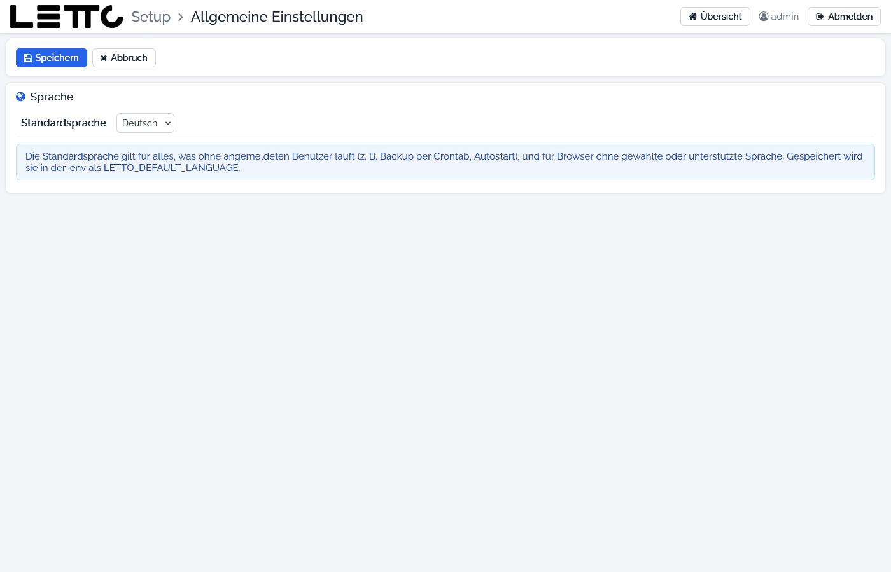

# Setup-Service: Allgemeine Einstellungen

Aufruf: Menü **Konfiguration → Allgemein** auf der [Hauptseite](../Hauptseite/index.md).

Hier werden serverweite Einstellungen gemacht. Derzeit ist das die Standardsprache.

## Felder und Buttons

| Element | Beschreibung |
|---|---|
| Standardsprache | Deutsch, English, Français oder Español; gespeichert als `LETTO_DEFAULT_LANGUAGE` in der `.env`. Sie gilt für alles, was ohne angemeldeten Benutzer läuft (z. B. die tägliche Datensicherung, Autostart) und für Browser, deren Sprache nicht unterstützt wird |
| Speichern | speichert die Einstellung; sie wirkt sofort |
| Abbruch | zurück zur Hauptseite, ohne zu speichern |

Die Sprache der Oberfläche für den eigenen Browser wird dagegen im Benutzermenü der [Hauptseite](../Hauptseite/index.md)
bzw. auf der [Anmeldung](../Anmeldung/index.md) gewählt.

Zurück zur Übersicht: [Setup-Service](../index.md)
