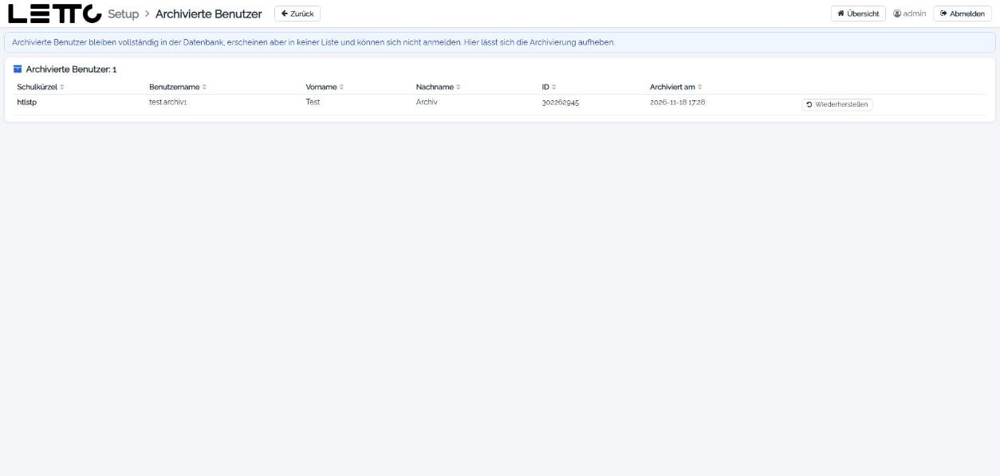

# Setup-Service: Archivierte Benutzer

Aufruf: Button **Archivierte Benutzer** auf der Seite [Benutzer](../Benutzer/index.md). Die Seite ist nur für den Administrator des Setup-Service.

Benutzer werden im Setup **nicht gelöscht**, sondern **archiviert**. Ein archivierter Benutzer

* bleibt mit allen Daten **vollständig in der Datenbank** der Schule (Klassenzuordnungen, Beurteilungen, Testversuche, Noten),
* **erscheint nirgends mehr**: weder in der [Benutzersuche](../Benutzersuche/index.md) und im Benutzerdialog noch in Klassen- und Lehrerlisten, Auswertungen
  und Beispielsammlung,
* **kann sich nicht anmelden** (auch nicht über LDAP, SSO oder LTI); laufende Sitzungen werden beim Archivieren beendet,
* behält seinen Login: er bleibt in der Schule vergeben, damit niemand unter demselben Namen neu angelegt wird.

Die Archivierung lässt sich jederzeit wieder aufheben. Die Liste der Seite zeigt alle archivierten Benutzer aller Schulen.

## Spalten und Buttons

| Element | Beschreibung |
|---|---|
| Schulkürzel, Benutzername, Vorname, Nachname, ID | der archivierte Benutzer |
| Archiviert am | Zeitpunkt der Archivierung |
| Wiederherstellen | hebt die Archivierung nach einer Rückfrage auf. Der Benutzer erscheint wieder in allen Listen und kann sich anmelden |
| Zurück | in der Kopfzeile: zurück zur Seite [Benutzer](../Benutzer/index.md) |

Die Spalten lassen sich durch Klick auf die Überschrift sortieren.

## Benutzer archivieren

Archiviert wird in der [Benutzersuche](../Benutzersuche/index.md) (roter Button in der Zeile des Benutzers) oder in den
[Benutzerdetails](../Benutzer/index.md#benutzerdetails) (Button **Archivieren**), jeweils nach einer Rückfrage.

**Nicht archivieren lassen** sich Administratoren: globale Administratoren, Benutzer mit Administratorrecht und die Konten `adminglobal` und `adminschule`.
Bei ihnen fehlt der Button; ein Aufruf über den Data-Service wird abgewiesen.

## Hinweise

* **Zähler und Lizenz:** Archivierte Benutzer zählen nicht in den Schüler- und Lehrerzahlen der Schulverwaltung des Setup. Die Lizenzzählung ist eine
  Verbrauchszählung: wer im Lizenzzeitraum angemeldet war, bleibt bis zum Ende dieses Zeitraums mitgezählt.
* **Technik:** Der Data-Service setzt in der Tabelle `user` das Feld `ARCHIVIERT` (Zeitpunkt) und zusätzlich `DISABLED=1`. Die Spalte legt er beim ersten
  Zugriff jeder Schule selbst an. Der **ältere LeTTo-Server** (Version 1.2 und früher) kennt `ARCHIVIERT` nicht: dort sperrt `DISABLED` die Anmeldung, in seinen Listen
  erscheint der Benutzer aber weiter.
* **Namenskonflikt:** Soll ein neuer Benutzer den Login eines archivierten bekommen, zuerst den archivierten wiederherstellen oder dessen Login ändern.
* Jede Archivierung und Wiederherstellung steht im [Änderungsprotokoll](../Benutzer/index.md#aenderungsprotokoll).

Zurück zur Übersicht: [Setup-Service](../index.md)
