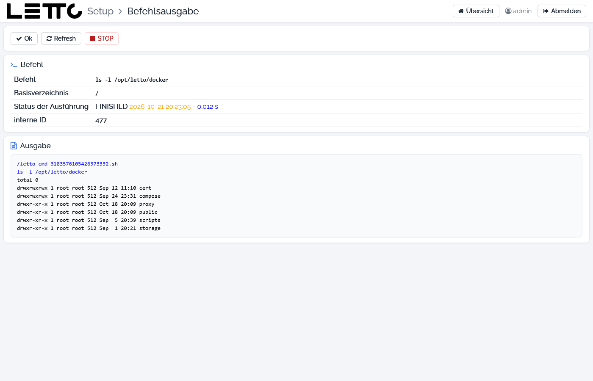

# Setup-Service: Befehlsausgabe

Die Befehlsausgabe zeigt den Fortschritt einer Aktion, die im Hintergrund läuft. Sie öffnet sich automatisch nach
Aktionen wie START, STOP, RESTART oder UPDATE eines Containers (Tab [Services](../Services/index.md),
[Schulen](../Schulen/index.md), [Update-Konfiguration](../Update-Konfiguration/index.md)), nach einem Backup, dem
Anlegen einer Schule oder einem Befehl aus der [Kommandoeingabe](../Kommandoeingabe/index.md). Die Ausgabe wird jede
Sekunde aktualisiert.

## Buttons

| Button | Wirkung |
|---|---|
| Ok | zurück zur Seite, von der die Aktion gestartet wurde; die Aktion läuft im Hintergrund weiter |
| Refresh | Seite neu laden |
| STOP | versucht, die laufende Aktion abzubrechen |

## Karte Befehl

| Feld | Bedeutung |
|---|---|
| Befehl | ausgeführter Befehl bzw. Name der Aktion |
| Basisverzeichnis | Arbeitsverzeichnis des Befehls |
| Status der Ausführung | z. B. RUNNING oder FINISHED mit Startzeit und Laufzeit |
| interne ID | Nummer der Aufgabe; unter dieser ID ist sie in der [Kommandoeingabe](../Kommandoeingabe/index.md) mit **öffnen** wieder abrufbar |

Die Karte **Ausgabe** enthält die Ausgabe der Aktion (Meldungen von `docker compose`, Fehler …).

Wird das Setup selbst neu gestartet oder aktualisiert, bricht die Verbindung ab. Dann erscheint der Hinweis, die Seite
nach dem Neustart neu zu laden; danach muss man sich neu [anmelden](../Anmeldung/index.md).

Zurück zur Übersicht: [Setup-Service](../index.md)
