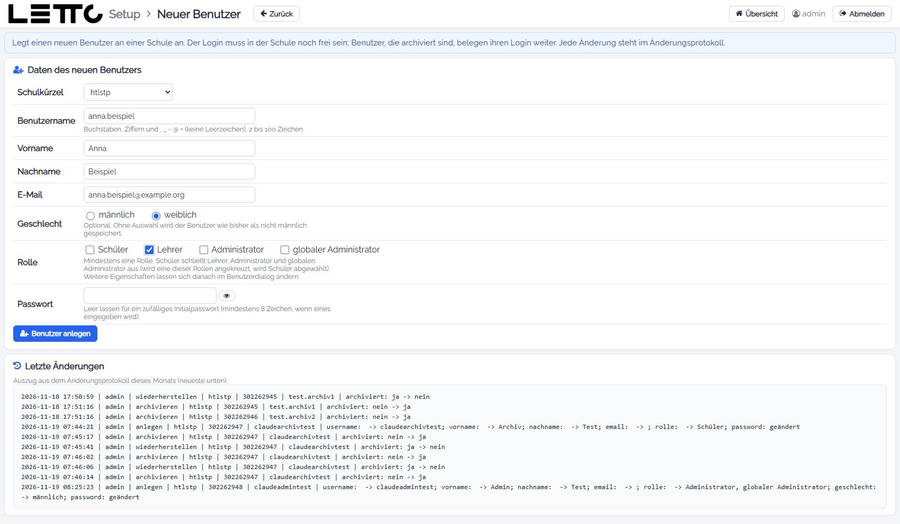

# Setup-Service: Neuer Benutzer

Aufruf: Button **Neuer Benutzer** auf der Seite [Benutzer](../Benutzer/index.md). Die Seite ist nur für den Administrator des Setup-Service.

Hier legt der Administrator einen neuen Benutzer an einer Schule an, zum Beispiel einen Lehrer oder einen Schüler, der keinen Import
(Untis, Sokrates) durchläuft. Der Benutzer wird über den Data-Service der Schule in der Schul-Datenbank gespeichert, das Setup greift nicht selbst
auf die Tabelle zu.

## Felder und Buttons

| Element | Beschreibung |
|---|---|
| Schulkürzel | die Schule, an der der Benutzer angelegt wird |
| Benutzername | der Login: Buchstaben, Ziffern und `.` `_` `-` `@` `+`, 2 bis 100 Zeichen, keine Leerzeichen. Er muss in der Schule noch **frei** sein |
| Vorname, Nachname, E-Mail | optional; die E-Mail-Adresse wird auf ein gültiges Format geprüft |
| Geschlecht | optional: männlich oder weiblich. Ohne Auswahl wird der Benutzer wie bisher als nicht männlich gespeichert |
| Rolle | mindestens eine Rolle: **Schüler**, **Lehrer**, **Administrator** oder **globaler Administrator**. Lehrer, Administrator und globaler Administrator lassen sich kombinieren. **Schüler schließt die anderen Rollen aus**: Wird Lehrer, Administrator oder globaler Administrator angekreuzt, wird Schüler automatisch abgewählt (und umgekehrt). Weitere Eigenschaften lassen sich danach im [Benutzerdialog](../Benutzer/index.md#benutzerdetails) ändern |
| Passwort | optional, mindestens 8 Zeichen. **Leer lassen** erzeugt ein zufälliges Initialpasswort |
| Benutzer anlegen | legt den Benutzer an und setzt das Passwort |
| Zurück | in der Kopfzeile: zurück zur Seite [Benutzer](../Benutzer/index.md) |

Nach dem Anlegen steht das **Initialpasswort einmal** auf der Seite. Es wird nirgends gespeichert und auch nicht im
[Änderungsprotokoll](../Benutzer/index.md#aenderungsprotokoll) festgehalten; bitte dem Benutzer sicher weitergeben (er kann es danach ändern).

## Was geprüft wird

* **Login schon vergeben:** Ein vorhandener Benutzer wird nie überschrieben. Auch der Login eines **archivierten** Benutzers gilt als vergeben; die Meldung nennt
  dann den Grund. Zuerst die Archivierung aufheben ([Archivierte Benutzer](../Archivierte-Benutzer/index.md)) oder einen anderen Login wählen.
* **Eingaben:** Fehlende Schule, ungültiger Login, ungültige E-Mail-Adresse, keine Rolle, Schüler zusammen mit einer anderen Rolle und ein zu kurzes Passwort werden mit einer Meldung abgewiesen.
* **Data-Service nicht erreichbar:** Die Meldung nennt die Schule; es wird nichts angelegt.
* **Passwort konnte nicht gesetzt werden:** Der Benutzer ist angelegt. Die Meldung weist darauf hin, im Benutzerdialog ein Passwort zu setzen.

Unter dem Formular stehen die letzten Einträge des [Änderungsprotokolls](../Benutzer/index.md#aenderungsprotokoll).

Zurück zur Übersicht: [Setup-Service](../index.md)
