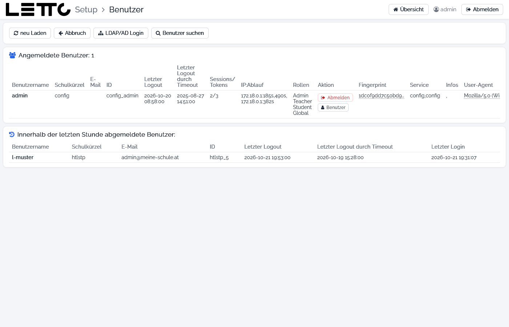
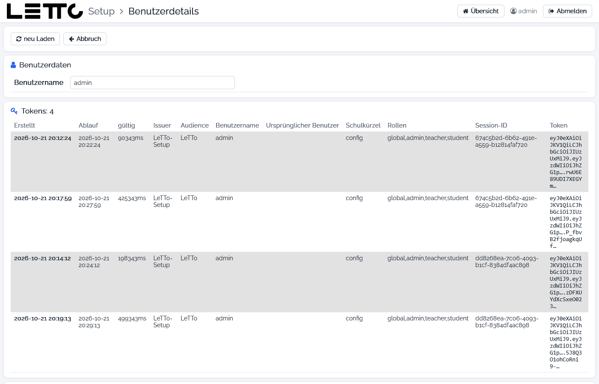

# Setup-Service: Benutzer

Aufruf: Menü **Verwaltung → Benutzer** auf der [Hauptseite](../Hauptseite/index.md).

Die Seite zeigt, wer gerade an LeTTo angemeldet ist – über alle Schulen des Servers und auch im Setup selbst – und wer
sich in der letzten Stunde abgemeldet hat. Einzelne Benutzer können abgemeldet werden, z. B. vor einem Update.

## Buttons oben

| Button | Wirkung |
|---|---|
| neu Laden | Liste neu laden |
| Abbruch | zurück zur Hauptseite |
| LDAP/AD Login | öffnet die [LDAP/AD-Konfiguration](../LDAP-AD/index.md) |
| Benutzer suchen | öffnet die [Benutzersuche](../Benutzersuche/index.md) |

## Angemeldete Benutzer

| Spalte | Bedeutung |
|---|---|
| Benutzername, Schulkürzel, E-Mail, ID | der Benutzer und seine Schule (`config` = Setup-Service) |
| Letzter Logout, Letzter Logout durch Timeout | Zeitpunkt der letzten Abmeldung bzw. automatischen Abmeldung |
| Sessions/Tokens | Anzahl der offenen Sitzungen und gültigen Tokens |
| IP:Ablauf | IP-Adresse und verbleibende Gültigkeit |
| Rollen | z. B. Admin, Teacher, Student, Global |
| Aktion | **Abmelden** meldet den Benutzer sofort ab (ohne Rückfrage); **Benutzer** öffnet die Benutzerdetails |
| Fingerprint, Service, Infos, User-Agent | Kennung des Browsers, verwendeter Service und Browser |

## Innerhalb der letzten Stunde abgemeldete Benutzer

Benutzername, Schulkürzel, E-Mail, ID, letzter Logout (auch durch Timeout) und letzter Login der Benutzer, die sich in
der letzten Stunde abgemeldet haben.

## Benutzerdetails

Die Benutzerdetails öffnen sich mit **Benutzer** hier oder in der [Benutzersuche](../Benutzersuche/index.md).

| Element | Beschreibung |
|---|---|
| neu Laden | Daten neu laden |
| Abbruch | zurück zur vorigen Seite |
| speichern | speichert die Änderungen in der Datenbank der Schule (nur bei Benutzern einer Schule) |
| Benutzerdaten | Stammdaten des Benutzers: Schulkürzel, User-ID, Benutzername, Vor- und Nachname, Active-Directory-Name, Personalnummer, Sokrates-ID, E-Mail, Geburtsdatum, Telefon, Sprache, die Rollen (Student, Lehrer/Vortragender, Administrator, globaler Administrator), Lizenz-Einstellungen und Abo-Einstellungen. Im Feld **Passwort** kann ein neues Passwort gesetzt werden – leer lassen, wenn es unverändert bleiben soll. Beim Setup-Benutzer `admin` gibt es nur den Benutzernamen |
| Tokens | gültige Anmelde-Tokens mit Erstellt, Ablauf, gültig, Issuer, Audience, Benutzername, ursprünglicher Benutzer, Schulkürzel, Rollen, Session-ID und Token |
| Sessions | Sitzungen des Benutzers mit Anmeldung, Abmeldung, IP-Adresse, Service und Browser; **Abmelden** beendet eine aktive Sitzung, **löschen** entfernt eine beendete (ohne Rückfrage), die eigene Sitzung ist als „aktuell“ markiert |

Zurück zur Übersicht: [Setup-Service](../index.md)
