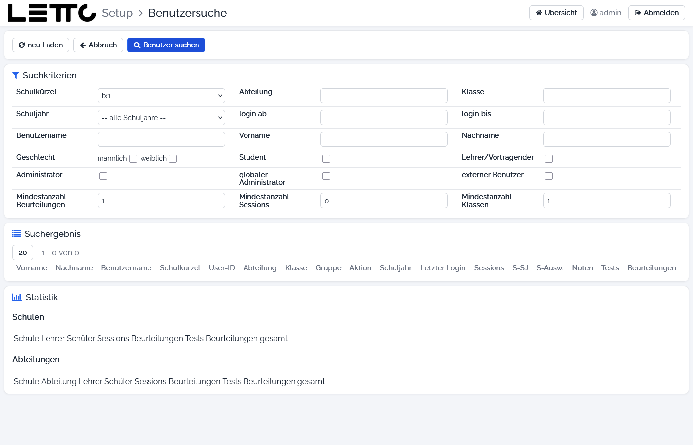

# Setup-Service: Benutzersuche

Aufruf: Button **Benutzer suchen** auf der Seite [Benutzer](../Benutzer/index.md).

Die Benutzersuche findet Benutzer in allen Schulen des Servers und zeigt, wie stark LeTTo genutzt wird (Anmeldungen,
Beurteilungen, Tests). Im Bild ist die Suche auf die Testschule `tx1` eingeschränkt.

## Buttons oben

| Button | Wirkung |
|---|---|
| neu Laden | Suchkriterien zurücksetzen und neu suchen |
| Abbruch | zurück zur Seite [Benutzer](../Benutzer/index.md) |
| Benutzer suchen | Suche mit den eingegebenen Kriterien starten |

## Suchkriterien

Alle Kriterien sind optional und werden kombiniert.

| Feld | Bedeutung |
|---|---|
| Schulkürzel | eine Schule oder „-- alle Schulen --“ |
| Abteilung, Klasse | Kürzel der Abteilung bzw. Name der Klasse |
| Schuljahr | ein Schuljahr oder „-- alle Schuljahre --“ |
| login ab, login bis | nur Benutzer, die sich in diesem Zeitraum angemeldet haben |
| Benutzername, Vorname, Nachname | Teile des Namens |
| Geschlecht | männlich, weiblich |
| Student, Lehrer/Vortragender, Administrator, globaler Administrator, externer Benutzer | nur Benutzer mit dieser Rolle |
| Mindestanzahl Beurteilungen | nur Benutzer mit mindestens so vielen Beurteilungen (Vorgabe 1) |
| Mindestanzahl Sessions | nur Benutzer mit mindestens so vielen Anmeldungen (Vorgabe 0) |
| Mindestanzahl Klassen | nur Benutzer in mindestens so vielen Klassen (Vorgabe 1) |

Mit den Vorgaben werden nur Benutzer gefunden, die in einer Klasse sind und eine Beurteilung haben. Um alle Benutzer
zu finden, die Mindestanzahlen auf 0 setzen.

## Suchergebnis

Über der Tabelle wird geblättert (‹ ›) und die Anzahl der Zeilen je Seite gewählt (**20**, **100**, **500**,
**1000**, **alle**); daneben steht „von … bis … von insgesamt …“.

| Spalte | Bedeutung |
|---|---|
| Vorname, Nachname, Benutzername, Schulkürzel, User-ID | der Benutzer |
| Abteilung, Klasse, Gruppe | Zuordnung in der Schule; Gruppe `S` = Schüler, `T` = Lehrer |
| Aktion | **Benutzer** öffnet die [Benutzerdetails](../Benutzer/index.md#benutzerdetails), **Statistik** die Benutzerstatistik, **Abmelden** meldet einen angemeldeten Benutzer ab; **Daten** hat derzeit keine Funktion |
| Schuljahr, Letzter Login | Schuljahr der Klasse und letzte Anmeldung |
| Sessions, S-SJ, S-Ausw. | Anmeldungen gesamt, im Schuljahr und im gewählten Zeitraum |
| Noten, Tests, Beurteilungen | Anzahl der Noten, Tests und Beurteilungen |

## Statistik

Unter dem Ergebnis stehen Summen für die gefundenen Benutzer, gegliedert nach **Schulen** und **Abteilungen**: Lehrer,
Schüler, Sessions, Beurteilungen, Tests und Beurteilungen gesamt.

## Benutzerstatistik

**Statistik** bei einem Benutzer öffnet eine Detailseite (**neu Laden**, **Abbruch**) mit den Karten **Benutzer**
(Stammdaten und Rollen), **Logins und Sessions** (erste und letzte Anmeldung, fehlgeschlagene Anmeldungen, Sitzungen),
**Beurteilungen** und **Schuljahr-Klassen** (Beurteilungen und Tests je Schuljahr und Klasse).

Zurück zur Übersicht: [Setup-Service](../index.md)
