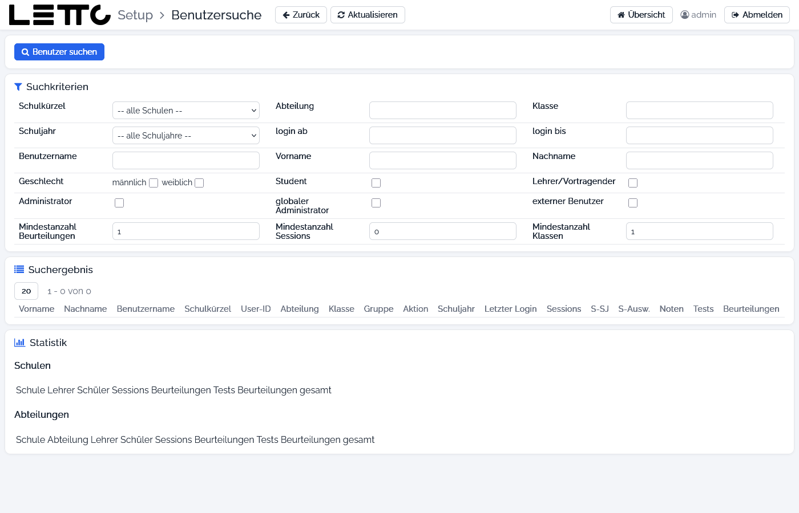
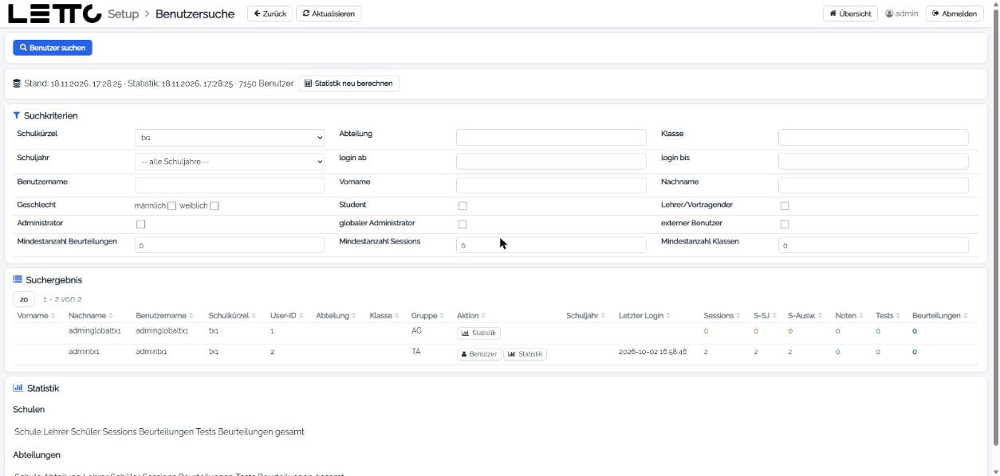

# Setup-Service: Benutzersuche

Aufruf: Button **Benutzer suchen** auf der Seite [Benutzer](../Benutzer/index.md).

Die Benutzersuche findet Benutzer in allen Schulen des Servers und zeigt, wie stark LeTTo genutzt wird (Anmeldungen,
Beurteilungen, Tests). Im Bild ist die Suche auf die Testschule `tx1` eingeschränkt.

## Buttons

| Button | Wirkung |
|---|---|
| Zurück | in der Kopfzeile: zurück zur Seite [Benutzer](../Benutzer/index.md) |
| Aktualisieren | in der Kopfzeile: Suchkriterien zurücksetzen und neu suchen |
| Benutzer suchen | Suche mit den eingegebenen Kriterien starten |

## Suchkriterien

Alle Kriterien sind optional und werden kombiniert.

| Feld | Bedeutung |
|---|---|
| Schulkürzel | eine Schule oder „-- alle Schulen --“ |
| Abteilung, Klasse | Kürzel der Abteilung bzw. Name der Klasse |
| Schuljahr | ein Schuljahr oder „-- alle Schuljahre --“ |
| login ab, login bis | nur Benutzer, die sich in diesem Zeitraum angemeldet haben |
| Benutzername, Vorname, Nachname | Teile des Namens |
| Geschlecht | männlich, weiblich |
| Student, Lehrer/Vortragender, Administrator, globaler Administrator, externer Benutzer | nur Benutzer mit dieser Rolle |
| Mindestanzahl Beurteilungen | nur Benutzer mit mindestens so vielen Beurteilungen (Vorgabe 1) |
| Mindestanzahl Sessions | nur Benutzer mit mindestens so vielen Anmeldungen (Vorgabe 0) |
| Mindestanzahl Klassen | nur Benutzer in mindestens so vielen Klassen (Vorgabe 1) |

Mit den Vorgaben werden nur Benutzer gefunden, die in einer Klasse sind und eine Beurteilung haben. Um alle Benutzer
zu finden, die Mindestanzahlen auf 0 setzen.

## Suchergebnis

## Schnell: Stand des Benutzer-Caches

Die Seite öffnet **sofort** mit dem zuletzt berechneten Stand und rechnet nicht bei jedem Aufruf alles neu. Über dem Suchformular steht der **Stand**
(„Stand: …, Statistik: …, 7150 Benutzer“). Ein Hintergrundlauf aktualisiert die Daten, solange die Seite offen ist; läuft er, erscheint der Fortschritt
(„Aktualisierung läuft im Hintergrund – Statistik Schule x (3 von 7)“). Sobald ein neuer Stand vorliegt, lädt die Seite **nur den Ergebnisbereich** nach: Suchkriterien,
Seite und Scrollposition bleiben erhalten.

| Element | Beschreibung |
|---|---|
| Aktualisieren | in der Kopfzeile: startet im Hintergrund eine Aktualisierung (Benutzerlisten, Anmeldedaten) und zeigt sofort den letzten Stand |
| Statistik neu berechnen | berechnet die Statistik (Klassen, Beurteilungen, Tests) aller Schulen im Hintergrund neu, auch wenn sich laut Prüfung nichts geändert hat |

Das Setup führt diese Aktualisierung auch ohne offene Seite alle 15 Minuten aus (Benutzerlisten und Anmeldedaten). Die aufwändige Statistik je Schule wird nur
neu berechnet, wenn sich die beteiligten Tabellen geändert haben. Der Stand liegt im Speicher und zusätzlich komprimiert in
`/opt/letto/docker/storage/setup/benutzer-cache`, damit die Seite nach einem Neustart sofort Daten zeigt.

Über der Tabelle wird geblättert (‹ ›) und die Anzahl der Zeilen je Seite gewählt (**20**, **100**, **500**,
**1000**, **alle**); daneben steht „von … bis … von insgesamt …“.

| Spalte | Bedeutung |
|---|---|
| Vorname, Nachname, Benutzername, Schulkürzel, User-ID | der Benutzer |
| Abteilung, Klasse, Gruppe | Zuordnung in der Schule; Gruppe `S` = Schüler, `T` = Lehrer |
| Aktion | **Benutzer** öffnet die [Benutzerdetails](../Benutzer/index.md#benutzerdetails) (nur für Benutzer, die sich schon angemeldet haben), **Statistik** die Benutzerstatistik, **Abmelden** meldet einen angemeldeten Benutzer ab, der rote Button **archiviert** den Benutzer nach einer Rückfrage (siehe [Archivierte Benutzer](../Archivierte-Benutzer/index.md); bei Administratoren fehlt er) |
| Schuljahr, Letzter Login | Schuljahr der Klasse und letzte Anmeldung |
| Sessions, S-SJ, S-Ausw. | Anmeldungen gesamt, im Schuljahr und im gewählten Zeitraum |
| Noten, Tests, Beurteilungen | Anzahl der Noten, Tests und Beurteilungen |

## Hinweise zur Suche

* Archivierte Benutzer erscheinen nicht im Ergebnis, auch nicht über ihren Anmeldeeintrag.
* Ein Textfilter (Benutzername, Nachname …) sucht den Anfang des Namens; Sonderzeichen wie der Punkt in einem Login (`anna.beispiel`) werden dabei noch nicht richtig
  behandelt, dafür den Anfang ohne Punkt eingeben.

## Statistik

Unter dem Ergebnis stehen Summen für die gefundenen Benutzer, gegliedert nach **Schulen** und **Abteilungen**: Lehrer,
Schüler, Sessions, Beurteilungen, Tests und Beurteilungen gesamt.

## Benutzerstatistik

**Statistik** bei einem Benutzer öffnet eine Detailseite (in der Kopfzeile **Zurück** und **Aktualisieren**) mit den Karten **Benutzer**
(Stammdaten und Rollen), **Logins und Sessions** (erste und letzte Anmeldung, fehlgeschlagene Anmeldungen, Sitzungen),
**Beurteilungen** und **Schuljahr-Klassen** (Beurteilungen und Tests je Schuljahr und Klasse).

Zurück zur Übersicht: [Setup-Service](../index.md)
