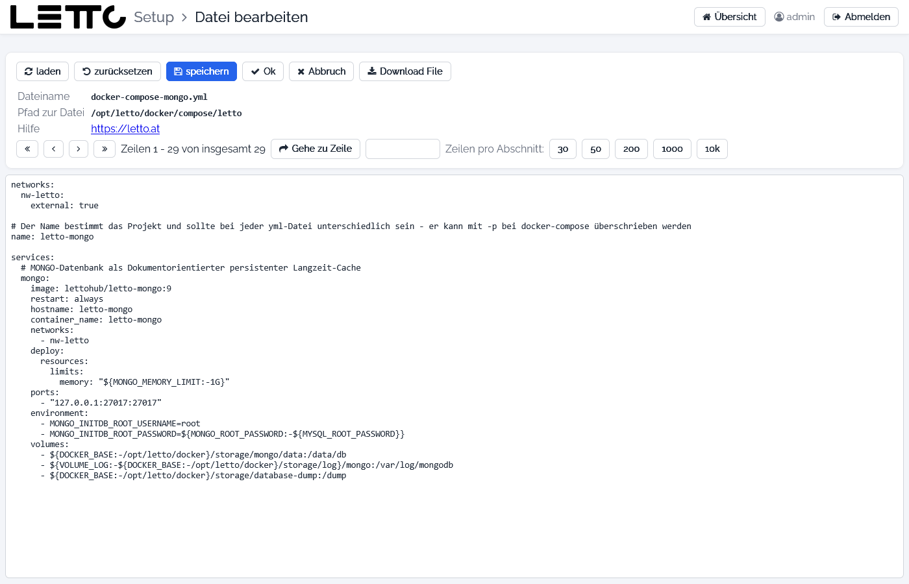
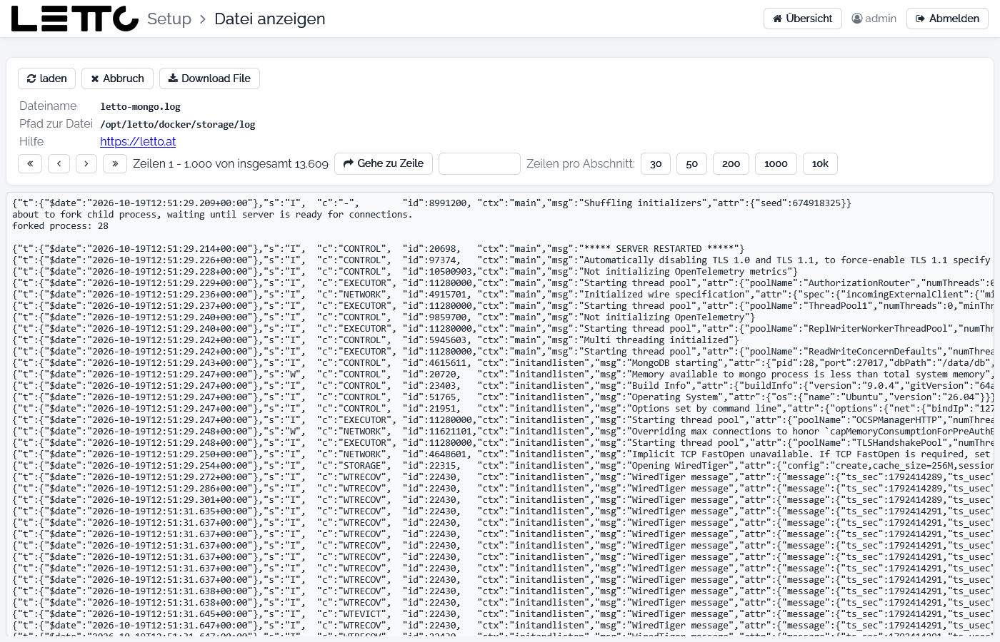

# Setup-Service: Datei-Editor

Der Datei-Editor öffnet sich über die Buttons **EDIT .env** und **EDIT YAML** (Tabs [Services](../Services/index.md),
[Schulen](../Schulen/index.md), [Question-Services](../Question-Services/index.md)), **Bearbeiten** im
[Explorer](../Explorer/index.md) und in der [Proxy-Konfiguration](../Proxy-Konfiguration/index.md) oder
**YML bearbeiten** auf der Seite [Datenbanken](../Datenbanken/index.md). Zum reinen Anzeigen von Dateien und Logs gibt es
die Seite **Datei anzeigen** (siehe unten).

## Datei bearbeiten

| Feld | Bedeutung |
|---|---|
| Dateiname, Pfad zur Datei | die geöffnete Datei, z. B. `docker-compose-mongo.yml` in `/opt/letto/docker/compose/letto` |
| Hilfe | Link zur Hilfe |
| Textfeld | Inhalt der Datei (bei großen Dateien der aktuelle Abschnitt) |

| Button | Wirkung |
|---|---|
| laden | Datei neu von der Festplatte laden |
| zurücksetzen | Änderungen verwerfen und Datei neu laden |
| speichern | Änderungen speichern und im Editor bleiben |
| Ok | Änderungen speichern und zurück zur aufrufenden Seite |
| Abbruch | zurück, ohne zu speichern |
| Download File | Datei herunterladen |
| « ‹ › » | zum Anfang, vorigen, nächsten oder letzten Abschnitt; daneben „Zeilen … von insgesamt …“ |
| Gehe zu Zeile | springt zur eingegebenen Zeile |
| Zeilen pro Abschnitt: 30 / 50 / 200 / 1000 / 10k | Größe eines Abschnitts (Vorgabe 1000 Zeilen) |

Die Datei wird ohne Prüfung gespeichert. Ein Fehler in einer `.env`-, `.yml`- oder `.conf`-Datei kann dazu führen,
dass ein Container nicht mehr startet. Änderungen wirken erst, wenn der betroffene Container neu gestartet wird
(RESTART im Tab [Services](../Services/index.md) bzw. **Proxy neu starten** in der
[Proxy-Konfiguration](../Proxy-Konfiguration/index.md)).

## Datei anzeigen

Die Seite **Datei anzeigen** zeigt eine Datei oder ein Container-Log nur zum Lesen. Sie öffnet sich über die Buttons
**out**, **err**, **LOG-Data** und **Log** (Tabs [Services](../Services/index.md), [Schulen](../Schulen/index.md),
[Docker-Status](../Docker-Status/index.md)) und beim Klick auf eine Datei im [Explorer](../Explorer/index.md). Textdateien
werden abschnittsweise angezeigt, HTML-Dateien und Bilder direkt; bei Binärdateien erscheint ein Hinweis.

| Button | Wirkung |
|---|---|
| laden | Datei bzw. Log neu laden (bei Logs der aktuelle Stand) |
| Abbruch | zurück zur aufrufenden Seite |
| Download File | Datei bzw. Log herunterladen |
| Navigation, Gehe zu Zeile, Zeilen pro Abschnitt | wie im Editor |

Zurück zur Übersicht: [Setup-Service](../index.md)
