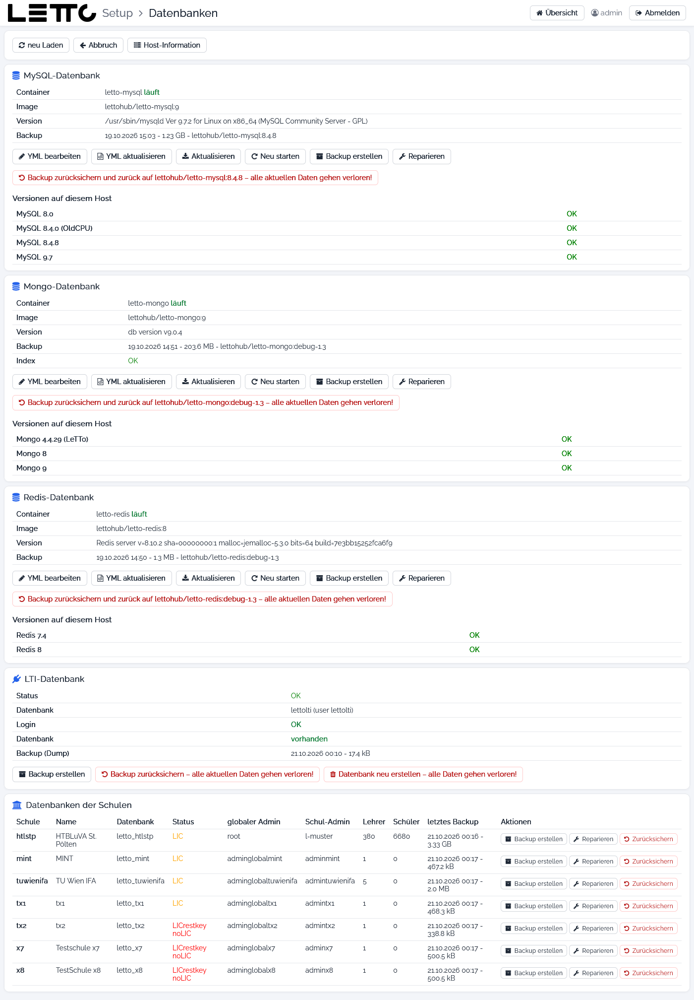

# Setup-Service: Datenbanken

Aufruf: Menü **Verwaltung → Datenbanken** auf der [Hauptseite](../Hauptseite/index.md).

Die Seite zeigt den Zustand aller Datenbanken des Servers und bietet Backup, Zurücksichern, Reparatur und den Wechsel auf
eine neuere Datenbank-Version. LeTTo verwendet:

* **MySQL** (`letto-mysql`) – die Datenbanken der Schulen und die LTI-Datenbank,
* **Mongo** (`letto-mongo`) – Benutzer- und Sitzungsdaten, Zwischenspeicher, Fragesammlungen,
* **Redis** (`letto-redis`) – schneller Zwischenspeicher.

Sicherungen der Datenbank-Container liegen in `/opt/letto/docker/storage/database-backup`, SQL-Dumps der Schulen und der
LTI-Datenbank in `/opt/letto/docker/storage/database-dump`. Siehe auch [Datensicherung](../Datensicherung/index.md).

## Buttons oben

| Button | Wirkung |
|---|---|
| neu Laden | Zustand neu ermitteln |
| Abbruch | zurück zur Hauptseite |
| Host-Information | öffnet die Seite [Host](../Host/index.md) |

## MySQL-, Mongo- und Redis-Datenbank

Jede der drei Karten zeigt:

| Feld | Bedeutung |
|---|---|
| Container | Name des Containers und ob er läuft |
| Image | verwendetes Image mit Tag, z. B. `lettohub/letto-mysql:9` |
| Version | Version der Datenbank-Software |
| Backup | Datum, Größe und Image der letzten Sicherung des Containers |
| Index (nur Mongo) | ob alle nötigen Indizes vorhanden sind; sonst legt **Index anlegen** sie an |

| Button | Wirkung |
|---|---|
| YML bearbeiten | Compose-Datei im [Datei-Editor](../Datei-Editor/index.md) öffnen |
| YML aktualisieren | Compose-Datei aus der Vorlage des Setup-Service erneuern |
| Aktualisieren | Image neu laden und den Container neu starten |
| Neu starten | Container neu starten |
| Backup erstellen | sichert die Daten des Containers; er wird dafür kurz gestoppt (mit Rückfrage) |
| Reparieren | prüft und repariert die Datenbank (MySQL: root-Login, Tabellen prüfen und reparieren; Mongo: Reparatur und Indizes; Redis: Reparatur der Datendateien). Was genau passiert, steht in der Rückfrage |
| Backup zurücksichern … – alle aktuellen Daten gehen verloren! | stellt die letzte Sicherung wieder her; wurde sie mit einer anderen Version erstellt, wird auch das Image zurückgestellt (mit Rückfrage) |
| Upgrade auf Version … | nur wenn eine neuere, auf diesem Host lauffähige Version verfügbar ist: erstellt zuerst ein vollständiges Backup und wechselt dann die Version (mit Rückfrage) |

Bei MySQL erscheint bei Problemen mit dem root-Zugang zusätzlich **root-Login zurücksetzen**.

Der Abschnitt **Versionen auf diesem Host** zeigt, welche Datenbank-Versionen auf diesem Rechner lauffähig sind
(z. B. MySQL 8.4.0 (OldCPU) für ältere Prozessoren).

## LTI-Datenbank

Die Datenbank des LTI-Service (Anbindung an Moodle, siehe [LTI Verbindung](../../../admin/LTIVerbindung/index.md)).

| Feld | Bedeutung |
|---|---|
| Status | Gesamtzustand |
| Datenbank | Name der Datenbank und des Benutzers |
| Login | OK, Benutzer fehlt oder falsches Passwort |
| Datenbank | vorhanden oder fehlt |
| Backup (Dump) | Datum und Größe des letzten Dumps |

Je nach Zustand: **Benutzer anlegen**, **Benutzer und Datenbank anlegen**, **Datenbank anlegen**, **Passwort setzen**,
außerdem **Backup erstellen**, **Backup zurücksichern – alle aktuellen Daten gehen verloren!** und
**Datenbank neu erstellen – alle Daten gehen verloren!** (alle mit Rückfrage).

## Datenbanken der Schulen

| Spalte | Bedeutung |
|---|---|
| Schule, Name, Datenbank | Kürzel, Bezeichnung und MySQL-Datenbank der Schule |
| Status | Zustand der Datenbank und der Lizenz (z. B. `LIC`, `LICrestkey noLIC`) |
| globaler Admin, Schul-Admin | Loginnamen der Administratoren der Schule |
| Lehrer, Schüler | Anzahl der Benutzer |
| letztes Backup | Datum und Größe des letzten Dumps |
| Backup erstellen | Dump der Schul-Datenbank erstellen; die Schule wird dafür kurz gestoppt (mit Rückfrage) |
| Reparieren | Tabellen prüfen und reparieren, Datenbank-Benutzer und Passwort richtigstellen (mit Rückfrage) |
| Zurücksichern | den letzten Dump in die Schule einspielen – **alle Änderungen seit dem Dump gehen verloren** (mit Rückfrage) |

Zurück zur Übersicht: [Setup-Service](../index.md)
