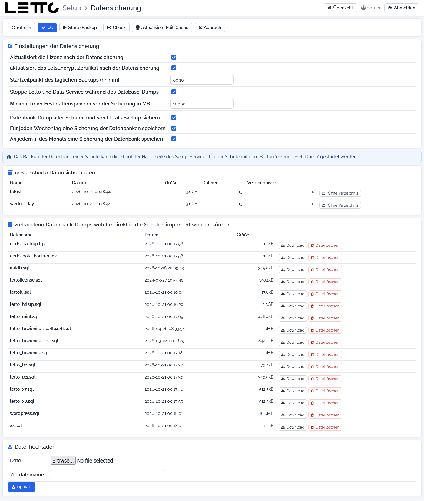

# Setup-Service: Datensicherung

Aufruf: Menü **Konfiguration → Backup/Cronjob** auf der [Hauptseite](../Hauptseite/index.md).

Das Setup-Service macht täglich zu einer einstellbaren Uhrzeit eine Datensicherung des ganzen Servers: SQL-Dumps
aller Schulen und der LTI-Datenbank, die Zertifikate (Volumes `certs` und `certs-data`) sowie Dumps von Redis und
Mongo. Danach kann es die Lizenzen und das Let's-Encrypt-Zertifikat erneuern. Ein eigener Cronjob am Host ist dafür
nicht nötig – das Setup prüft selbst jede Minute, ob die Zeit erreicht ist. Auf dieser Seite werden die Einstellungen
dazu gemacht, eine Sicherung von Hand gestartet und die vorhandenen Sicherungen und Dumps verwaltet.

Mehr zur Sicherung und Wiederherstellung: [Datensicherung-Docker](../../Datensicherung-Docker/index.md).

## Buttons oben

| Button | Wirkung |
|---|---|
| refresh | Seite neu laden |
| Ok | Einstellungen speichern und zurück zur Hauptseite |
| Starte Backup | Einstellungen speichern und sofort eine Sicherung starten (öffnet die [Befehlsausgabe](../Befehlsausgabe/index.md)); nicht möglich, solange schon eine Sicherung oder ein Dump läuft |
| Check | prüft, ob genug Festplattenplatz frei ist und ob die Dumps aller Schulen aktuell (jünger als 24 Stunden) und nicht leer sind |
| aktualisiere Edit-Cache | lädt alle Zwischenspeicher des Edit-Service neu (dauert ein Weilchen) |
| Abbruch | zurück zur Hauptseite, ohne zu speichern |

## Einstellungen der Datensicherung

Alle Einstellungen werden in der `.env` gespeichert.

| Feld | Variable in der `.env` | Bedeutung |
|---|---|---|
| Aktualisiert die Lizenz nach der Datensicherung | `CHECK_LICENSE_AUTO` | nach der Sicherung die Lizenzen aller Schulen vom Lizenzserver holen |
| aktualisiert das LetsEncrypt Zertifikat nach der Datensicherung | `REFRESH_LETS_ENCRYPT_AUTO` | nach der Sicherung das [Https-Zertifikat](../../Https-Zertifikat/index.md) erneuern |
| Startzeitpunkt des täglichen Backups (hh:mm) | `TIME_DAILY_BACKUP` | Uhrzeit der täglichen Sicherung, z. B. `0:30`; mehrere Zeiten mit Leerzeichen, Komma oder Strichpunkt getrennt; leer = keine automatische Sicherung |
| Stoppe Letto und Data-Service während des Database-Dumps | `BACKUP_STOP_LETTO` | stoppt die Container jeder Schule während ihres Dumps, damit der Dump in sich stimmig ist |
| Minimal freier Festplattenspeicher vor der Sicherung in MB | `BACKUP_MIN_FREE_DISK_SPACE_MB` | Vorgabe 10000; ist weniger frei, werden zuerst alte Sicherungen gelöscht |
| Datenbank-Dump aller Schulen und von LTI als Backup sichern | `BACKUP_DATABASE` | SQL-Dumps aller Schul-Datenbanken und der LTI-Datenbank erstellen |
| Für jeden Wochentag eine Sicherung der Datenbanken speichern | `BACKUP_DATABASE_DAY_OF_WEEK` | zusätzlich eine Kopie je Wochentag (`monday` … `sunday`) aufheben |
| An jedem 1. des Monats eine Sicherung der Datenbank speichern | `BACKUP_DATABASE_MONTHLY_IMAGE` | zusätzlich eine Monatskopie aufheben |

Der Hinweis darunter erinnert daran, dass der Dump einer einzelnen Schule auch direkt im Tab
[Schulen](../Schulen/index.md) mit **erzeuge SQL-Dump** gestartet werden kann.

## Gespeicherte Datensicherungen

Liste der Sicherungen in `/opt/letto/docker/storage/backup` (z. B. `latest`, die Wochentage, Monatskopien) mit Datum,
Größe und Anzahl der Dateien und Verzeichnisse. **Öffne Verzeichnis** zeigt die Sicherung im
[Explorer](../Explorer/index.md).

## Vorhandene Datenbank-Dumps

Liste der Dateien in `/opt/letto/docker/storage/database-dump`. Diese Dumps können beim
[Anlegen oder Bearbeiten einer Schule](../Schule-bearbeiten/index.md) importiert werden.

| Button | Wirkung |
|---|---|
| Download | Dump herunterladen |
| Datei löschen | Dump löschen (mit Rückfrage) |

## Datei hochladen

Lädt einen Dump (z. B. von einem anderen Server) in das Dump-Verzeichnis: **Datei** auswählen, optional einen
**Zieldateiname** angeben und **upload** drücken. Damit der Dump beim Import einer Schule automatisch zugeordnet wird,
sollte er `letto_<schule>.sql` heißen.

## siehe auch

* [Datenbanken](../Datenbanken/index.md) – Backup und Zurücksichern einzelner Datenbanken
* [Datensicherung-Docker](../../Datensicherung-Docker/index.md)

Zurück zur Übersicht: [Setup-Service](../index.md)
