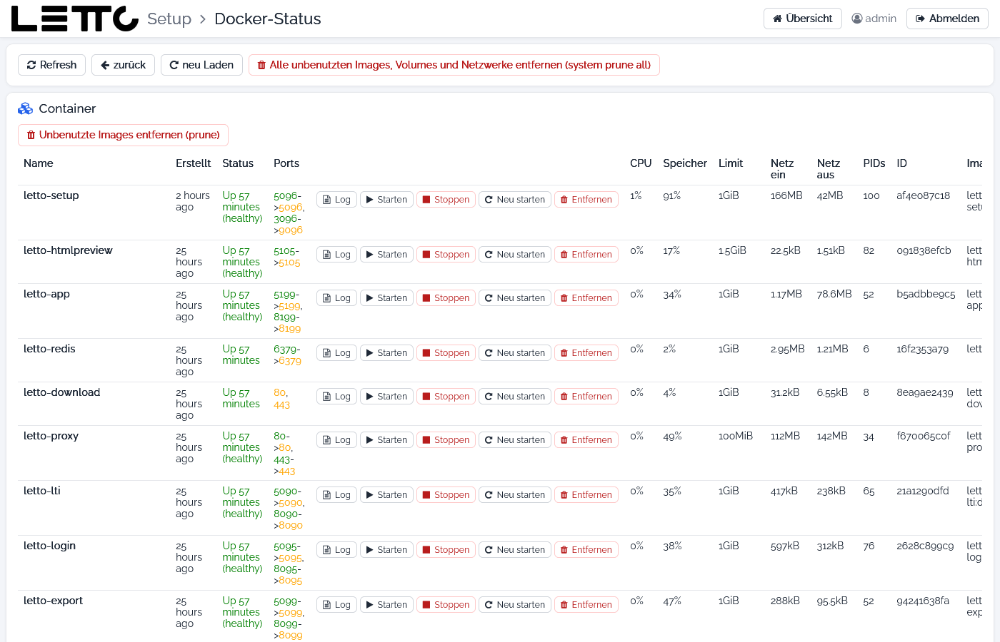

# Setup-Service: Docker-Status

Aufruf: Button **STATUS** in der Zeile „Docker Pfade“ im Tab [Services](../Services/index.md).

Der Docker-Status zeigt alle Container, Netzwerke und Volumes des Docker am Host – auch solche, die nicht zu LeTTo
gehören – und steuert sie direkt mit `docker`-Befehlen. Das Bild zeigt den oberen Teil der Seite.

**Vorsicht:** Die Buttons wirken sofort und **ohne Rückfrage**. Entfernen, Leeren und prune können Daten endgültig
löschen. Für das normale Starten, Stoppen und Aktualisieren den Tab [Services](../Services/index.md) verwenden – dort
wird `docker compose` mit den richtigen Einstellungen benutzt.

## Buttons oben

| Button | Wirkung |
|---|---|
| Refresh | Docker im Hintergrund neu analysieren |
| zurück | zurück zur Hauptseite |
| neu Laden | Seite neu laden |
| Alle unbenutzten Images, Volumes und Netzwerke entfernen (system prune all) | `docker system prune -a -f`: löscht alle Images, Netzwerke und den Build-Cache, die von keinem Container verwendet werden |

## Container

**Unbenutzte Images entfernen (prune)** löscht alle Images, die kein Container verwendet (`docker image prune -a -f`) –
das schafft oft viel Platz nach Updates.

| Spalte | Bedeutung |
|---|---|
| Name, Erstellt, Status | Container, Alter und Zustand (z. B. „Up 55 minutes (healthy)“) |
| Ports | veröffentlichte Ports (Host → Container) |
| Log | Log des Containers im [Datei-Editor](../Datei-Editor/index.md#datei-anzeigen) |
| Starten, Stoppen, Neu starten | `docker start`, `docker stop`, `docker restart` |
| Entfernen | `docker rm` – löscht den Container |
| CPU, Speicher, Limit | aktuelle Auslastung und Speicherlimit (rot ab 95 %) |
| Netz ein, Netz aus, PIDs, ID, Image | Netzwerkverkehr, Anzahl Prozesse, Container-ID und Image |

## LeTTo-Services

Alle Services aus den Compose-Dateien von LeTTo mit Hostname, Containername und Status (**LÄUFT**, **PROBLEME**,
**GESTOPPT**) und denselben Buttons wie oben. Darunter:

* **Netzwerke** – die von LeTTo benötigten Netzwerke (`nw-letto`, `nw-proxy`); fehlt eines, legt **Anlegen** es an.
* **Volumes** – die von LeTTo benötigten Volumes (`certs`, `certs-data`, `lettomysql`); **Anlegen** legt ein fehlendes
  an, **Leeren** löscht den gesamten Inhalt des Volumes (z. B. alle Zertifikate).

## Netzwerke und Volumes

Die Karten **Netzwerke** und **Volumes** listen alle Netzwerke bzw. Volumes des Hosts mit **Löschen** je Eintrag und
**Unbenutzte Netzwerke entfernen (prune)** bzw. **Unbenutzte Volumes entfernen (prune)**. Achtung: prune bei Volumes
löscht alle Volumes, die gerade von keinem laufenden Container verwendet werden – auch solche mit Daten.

Zurück zur Übersicht: [Setup-Service](../index.md)
