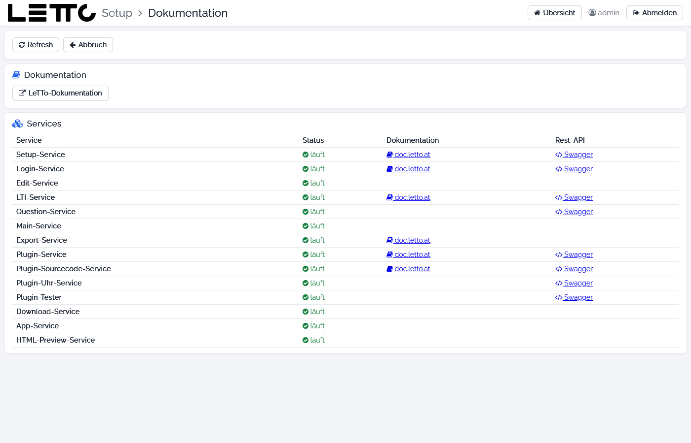

# Setup-Service: Dokumentation

Aufruf: Menü **Hilfe → Dokumentation** auf der [Hauptseite](../Hauptseite/index.md).

Die Seite sammelt die Links zur Dokumentation und zu den REST-Schnittstellen der installierten Services.

## Buttons

| Button | Wirkung |
|---|---|
| Refresh | Zustand der Services neu ermitteln |
| Abbruch | zurück zur Hauptseite |
| LeTTo-Dokumentation | öffnet [doc.letto.at](https://doc.letto.at) |

## Services

| Spalte | Bedeutung |
|---|---|
| Service | installierter Service (Setup immer, sonst nur die installierten) |
| Status | läuft oder gestoppt |
| Dokumentation | Link auf die Seite des Service hier im Wiki (sofern vorhanden) |
| Rest-API | Link auf die Swagger-Oberfläche des Service (`https://<server>/<service>/swagger-ui/index.html`), nur wenn der Service läuft und eine REST-Schnittstelle anbietet |

Zurück zur Übersicht: [Setup-Service](../index.md)
