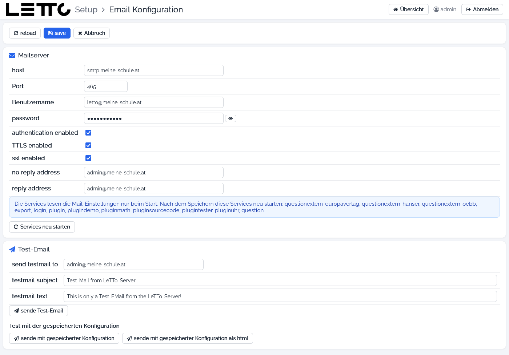

# Setup-Service: E-Mail

Aufruf: Menü **Konfiguration → E-Mail** auf der [Hauptseite](../Hauptseite/index.md).

Hier wird der Mailserver (SMTP) eingestellt, über den alle LeTTo-Services Mails verschicken – z. B. beim Zurücksetzen
von Passwörtern. Mit einer Test-Mail lässt sich prüfen, ob die Einstellungen stimmen.

## Buttons oben

| Button | Wirkung |
|---|---|
| reload | Einstellungen neu aus der `.env` laden (nicht gespeicherte Eingaben gehen verloren) |
| save | Einstellungen in der `.env` speichern |
| Abbruch | zurück zur Hauptseite, ohne zu speichern |

## Mailserver

| Feld | Variable in der `.env` | Bedeutung |
|---|---|---|
| host | `spring_mail_host` | Name des SMTP-Servers, z. B. `smtp.meine-schule.at` |
| Port | `spring_mail_port` | Port des SMTP-Servers, meist 465 (SSL) oder 587 (STARTTLS) |
| Benutzername | `spring_mail_username` | Anmeldename am SMTP-Server |
| password | `spring_mail_password` | Passwort am SMTP-Server (verdeckt, mit dem Auge-Symbol sichtbar) |
| authentication enabled | `spring_mail_properties_mail_smtp_auth` | Anmeldung am SMTP-Server verwenden |
| TTLS enabled | `spring_mail_properties_mail_smtp_starttls_enable` | Verbindung mit STARTTLS verschlüsseln |
| ssl enabled | `spring_mail_properties_mail_smtp_ssl_enable` | Verbindung mit SSL verschlüsseln |
| no reply address | `spring_mail_address_noreply` | Absenderadresse für Mails, auf die nicht geantwortet werden soll |
| reply address | `spring_mail_address_reply` | Adresse für Antworten |

Die Services lesen diese Werte nur beim Start. Unter den Feldern steht, welche Services die Mail-Einstellungen
verwenden (z. B. login, export, question, die Plugins und externe Question-Services). Nach dem Speichern startet
**Services neu starten** genau diese Services nacheinander neu (mit Rückfrage, sie sind dabei kurz nicht erreichbar).

## Test-Email

| Element | Beschreibung |
|---|---|
| send testmail to | Empfänger der Test-Mail (Vorgabe: Admin-E-Mail des Servers) |
| testmail subject | Betreff |
| testmail text | Text der Mail |
| sende Test-Email | sendet die Test-Mail mit den **eingegebenen** Werten, auch wenn sie noch nicht gespeichert sind |
| sende mit gespeicherter Konfiguration | sendet die Test-Mail mit den **gespeicherten** Werten aus der `.env` |
| sende mit gespeicherter Konfiguration als html | wie oben, aber als HTML-Mail |

„Email wurde gesendet an …“ bedeutet, dass der Mailserver die Mail angenommen hat. Scheitert das Senden (falscher
Server, Port oder falsche Anmeldedaten), erscheint „Fehler - email kann nicht gesandt werden“; die Ursache steht im Log
des Setup-Service. Ob die Mail wirklich ankommt, zeigt das Postfach des Empfängers (auch den Spam-Ordner prüfen).

Zurück zur Übersicht: [Setup-Service](../index.md)
