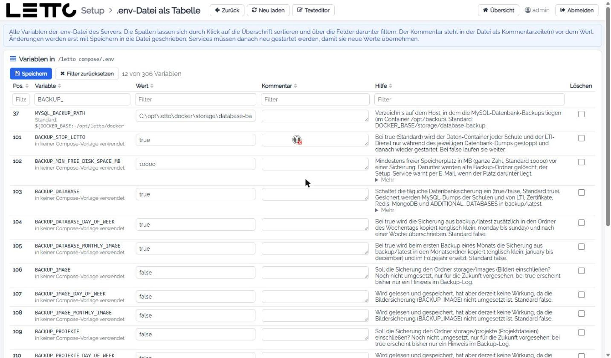
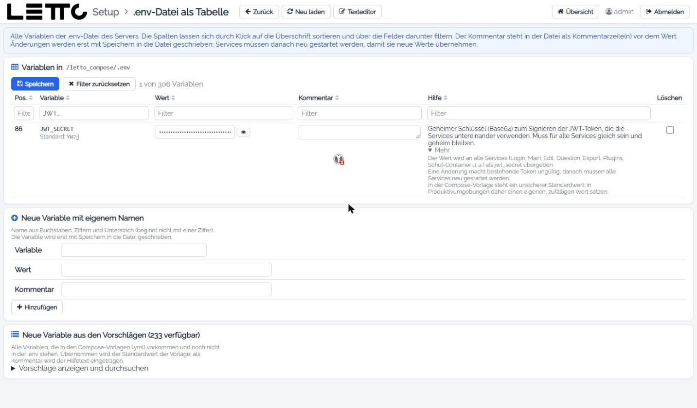
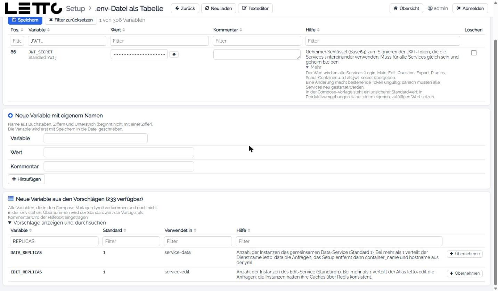

# Setup-Service: .env als Tabelle

Aufruf: Menü **Konfiguration → .env als Tabelle** auf der [Hauptseite](../Hauptseite/index.md). Die Seite ist nur für den Administrator des Setup-Service.

Die zentrale Konfigurationsdatei `/opt/letto/docker/compose/letto/.env` enthält Servername, Passwörter, Schulen, Mail, Backup und viele
weitere Einstellungen. Diese Seite zeigt **alle Variablen als Tabelle** mit Kommentar und einem mehrsprachigen **Hilfetext**, der erklärt,
wozu der Wert dient. Werte lassen sich ändern, Variablen löschen und neue hinzufügen. Wer lieber den Text der Datei direkt bearbeitet,
erreicht den bisherigen Editor über **Texteditor**.

## Die Tabelle

| Spalte | Bedeutung |
|---|---|
| Pos. | Position der Variablen in der Datei (Reihenfolge der `.env`) |
| Variable | Name der Variablen. Darunter steht der **Standard** aus den Compose-Vorlagen (`${NAME:-Standard}`), wenn es einen gibt, und der Hinweis „in keiner Compose-Vorlage verwendet“, wenn keine `.yml` die Variable verwendet |
| Wert | der Inhalt. Passwörter, Schlüssel und Tokens (`…PASSWORD`, `…SECRET`, `…TOKEN`, `…KEY`, `LETTO_RESTKEY`) sind verdeckt und über das Auge-Symbol einblendbar |
| Kommentar | steht in der Datei als Kommentarzeile(n) `#` unmittelbar **vor** der Variablen |
| Hilfe | kurzer Hilfetext in der Sprache der Oberfläche; bei längeren Erklärungen mit **Mehr** aufklappbar |
| Löschen | markiert die Variable; sie wird mit **Speichern** samt ihrem Kommentar aus der Datei entfernt (mit Rückfrage) |

**Sortieren** geht per Klick auf die Spaltenüberschrift (nochmal klicken kehrt um). **Filtern** geht je Spalte über das Feld unter der Überschrift;
die Filter wirken zusammen, die Anzeige nennt die Zahl der Treffer. **Filter zurücksetzen** leert alle Felder.

## Buttons

| Button | Wirkung |
|---|---|
| Zurück | in der Kopfzeile: zurück zur Hauptseite; bei ungespeicherten Änderungen mit Rückfrage |
| Neu laden | liest die Datei neu und verwirft nicht gespeicherte Eingaben (fragt bei Änderungen nach) |
| Texteditor | öffnet den [Datei-Editor](../Datei-Editor/index.md) mit der `.env`; **Zurück** führt hierher |
| Speichern | schreibt alle Änderungen in die Datei, bleibt auf der Seite und meldet das Ergebnis |

## Was beim Speichern passiert

* Es werden **nur die geänderten Zeilen** neu geschrieben. Kommentare, Leerzeilen und die Reihenfolge der übrigen Datei bleiben unverändert
  (das gilt seit Version 1.3 auch für alle anderen Setup-Seiten, die die `.env` schreiben).
* Vor jeder Änderung entsteht eine **Sicherung** `.env.vor-tabelle-<Datum>` im selben Ordner (die letzten 10 bleiben erhalten).
* Das Setup liest die Konfiguration danach neu. **Services und Schulen übernehmen neue Werte erst nach einem Neustart** des jeweiligen
  Containers; die Seite startet nichts automatisch.
* Werte mit `$` oder Backtick schreibt das Setup in einfachen Anführungszeichen, Zeilenumbrüche im Wert werden zu Leerzeichen.

## Variablen hinzufügen

Unter der Tabelle gibt es zwei Möglichkeiten. Eine neue Zeile erscheint grün markiert mit dem Hinweis **neu** und wird erst mit **Speichern** in die Datei geschrieben;
**Neu laden** verwirft sie wieder.

**Neue Variable mit eigenem Namen:** Name (Buchstaben, Ziffern und Unterstrich, nicht mit einer Ziffer beginnend, noch nicht vorhanden), Wert und
Kommentar eingeben und **Hinzufügen** wählen.

**Neue Variable aus den Vorschlägen:** Die Liste (zum Aufklappen) enthält alle Variablen, die in den Compose-Vorlagen (`.yml`) vorkommen und noch
**nicht** in der `.env` stehen, dazu Standardwert, die Vorlagen, die sie verwenden, und den Hilfetext. Auch sie ist sortier- und
spaltenweise filterbar. **Übernehmen** fügt die Variable mit dem Standardwert der Vorlage hinzu und trägt den Hilfetext als Kommentar ein.

## Hilfetexte

Die Hilfetexte gibt es in Deutsch, Englisch, Französisch und Spanisch. Sie wurden aus den Compose-Vorlagen, dem Setup-Code und den Quelltexten der
Dienste ermittelt. Manche Variablen haben im aktuellen Programmstand **keine Wirkung** (zum Beispiel `BACKUP_IMAGE` und `BACKUP_PROJEKTE`, die die
Sicherung von `storage/images` und `storage/projekte` vorsehen, aber noch nicht umgesetzt sind); der Text sagt das dann ausdrücklich. Variablen, die keine
Compose-Vorlage verwendet und die auch kein Dienst liest, zeigt die Spalte *Variable* mit dem Hinweis „in keiner Compose-Vorlage verwendet“.

## Hinweise

* Eine falsch gesetzte Variable kann Dienste am Start hindern. Vor größeren Änderungen die Sicherung `.env.vor-tabelle-<Datum>` prüfen oder
  die Datei mit der [Datensicherung](../Datensicherung/index.md) sichern.
* Passwörter und Schlüssel werden nicht in Meldungen oder Logs wiederholt. Die verdeckten Felder sollten beim Weitergeben von Bildschirmfotos
  verdeckt bleiben.

Zurück zur Übersicht: [Setup-Service](../index.md)
