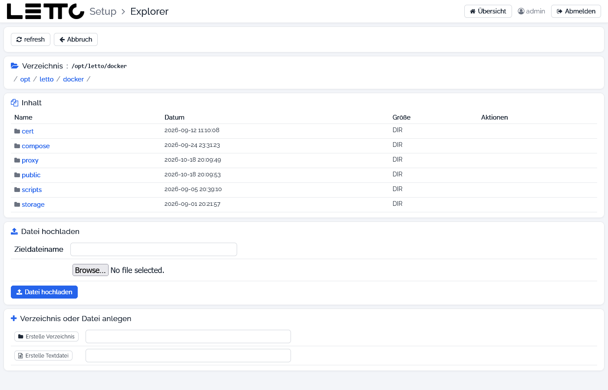

# Setup-Service: Explorer

Aufruf: Menü **Werkzeuge → Explorer** auf der [Hauptseite](../Hauptseite/index.md) (startet in `/opt/letto/docker`),
**Öffne Verzeichnis** auf der Seite [Datensicherung](../Datensicherung/index.md) oder **Startscripts zeigen** auf der
Seite [Update-Konfiguration](../Update-Konfiguration/index.md).

Der Explorer ist ein Datei-Browser für das Dateisystem des Setup-Containers. Unter `/opt/letto` liegen dort alle
Daten des Servers (Konfiguration, Compose-Dateien, Proxy, Sicherungen, Logs). Dateien können angezeigt, bearbeitet,
hoch- und heruntergeladen und gelöscht werden.

**Vorsicht:** Der Explorer erreicht auch die `.env` mit allen Passwörtern. Gelöschte Dateien sind endgültig weg.

## Buttons oben

| Button | Wirkung |
|---|---|
| refresh | Verzeichnis neu einlesen |
| Abbruch | zurück zur Hauptseite |

## Karte Verzeichnis

Zeigt den aktuellen Pfad. Jeder Teil des Pfads ist ein Link – ein Klick wechselt in dieses Verzeichnis, `/` führt zum
obersten Verzeichnis.

## Karte Inhalt

| Spalte / Button | Beschreibung |
|---|---|
| Name | Klick auf ein Verzeichnis öffnet es, Klick auf eine Datei zeigt sie im [Datei-Editor](../Datei-Editor/index.md#datei-anzeigen) an |
| Datum, Größe | Änderungsdatum und Größe (`DIR` bei Verzeichnissen) |
| Bearbeiten | öffnet die Datei im [Datei-Editor](../Datei-Editor/index.md) |
| Download | lädt die Datei auf den eigenen Rechner |
| Datei löschen | löscht die Datei (mit Rückfrage) |
| Kopiere in Database-Dump-Verzeichnis | nur bei `.sql`- und `.sql.gz`-Dateien: kopiert die Datei nach `/opt/letto/docker/storage/database-dump`, damit sie beim [Import in eine Schule](../Schule-bearbeiten/index.md) zur Auswahl steht |

## Karte Datei hochladen

| Feld / Button | Beschreibung |
|---|---|
| Zieldateiname | Name der Datei am Server; leer = Name der hochgeladenen Datei |
| Dateiauswahl | Datei am eigenen Rechner auswählen |
| Datei hochladen | lädt die Datei in das aktuelle Verzeichnis |

## Karte Verzeichnis oder Datei anlegen

| Button | Wirkung |
|---|---|
| Lösche Verzeichnis | nur bei leeren Verzeichnissen: löscht das aktuelle Verzeichnis (ohne Rückfrage) |
| Erstelle Verzeichnis | legt ein Unterverzeichnis mit dem Namen aus dem Feld daneben an |
| Erstelle Textdatei | legt eine leere Textdatei mit dem Namen aus dem Feld daneben an |

Zurück zur Übersicht: [Setup-Service](../index.md)
