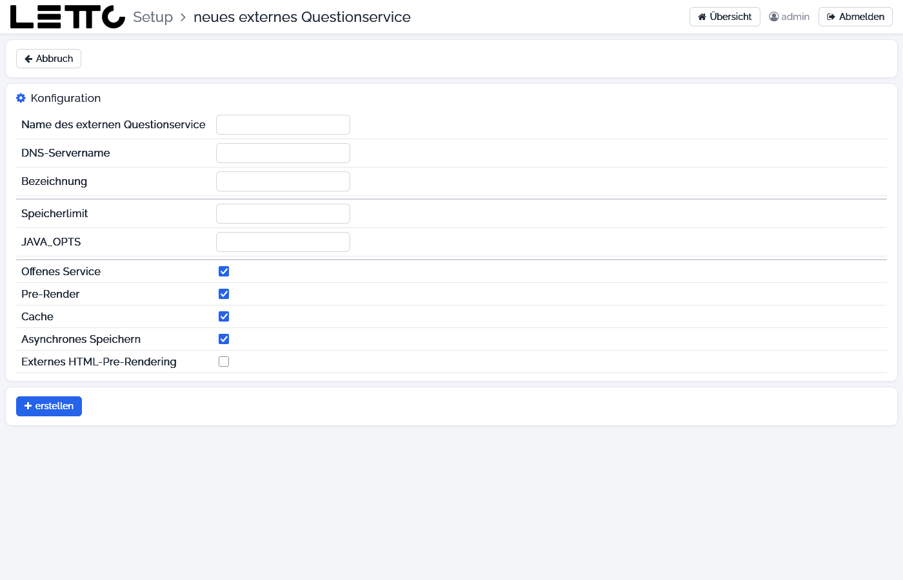
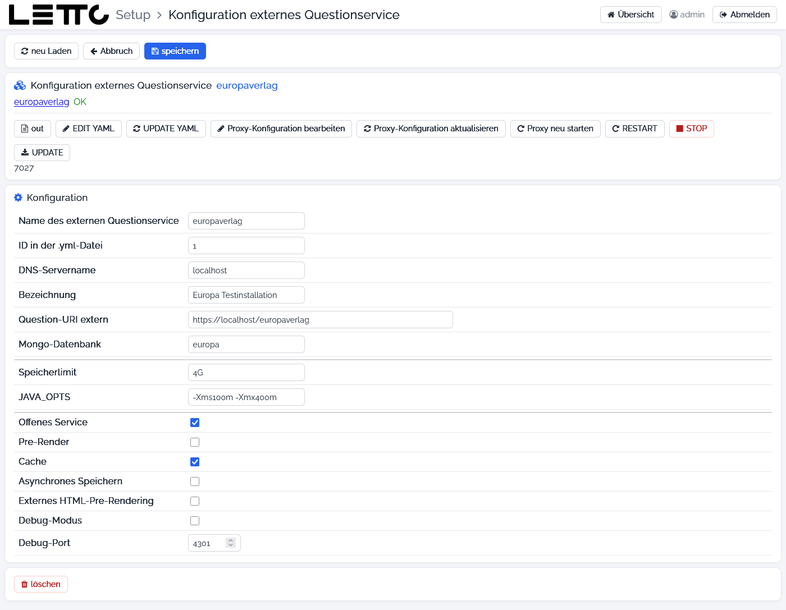

# Setup-Service: Externes Questionservice

Aufruf im Tab [Question-Services](../Question-Services/index.md) der Hauptseite:

* **Externes Questionservice hinzufügen** – legt ein neues an (Seite **neues externes Questionservice**),
* **Konfiguration** bei einem Question-Service – ändert ein bestehendes.

Ein externes Question-Service ist ein eigener Container `letto-question-<name>` mit eigener Mongo-Datenbank, der eine
Fragesammlung unabhängig von einer Schule bereitstellt. Dazu gehören die Compose-Datei
`docker-questionextern-<name>.yml`, die Proxy-Konfiguration `questionextern-<name>.conf` und Einträge in der `.env`.

## Neues externes Questionservice

| Feld | Beschreibung |
|---|---|
| Name des externen Questionservice | Pflichtfeld; wird beim Tippen geprüft – reservierte Namen und Namen, die schon eine Schule oder ein anderes Question-Service verwendet, sind nicht erlaubt. Ergibt die Adresse `https://<dns-servername>/<name>` |
| DNS-Servername | DNS-Name, unter dem das Question-Service erreichbar ist; dafür wird ein DNS-Eintrag benötigt |
| Bezeichnung | Anzeigename |
| Speicherlimit | Speichergrenze des Containers, z. B. `4G` |
| JAVA_OPTS | Java-Optionen, z. B. `-Xms100m -Xmx400m` |
| Offenes Service | das Question-Service ist offen zugänglich (`QUESTION_<n>_OPEN`) |
| Pre-Render | Fragen werden im Question-Service vorgerendert (`QUESTION_<n>_PRERENDER`) |
| Cache | durchgerechnete Fragen werden im Zwischenspeicher abgelegt (`QUESTION_<n>_CACHE`) |
| Asynchrones Speichern | Fragen werden asynchron (im Hintergrund) gespeichert (`QUESTION_<n>_SAVEASYNC`) |
| Externes HTML-Pre-Rendering | beim Rendern der HTML-Vorschau (Frage als Bild) wird die externe Adresse verwendet (`QUESTION_<n>_HTMLPRERENDER_EXTERN`) |

**erstellen** legt Container, Datenbank, Compose-Datei, Proxy-Konfiguration und `.env`-Einträge an und startet das
Service (erst möglich, wenn der Name gültig ist). **Abbruch** kehrt zur Hauptseite zurück.

## Konfiguration externes Questionservice

### Buttons oben

| Button | Wirkung |
|---|---|
| neu Laden | Werte neu laden |
| Abbruch | zurück zur Hauptseite |
| speichern | Änderungen speichern, Compose-Datei erneuern und das Service neu starten |

### Karte Konfiguration externes Questionservice

Link und Zustand des Service, dahinter die Revision.

| Button | Wirkung |
|---|---|
| out | Log des Containers |
| EDIT YAML | Compose-Datei im [Datei-Editor](../Datei-Editor/index.md) |
| UPDATE YAML | Compose-Datei aus der Vorlage erneuern |
| Proxy-Konfiguration bearbeiten | `questionextern-<name>.conf` im Editor öffnen |
| Proxy-Konfiguration aktualisieren | Proxy-Konfiguration aus der Vorlage erneuern |
| Proxy neu starten | Proxy neu starten, damit Änderungen wirken |
| RESTART, STOP, UPDATE | Container neu starten, stoppen bzw. aktualisieren |

### Karte Konfiguration

Wie beim Anlegen, zusätzlich:

| Feld | Beschreibung |
|---|---|
| Name des externen Questionservice | nicht mehr änderbar |
| ID in der .yml-Datei | Nummer des Service in der `.env` (nur Anzeige) |
| Question-URI extern | Adresse, unter der das Service erreichbar ist |
| Mongo-Datenbank | Name der eigenen Mongo-Datenbank |
| Debug-Modus, Debug-Port | Remote-Debugging des Containers einschalten und Port festlegen (nur für Entwickler) |

**löschen** entfernt das Question-Service mit allen Daten (mit Rückfrage).

Zurück zur Übersicht: [Setup-Service](../index.md)
