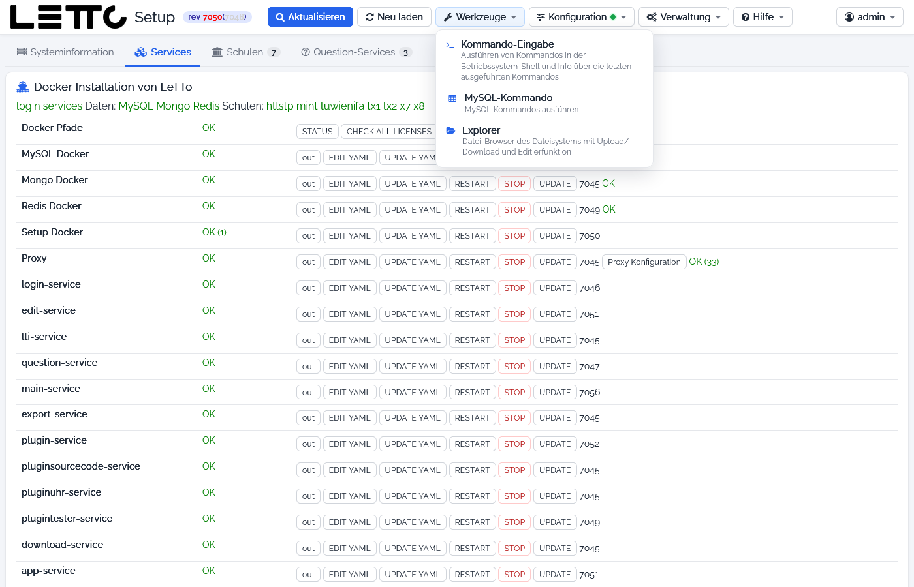
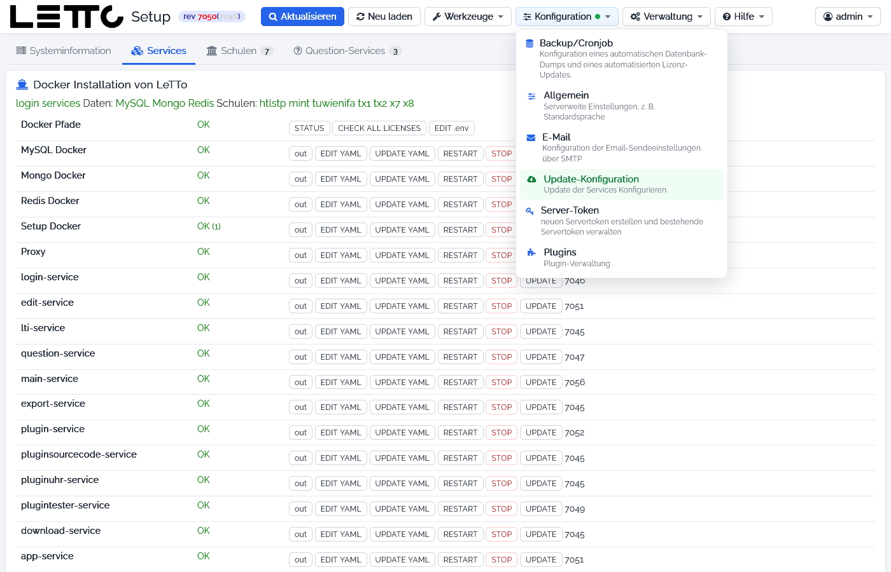
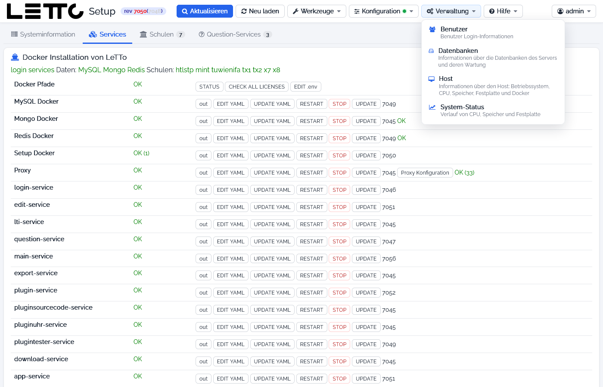
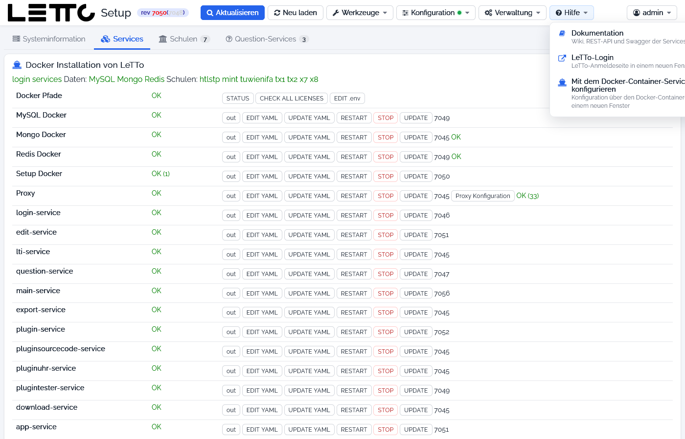
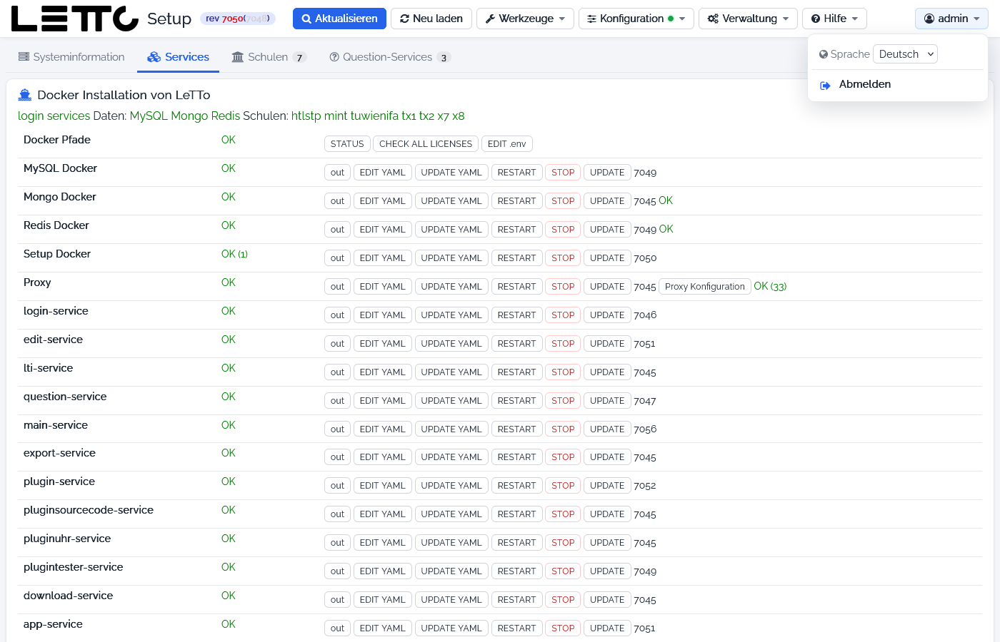
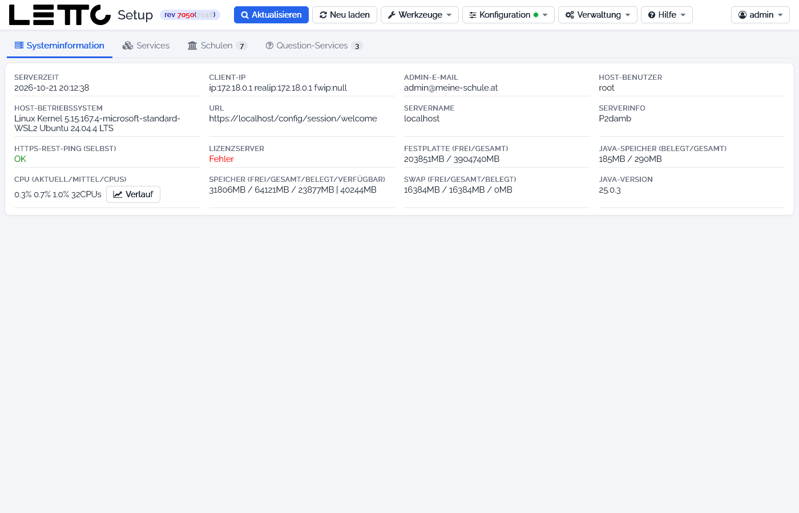

# Setup-Service: Hauptseite

Die Hauptseite ist die Zentrale des Setup-Service. Sie erscheint nach der [Anmeldung](../Anmeldung/index.md) und ist von
jeder anderen Seite über das LeTTo-Logo oder den Button **Übersicht** erreichbar. Sie besteht aus der Titelleiste mit
den Menüs und vier Tabs:

* **Systeminformation** – auf dieser Seite beschrieben
* [Services](../Services/index.md) – Docker-Container von LeTTo (Standard nach der Anmeldung)
* [Schulen](../Schulen/index.md) – installierte Schulen
* [Question-Services](../Question-Services/index.md) – externe Question-Services

Die Statuswerte der Tabs werden alle paar Sekunden automatisch aktualisiert.

## Titelleiste

| Element | Beschreibung |
|---|---|
| rev … | Revision (Build-Nummer) des laufenden Setup-Service |
| Aktualisieren | komplette Analyse des Servers (Hardware, Docker, Software) – dauert einige Sekunden, die Seite lädt sich danach selbst neu |
| Neu laden | Seite neu anzeigen, ohne den Server neu zu analysieren |
| Werkzeuge | Menü mit Werkzeugen (siehe unten) |
| Konfiguration | Menü mit den Einstellungen; ein grüner Punkt bzw. hervorgehobener Eintrag zeigt ein verfügbares Update |
| Verwaltung | Menü zur Verwaltung von Benutzern, Datenbanken und Host |
| Hilfe | Menü mit Dokumentation und Links |
| Benutzername (z. B. admin) | Sprache der Oberfläche wählen, **Abmelden** |

Unten am Fenster erscheint bei Bedarf eine Statusleiste. Sie zeigt laufende Analysen und Aufgaben sowie
**Probleme der Konfiguration (.env)**, z. B. fehlendes Admin-Passwort, nicht gesetzter Servername (`SERVER_NAME`) oder
E-Mail-Adresse (`EMAIL`), fehlende Schlüssel oder noch nicht geänderte Standard-Passwörter. Diese Punkte sollten
behoben werden (über **EDIT .env** im Tab [Services](../Services/index.md)).

### Menü Werkzeuge

| Eintrag | Seite |
|---|---|
| Kommando-Eingabe | [Kommandoeingabe](../Kommandoeingabe/index.md) – Befehle in der Betriebssystem-Shell ausführen |
| MySQL-Kommando | [MySQL-Befehl](../MySQL-Befehl/index.md) – SQL-Befehle ausführen |
| Explorer | [Explorer](../Explorer/index.md) – Datei-Browser mit Upload, Download und Editor |

### Menü Konfiguration

| Eintrag | Seite |
|---|---|
| Backup/Cronjob | [Datensicherung](../Datensicherung/index.md) – automatischer Datenbank-Dump und Lizenz-Update |
| Allgemein | [Allgemeine Einstellungen](../Allgemeine-Einstellungen/index.md) – Standardsprache |
| E-Mail | [E-Mail](../E-Mail/index.md) – SMTP-Einstellungen |
| Update-Konfiguration | [Update-Konfiguration](../Update-Konfiguration/index.md) – Updates der Services |
| Server-Token | [Server-Token](../Server-Token/index.md) – Tokens für fremde Server |
| Plugins | [Plugins](../Plugins/index.md) – Plugin-Verwaltung |

### Menü Verwaltung

| Eintrag | Seite |
|---|---|
| Benutzer | [Benutzer](../Benutzer/index.md) – angemeldete Benutzer |
| Datenbanken | [Datenbanken](../Datenbanken/index.md) – Datenbanken des Servers und deren Wartung |
| Host | [Host](../Host/index.md) – Betriebssystem, CPU, Speicher, Festplatte, Docker |
| System-Status | [System-Status](../System-Status/index.md) – Verlauf von CPU, Speicher und Festplatte |

### Menü Hilfe

| Eintrag | Beschreibung |
|---|---|
| Dokumentation | [Dokumentation](../Dokumentation/index.md) – Wiki, REST-API und Swagger der Services |
| LeTTo-Login | öffnet die Anmeldeseite von LeTTo in einem neuen Fenster |
| Mit dem Docker-Container-Service konfigurieren | öffnet das Setup über den Proxy (`https://<server>/config`) oder, wenn der Proxy nicht antwortet, direkt über Port 3096 |

### Benutzermenü

| Eintrag | Beschreibung |
|---|---|
| Sprache | Sprache der Oberfläche |
| Abmelden | beendet die Sitzung und öffnet die [Anmeldung](../Anmeldung/index.md) |

## Tab Systeminformation

Der Tab zeigt nur Informationen, er hat keine Eingabefelder.

| Feld | Bedeutung |
|---|---|
| Serverzeit | aktuelle Uhrzeit am Server |
| Client-IP | IP-Adresse des Browsers (`ip`), wie sie über den Proxy ankommt (`realip`, `fwip`) |
| Admin-E-Mail | `EMAIL` aus der `.env` – Adresse des Server-Administrators (z. B. für Let's Encrypt) |
| Host-Benutzer | Benutzer, unter dem das Setup läuft |
| Host-Betriebssystem | Kernel und Betriebssystem des Hosts |
| URL | Adresse, über die das Setup gerade aufgerufen wird |
| Servername | `SERVER_NAME` aus der `.env` – DNS-Name des Servers |
| Serverinfo | `SERVER_INFO` aus der `.env` – freier Beschreibungstext |
| HTTPS-REST-Ping (selbst) | **OK**, wenn der Server sich über seinen eigenen DNS-Namen per https erreicht; bei **FAIL** siehe [Https REST ping](../../HttpsRESTping/index.md) |
| Lizenzserver | Erreichbarkeit des LeTTo-Lizenzservers (für Lizenzen und Restkey nötig) |
| Festplatte (frei/gesamt) | freier und gesamter Platz des Docker-Verzeichnisses |
| Java-Speicher (belegt/gesamt) | Speicher des Setup-Service |
| CPU (aktuell/Mittel/CPUs) | CPU-Last jetzt und im Mittel, Anzahl CPUs; **Verlauf** öffnet den [System-Status](../System-Status/index.md) |
| Speicher (frei/gesamt/belegt/verfügbar) | Arbeitsspeicher des Hosts |
| Swap (frei/gesamt/belegt) | Auslagerungsspeicher des Hosts |
| Java-Version | Java-Version des Setup-Service |

Ausführlichere Informationen zum Server stehen auf der Seite [Host](../Host/index.md).

Zurück zur Übersicht: [Setup-Service](../index.md)
