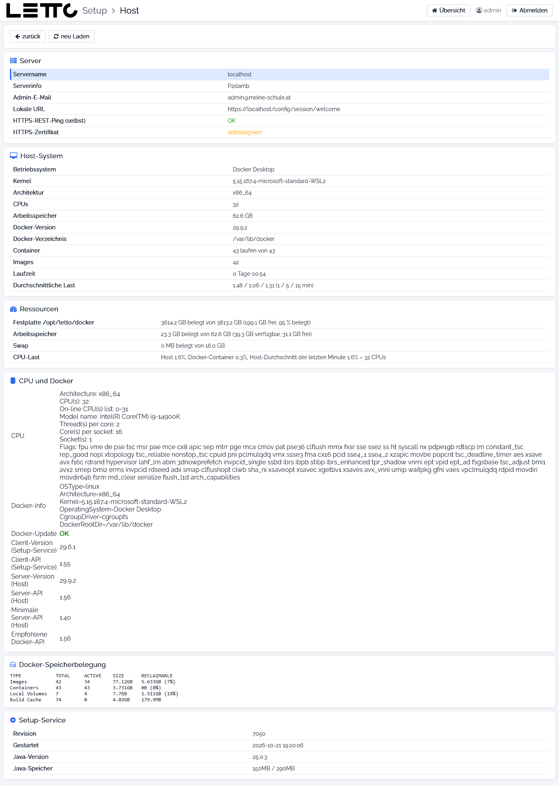

# Setup-Service: Host

Aufruf: Menü **Verwaltung → Host** auf der [Hauptseite](../Hauptseite/index.md) oder **Host-Information** auf der Seite
[Datenbanken](../Datenbanken/index.md).

Die Seite zeigt Informationen über den Rechner, auf dem LeTTo läuft. Sie ändert nichts.

## Buttons

| Button | Wirkung |
|---|---|
| zurück | zurück zur aufrufenden Seite |
| neu Laden | Werte neu ermitteln |

## Karten

| Karte | Inhalt |
|---|---|
| Server | Servername, Serverinfo, Admin-E-Mail, lokale URL, HTTPS-REST-Ping (selbst) und Zustand des HTTPS-Zertifikats |
| Host-System | Betriebssystem, Kernel, Architektur, CPUs, Arbeitsspeicher, Docker-Version und Docker-Verzeichnis, laufende Container, Anzahl Images, Laufzeit seit dem letzten Neustart und durchschnittliche Last (1/5/15 Minuten) |
| Ressourcen | belegter Platz auf der Festplatte von `/opt/letto/docker`, Arbeitsspeicher, Swap und CPU-Last |
| CPU und Docker | Prozessor (`lscpu`), Docker-Info sowie Versionen und API-Versionen von Docker-Client (im Setup) und Docker-Server (am Host); **Docker-Update OK** bzw. ein Hinweis, wenn Docker am Host zu alt ist |
| Docker-Speicherbelegung | Ausgabe von `docker system df`: Platz für Images, Container, Volumes und Build-Cache und wie viel davon freigegeben werden kann |
| Setup-Service | Revision, Startzeit, Java-Version und Java-Speicher des Setup-Service |

Wird der Platz knapp, können unbenutzte Images im [Docker-Status](../Docker-Status/index.md) entfernt werden. Den
Verlauf von CPU, Speicher und Festplatte zeigt der [System-Status](../System-Status/index.md).

Zurück zur Übersicht: [Setup-Service](../index.md)
