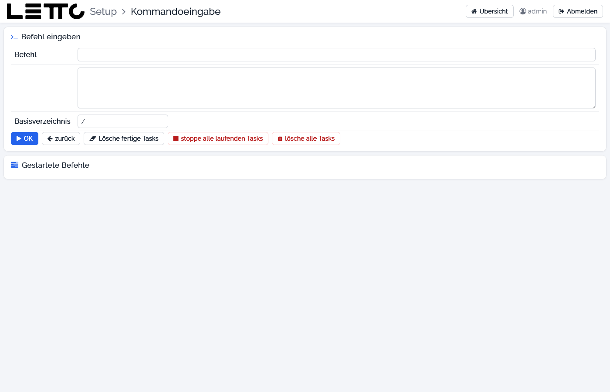

# Setup-Service: Kommandoeingabe

Aufruf: Menü **Werkzeuge → Kommando-Eingabe** auf der [Hauptseite](../Hauptseite/index.md).

Mit der Kommandoeingabe werden Shell-Befehle (bash) im Container `letto-setup` ausgeführt. Der Container hat Zugriff auf
das Docker des Hosts und auf `/opt/letto`, Befehle wie `docker ps` oder `docker logs letto-proxy` wirken also direkt am
Server. Die Seite listet außerdem alle Hintergrund-Aufgaben des Setups, auch die von anderen Seiten gestarteten
(Updates, Backups …).

**Vorsicht:** Das ist eine Root-Shell ohne Rückfragen. Ein falscher Befehl kann Daten oder Container löschen.

## Felder

| Feld | Beschreibung |
|---|---|
| Befehl | der auszuführende Befehl (eine Zeile) |
| mehrzeiliges Feld | weitere Befehlszeilen; sie werden an den Befehl angehängt und gemeinsam als Skript ausgeführt |
| Basisverzeichnis | Arbeitsverzeichnis, in dem der Befehl läuft (Vorgabe `/`) |

## Buttons

| Button | Wirkung |
|---|---|
| OK | startet den Befehl im Hintergrund und öffnet die [Befehlsausgabe](../Befehlsausgabe/index.md) |
| zurück | zurück zur Hauptseite |
| Lösche fertige Tasks | entfernt alle abgeschlossenen Aufgaben aus der Liste |
| stoppe alle laufenden Tasks | bricht nach einer Rückfrage alle laufenden Aufgaben ab – auch laufende Updates oder Backups |
| lösche alle Tasks | stoppt und entfernt nach einer Rückfrage alle Aufgaben |

## Gestartete Befehle

Die Karte **Gestartete Befehle** zeigt je Aufgabe ID, Befehl, Status und Laufzeit mit den Buttons **öffnen** (zeigt die
[Befehlsausgabe](../Befehlsausgabe/index.md) dieser Aufgabe), **STOP** und **entfernen**.

## siehe auch

* [MySQL-Befehl](../MySQL-Befehl/index.md) – SQL-Befehle an die Datenbanken
* [Explorer](../Explorer/index.md) – Dateien ansehen und bearbeiten

Zurück zur Übersicht: [Setup-Service](../index.md)
