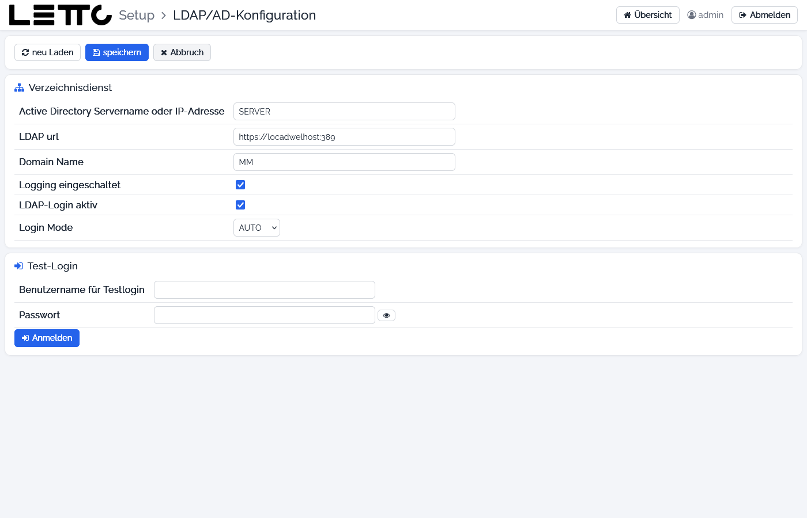

# Setup-Service: LDAP/AD-Konfiguration

Aufruf: Button **LDAP/AD Login** auf der Seite [Benutzer](../Benutzer/index.md).

Hier wird eingestellt, dass sich LeTTo-Benutzer mit ihrem Schul-Account aus Active Directory oder LDAP anmelden
können. Die Anmeldung prüft der Login-Service (`letto-login`). Wie Benutzer in LeTTo dem AD zugeordnet werden, steht unter
[Active Directory / LDAP](../../../../howto/admin/active-directory-ldap/index.md) und
[AD-Check](../../../admin/global/AD-check/index.md).

## Buttons oben

| Button | Wirkung |
|---|---|
| neu Laden | Werte neu aus der `.env` laden |
| speichern | Werte in der `.env` speichern und zurück zur Seite Benutzer |
| Abbruch | zurück, ohne zu speichern |

## Verzeichnisdienst

| Feld | Variable in der `.env` | Bedeutung |
|---|---|---|
| Active Directory Servername oder IP-Adresse | `LDAP_AD_SERVER` | Name oder IP-Adresse des Domain-Controllers |
| LDAP url | `LDAP_SERVER` | Adresse des LDAP-Servers, z. B. `ldaps://dc.meine-schule.local:636` |
| Domain Name | `LDAP_DOMAIN` | Name der Domäne |
| Logging eingeschaltet | `LDAP_LOGGING` | ausführliches Protokoll der LDAP-Anmeldungen im Log des Login-Service |
| LDAP-Login aktiv | `LDAP_LOGIN` | Anmeldung über LDAP/AD einschalten |
| Login Mode | `LDAP_MODE` | Verfahren: AUTO, AD, LDAP1, LDAP2, LDAP3 |

Der Login-Service liest diese Werte beim Start. Nach dem Speichern den `login-service` im Tab
[Services](../Services/index.md) neu starten.

## Test-Login

| Element | Beschreibung |
|---|---|
| Benutzername für Testlogin | ein Benutzer des Verzeichnisdienstes |
| Passwort | sein Passwort |
| Anmelden | prüft die Anmeldung mit den **eingegebenen** Einstellungen (auch ungespeichert) über den Login-Service und zeigt das Ergebnis und das Protokoll darunter |

Mögliche Ergebnisse: Test-Login erfolgreich (mit der Schule des Benutzers), erfolgreich, aber der Benutzer ist in keiner
Schule bekannt, fehlgeschlagen oder Login-Service nicht erreichbar.

Zurück zur Übersicht: [Setup-Service](../index.md)
