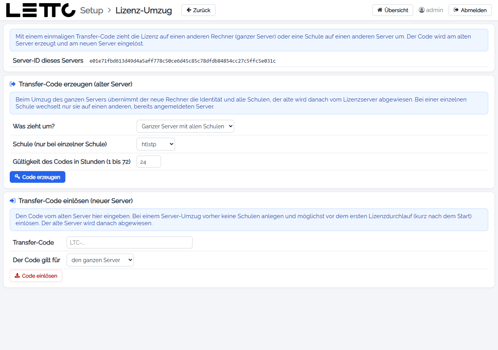

# Setup-Service: Lizenz-Umzug

Aufruf: Menü **Konfiguration → Lizenz-Umzug** auf der [Hauptseite](../Hauptseite/index.md). Die Seite ist nur für den Administrator des Setup-Service.

Mit einem einmaligen **Transfer-Code** zieht die Lizenz auf einen anderen Rechner (der **ganze Server** mit allen Schulen) oder eine
**einzelne Schule** auf einen anderen Server um. Der Code wird am alten Server erzeugt und am neuen Server eingelöst. Hintergrund
und Voraussetzungen stehen auf der Seite [Lizenzvergabe](../../Lizenzvergabe/index.md).

## Buttons oben

| Button | Wirkung |
|---|---|
| Zurück | in der Kopfzeile: zurück zur Hauptseite |

## Server-ID

Die Server-ID dieses Servers (Fingerabdruck seines Schlüssels). Steht dort **-**, ist der Server noch nicht am Lizenzserver angemeldet.

## Transfer-Code erzeugen (alter Server)

| Feld | Bedeutung |
|---|---|
| Was zieht um? | **Ganzer Server mit allen Schulen** (neue Hardware oder anderer Servername) oder **Eine einzelne Schule** |
| Schule | nur bei einer einzelnen Schule: die Schule, die auf einen anderen Server wechselt |
| Gültigkeit des Codes in Stunden | 1 bis 72, Vorgabe 24 |
| Code erzeugen | fordert beim Lizenzserver einen Code an |

Der Code (`LTC-…`) erscheint **nur einmal** in einem grünen Feld und ist einmal einlösbar. Bitte notieren. Es sind höchstens
5 offene Codes je Server möglich. Ist der Server nicht am Lizenzserver angemeldet, ist der Button gesperrt; auf einem defekten
Server erzeugt ein globaler Administrator den Code am Lizenzserver.

Beim Umzug des ganzen Servers übernimmt der neue Rechner die Identität und alle Schulen; der alte wird danach vom Lizenzserver
abgewiesen. Bei einer einzelnen Schule wechselt nur sie auf einen anderen, bereits angemeldeten Server.

## Transfer-Code einlösen (neuer Server)

| Feld | Bedeutung |
|---|---|
| Transfer-Code | der Code vom alten Server |
| Der Code gilt für | **den ganzen Server** oder **die Schule** *Kürzel* (die Schule, die hier angekommen ist) |
| Code einlösen | löst den Code nach einer Rückfrage ein |

Nach dem Einlösen:

* **Ganzer Server:** Die Lizenz gehört jetzt zu diesem Server, der neue **Restkey** wurde eingetragen und die Lizenzen sind geholt.
  Services, die den Restkey nutzen (zentrale Beispielsammlung), danach neu starten.
* **Schule:** Die Schule ist diesem Server zugeordnet und das Lizenz-Token wurde geholt.

Den Code beim Umzug des ganzen Servers **vor dem ersten Lizenzdurchlauf** einlösen (etwa 2 Minuten nach dem Start des Setup-Service).
Meldet sich der neue Server vorher von selbst an, hat er am Lizenzserver schon Demo-Schulen und der Umzug wird abgelehnt.

## Meldungen

| Meldung | Bedeutung |
|---|---|
| Der Code ist unbekannt, abgelaufen oder schon eingelöst | aus Sicherheitsgründen nicht unterschieden; einen neuen Code erzeugen |
| Dieser Server hat am Lizenzserver bereits Schulen, ein Server-Umzug ist nur auf einen leeren Server möglich | der neue Server hat sich schon angemeldet, siehe oben |
| Quell- und Zielserver sind derselbe Server | der Code wurde am selben Server eingelöst, an dem er erzeugt wurde |
| Der Servername gehört am Lizenzserver bereits einem anderen Server | der neue Servername ist am Lizenzserver vergeben |
| Die Schulnummer ist an diesem Server am Lizenzserver schon vergeben | eine andere Schule hat diese Nummer |
| Für eine einzelne Schule muss dieser Server am Lizenzserver angemeldet sein | erst anmelden lassen (ein Durchlauf), dann einlösen |
| Zu viele Versuche | später erneut versuchen |

Zurück zur Übersicht: [Setup-Service](../index.md)
