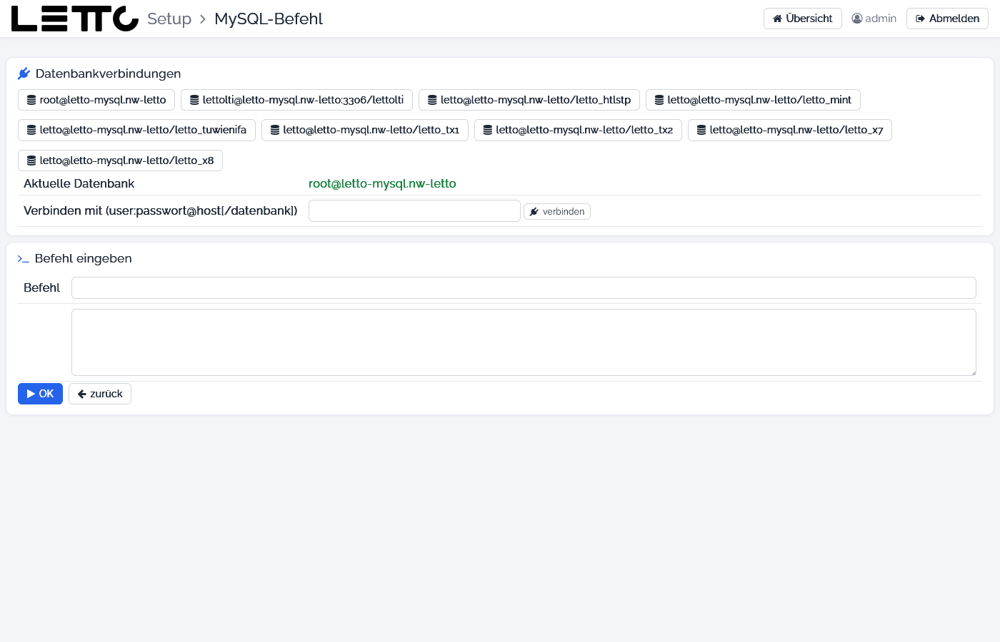

# Setup-Service: MySQL-Befehl

Aufruf: Menü **Werkzeuge → MySQL-Kommando** auf der [Hauptseite](../Hauptseite/index.md).

Auf dieser Seite werden SQL-Befehle direkt an die MySQL-Datenbanken des Servers geschickt, z. B. um Daten einer Schule
nachzusehen. Änderungen (`UPDATE`, `DELETE`, `DROP` …) wirken sofort und ohne Rückfrage.

## Karte Datenbankverbindungen

| Element | Beschreibung |
|---|---|
| Verbindungs-Buttons | je eine fertige Verbindung: `root` auf dem MySQL-Container (alle Datenbanken), der LTI-Benutzer auf `lettolti` und je Schule der Datenbank-Benutzer auf `letto_<schule>`; ein Klick wählt die Verbindung |
| Aktuelle Datenbank | die gerade gewählte Verbindung |
| Verbinden mit (user:passwort@host[/datenbank]) | eigene Verbindung, z. B. `letto:geheim@letto-mysql.nw-letto/letto_tx1` |
| verbinden | prüft die eingegebene Verbindung und wählt sie aus |

## Karte Befehl eingeben

| Element | Beschreibung |
|---|---|
| Befehl | ein SQL-Befehl; Enter führt ihn aus |
| mehrzeiliges Feld | weitere Befehle; mehrere Befehle mit `;` trennen |
| OK | führt die Befehle mit der aktuellen Verbindung aus |
| zurück | zurück zur Hauptseite |

Unter den Karten erscheint für jeden Befehl das Ergebnis – bei `SELECT`, `SHOW` oder `DESCRIBE` als Tabelle, sonst
die Anzahl der geänderten Zeilen oder die Fehlermeldung. Nach einem Fehler werden die weiteren Befehle nicht mehr
ausgeführt.

## siehe auch

* [Datenbanken](../Datenbanken/index.md) – Backup, Reparatur und Wiederherstellung der Datenbanken
* [Kommandoeingabe](../Kommandoeingabe/index.md)

Zurück zur Übersicht: [Setup-Service](../index.md)
