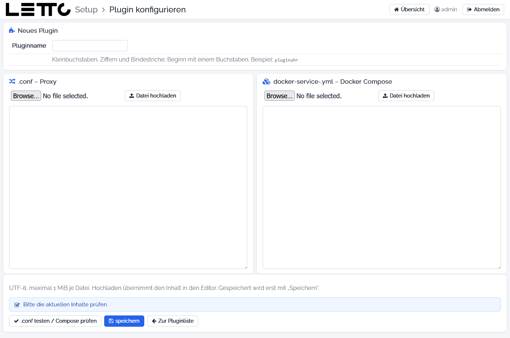

# Setup-Service: Plugin hinzufügen

Aufruf: Button **hinzufügen** auf der Seite [Plugins](../Plugins/index.md). Die Seite heißt **Plugin konfigurieren**.

Ein neues Plugin besteht aus zwei Dateien, die hier eingegeben oder hochgeladen werden:

* der Proxy-Konfiguration `/opt/letto/docker/proxy/<name>.conf`, damit das Plugin über `https://<server>/<name>` erreichbar ist,
* der Compose-Datei `/opt/letto/docker/compose/letto/docker-service-<name>.yml`, die den Container beschreibt.

Vorlagen für eigene Plugins gibt es beim [Referenz-Plugin Java](../../../Plugins/referenz-plugin-java/index.md) und
[Referenz-Plugin Python](../../../Plugins/referenz-plugin-python/index.md).

## Felder

| Feld | Beschreibung |
|---|---|
| Pluginname | Pflichtfeld: Kleinbuchstaben, Ziffern und Bindestriche, beginnt mit einem Buchstaben (z. B. `pluginuhr`); ergibt die Dateinamen |
| .conf – Proxy | nginx-Konfiguration; mit der Dateiauswahl und **Datei hochladen** eine Datei übernehmen oder direkt im Textfeld schreiben |
| docker-service-.yml – Docker Compose | Compose-Datei des Containers; ebenfalls hochladen oder im Textfeld schreiben |

Beide Dateien müssen UTF-8 sein und dürfen höchstens 1 MiB groß sein. Hochladen übernimmt den Inhalt nur in das
Textfeld, gespeichert wird erst mit **speichern**.

## Buttons

| Button | Wirkung |
|---|---|
| .conf testen / Compose prüfen | prüft die nginx-Konfiguration in einer Kopie des Proxy-Containers und die Compose-Datei mit `docker compose config`; das Ergebnis steht im Hinweisfeld darüber |
| speichern | erst nach erfolgreicher Prüfung möglich; schreibt beide Dateien (vorhandene Dateien werden nicht überschrieben). Jede Änderung im Textfeld verlangt eine neue Prüfung |
| Zur Pluginliste | zurück zur Seite [Plugins](../Plugins/index.md) |

Nach dem Speichern wird der Container noch nicht gestartet. Danach den Proxy neu starten
([Proxy-Konfiguration](../Proxy-Konfiguration/index.md) → **Proxy neu starten**) und den neuen Service im Tab
[Services](../Services/index.md) bzw. auf der Seite [Update-Konfiguration](../Update-Konfiguration/index.md) starten.
Sobald das Plugin läuft, meldet es sich selbst an und erscheint in der Liste der [Plugins](../Plugins/index.md).

Zurück zur Übersicht: [Setup-Service](../index.md)
