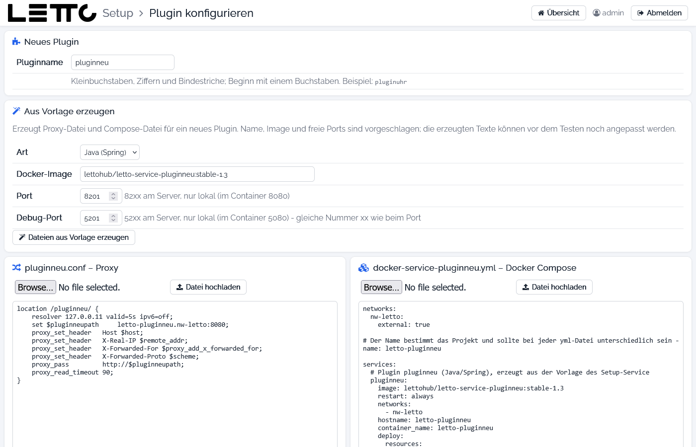

# Setup-Service: Plugin hinzufügen

Aufruf: Button **hinzufügen** auf der Seite [Plugins](../Plugins/index.md). Die Seite heißt **Plugin konfigurieren**.

Ein neues Plugin besteht aus zwei Dateien, die hier eingegeben oder hochgeladen werden:

* der Proxy-Konfiguration `/opt/letto/docker/proxy/<name>.conf`, damit das Plugin über `https://<server>/<name>` erreichbar ist,
* der Compose-Datei `/opt/letto/docker/compose/letto/docker-service-<name>.yml`, die den Container beschreibt.

Beide Dateien unterscheiden sich zwischen den Plugins meist nur in wenigen Werten. Deshalb erzeugt die Seite sie beim
Öffnen bereits aus einer Vorlage (siehe unten); sie können aber auch selbst geschrieben oder hochgeladen werden.
Hintergrund zu eigenen Plugins: [Referenz-Plugin Java](../../../Plugins/referenz-plugin-java/index.md) und
[Referenz-Plugin Python](../../../Plugins/referenz-plugin-python/index.md).

## Aus Vorlage erzeugen

Die Karte **Aus Vorlage erzeugen** schlägt alle Werte vor, sodass es keine Konflikte mit vorhandenen Diensten gibt:

| Feld | Vorschlag |
|---|---|
| Pluginname (Karte darüber) | `pluginneu`, `pluginneu2`, … – der erste Name ohne vorhandene Dateien |
| Art | **Java (Spring)** (wie die LeTTo-Plugins) oder **Python** (wie `plugindemopython`) |
| Docker-Image | `lettohub/letto-service-<name>:stable-1.3`; folgt beim Tippen dem Pluginnamen, bis es selbst geändert wird |
| Port | `82xx` am Server, im Container `8080` |
| Debug-Port | `52xx` am Server, im Container `5080` – folgt dem Port, `xx` ist bei beiden gleich |

`xx` ist die kleinste Nummer, die weder als `82xx` noch als `52xx` in einer Compose-Datei, der `.env` oder bei einem
Container vorkommt. Beide Ports werden nur lokal (`127.0.0.1`) gebunden – von außen ist das Plugin nur über den Proxy
erreichbar, Debuggen geht per SSH-Tunnel. **Dateien aus Vorlage erzeugen** schreibt beide Textfelder neu (mit Rückfrage,
wenn sie schon Text enthalten). Ist ein Port bereits belegt, kommt eine Meldung. Danach die Texte bei Bedarf anpassen,
testen und speichern.

## Felder

| Feld | Beschreibung |
|---|---|
| Pluginname | Pflichtfeld: Kleinbuchstaben, Ziffern und Bindestriche, beginnt mit einem Buchstaben (z. B. `pluginuhr`); ergibt die Dateinamen |
| .conf – Proxy | nginx-Konfiguration; mit der Dateiauswahl und **Datei hochladen** eine Datei übernehmen oder direkt im Textfeld schreiben |
| docker-service-.yml – Docker Compose | Compose-Datei des Containers; ebenfalls hochladen oder im Textfeld schreiben |

Beide Dateien müssen UTF-8 sein und dürfen höchstens 1 MiB groß sein. Hochladen übernimmt den Inhalt nur in das
Textfeld, gespeichert wird erst mit **speichern**.

## Buttons

| Button | Wirkung |
|---|---|
| Testen | prüft beide Dateien: die nginx-Konfiguration in einer Kopie des Proxy-Containers und die Compose-Datei mit `docker compose config`. Das Ergebnis beider Prüfungen steht im Hinweisfeld, Fehler mit Dateiname und Zeile (z. B. `unknown directive "x" in pluginneu.conf:2`) |
| Speichern | erst möglich, wenn beide Dateien im aktuellen Stand erfolgreich geprüft sind; jede Änderung im Textfeld verlangt eine neue Prüfung. Ein neues Plugin überschreibt keine vorhandenen Dateien |
| Zur Pluginliste | zurück zur Seite [Plugins](../Plugins/index.md) |

Nach dem Speichern wird der Container noch nicht gestartet. Die Seite wechselt zu den
[Plugin-Details](../Plugins/index.md#plugin-details) mit dem Hinweis, was noch zu tun ist: dort **Starten** und
**Proxy prüfen und neu starten** drücken. Sobald das Plugin läuft, meldet es sich selbst an und erscheint mit allen
Angaben in der Liste der [Plugins](../Plugins/index.md).

Dieselbe Seite öffnet sich auch über **Dateien bearbeiten** in den Plugin-Details. Dann ist der Pluginname fest, die
Karte **Aus Vorlage erzeugen** fehlt und beide Dateien sind änderbar; gespeichert werden immer beide gemeinsam.
Änderungen an der Compose-Datei wirken nach **Starten**, Änderungen an der Proxy-Datei nach
**Proxy prüfen und neu starten**.

Zurück zur Übersicht: [Setup-Service](../index.md)
