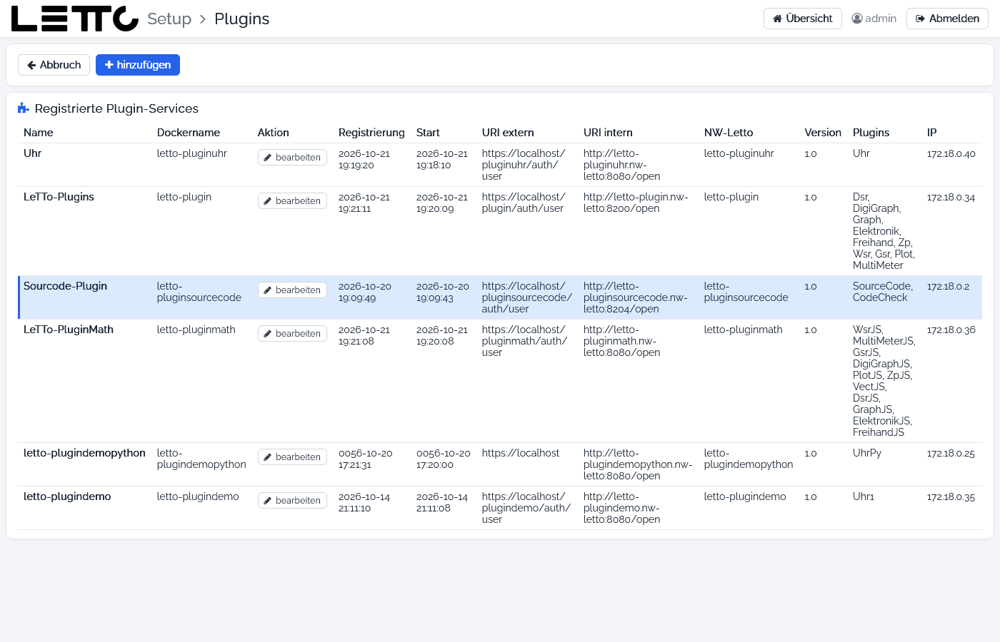
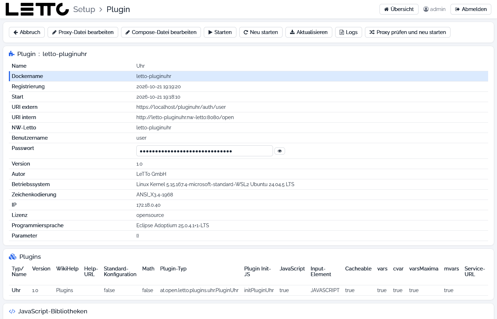

# Setup-Service: Plugins

Aufruf: Menü **Konfiguration → Plugins** auf der [Hauptseite](../Hauptseite/index.md).

Plugins sind eigene Docker-Container (z. B. Uhr, LeTTo-Plugins, Sourcecode-Plugin), die zusätzliche Fragetypen und
Grafiken liefern. Jedes Plugin meldet sich beim Start selbst beim Setup-Service an. Diese Seite zeigt alle
angemeldeten Plugin-Services; die Angaben zu den Plugins werden dabei direkt beim jeweiligen Container abgefragt.
Mehr zu Plugins: [Plugins](../../../Plugins/index.md).

## Buttons

| Button | Wirkung |
|---|---|
| Abbruch | zurück zur Hauptseite |
| hinzufügen | neues Plugin anlegen – siehe [Plugin hinzufügen](../Plugin-hinzufuegen/index.md) |

## Registrierte Plugin-Services

| Spalte | Bedeutung |
|---|---|
| Name | Name des Plugin-Service |
| Dockername | Name des Containers |
| Aktion | **bearbeiten** öffnet die Details (siehe unten) |
| Registrierung | Zeitpunkt der letzten Anmeldung beim Setup |
| Start | Startzeit des Containers |
| URI extern | Adresse des Plugins von außen (über den Proxy) |
| URI intern | Adresse im Docker-Netzwerk `nw-letto` |
| NW-Letto | Hostname im Docker-Netzwerk |
| Version | Version des Plugin-Service |
| Plugins | Plugin-Typen, die dieser Service liefert |
| IP | IP-Adresse des Containers |

Ein Plugin-Container wird wie jeder andere Service im Tab [Services](../Services/index.md) gestartet, gestoppt und
aktualisiert.

## Plugin-Details

**bearbeiten** zeigt alle Angaben eines Plugin-Service und bietet die Aktionen für seinen Container.

| Button | Wirkung |
|---|---|
| Abbruch | zurück zur Liste |
| Proxy-Datei bearbeiten | öffnet `/opt/letto/docker/proxy/<name>.conf` in der Seite [Plugin hinzufügen](../Plugin-hinzufuegen/index.md) zum Bearbeiten; vor dem Speichern wird die Datei geprüft |
| Compose-Datei bearbeiten | öffnet `docker-service-<name>.yml` ebenso zum Bearbeiten |
| Starten | startet den Container (`docker compose up -d`) |
| Neu starten | startet den Container neu |
| Aktualisieren | lädt das Image neu und startet den Container |
| Logs | zeigt die letzten 1000 Zeilen des Container-Logs in der [Befehlsausgabe](../Befehlsausgabe/index.md) |
| Proxy prüfen und neu starten | prüft die nginx-Konfiguration und startet den Proxy neu (mit Rückfrage – alle Schulen sind dabei kurz nicht erreichbar) |

Hat sich ein Plugin noch nicht beim Setup angemeldet (z. B. gleich nach dem Anlegen), zeigt die Seite statt der Angaben
einen Hinweis; die Buttons stehen trotzdem zur Verfügung.

| Karte | Inhalt |
|---|---|
| Plugin : &lt;dockername&gt; | Name, Dockername, Registrierung, Start, URI extern/intern, NW-Letto, Benutzername und Passwort für die Verbindung zum Plugin, Version, Autor, Betriebssystem, Zeichenkodierung, IP, Lizenz, Programmiersprache, Parameter |
| Plugins | je Plugin-Typ: Version, WikiHelp und Help-URL, Standard-Konfiguration, Math, Plugin-Typ (Java-Klasse), Init-JS, JavaScript, Input-Element, Cacheable und die unterstützten Variablen-Arten |
| JavaScript-Bibliotheken | JavaScript-Dateien, die das Plugin im Browser lädt |

Das Passwort der Plugin-Verbindung ist verdeckt und wird mit dem Auge-Symbol sichtbar.

Zurück zur Übersicht: [Setup-Service](../index.md)
