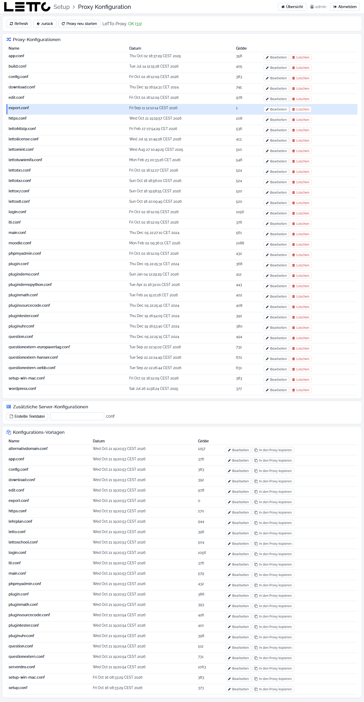

# Setup-Service: Proxy-Konfiguration

Aufruf: Button **Proxy Konfiguration** in der Zeile „Proxy“ im Tab [Services](../Services/index.md).

Der Reverse-Proxy `letto-proxy` (nginx) nimmt alle Anfragen an `https://<server>/…` an und leitet sie an die Container
weiter. Für jeden Service, jede Schule und jedes Plugin gibt es eine Konfigurationsdatei in
`/opt/letto/docker/proxy`. Auf dieser Seite werden diese Dateien verwaltet. Änderungen wirken erst nach
**Proxy neu starten**.

## Buttons oben

| Element | Wirkung |
|---|---|
| Refresh | Liste neu laden |
| zurück | zurück zur Hauptseite |
| Proxy neu starten | startet den Proxy neu (`docker restart letto-proxy`) und lädt damit alle Konfigurationsdateien neu |
| LeTTo-Proxy | Zustand des Proxy; in Klammern die Anzahl der Konfigurationsdateien |

## Proxy-Konfigurationen

Die aktiven Dateien in `/opt/letto/docker/proxy`, z. B. `login.conf`, `config.conf` (Setup), `letto<schule>.conf`,
`plugin<name>.conf`, `https.conf`.

| Button | Wirkung |
|---|---|
| Bearbeiten | öffnet die Datei im [Datei-Editor](../Datei-Editor/index.md) |
| Löschen | löscht die Datei (mit Rückfrage); nach dem Neustart des Proxy ist der Service nicht mehr erreichbar |

## Zusätzliche Server-Konfigurationen

Eigene Server-Blöcke in `/opt/letto/docker/proxy/servers`, z. B. für eine zusätzliche Domain. **Erstelle Textdatei**
legt eine leere Datei mit dem Namen aus dem Feld daneben (Endung `.conf`) an; vorhandene Dateien haben **Bearbeiten**
und **Löschen**.

## Konfigurations-Vorlagen

Die Vorlagen des Setup-Service in `/opt/letto/docker/proxy/templates`, z. B. `alternativdomain.conf`,
`lettoschool.conf`, `serverdns.conf`.

| Button | Wirkung |
|---|---|
| Bearbeiten | Vorlage im Editor ansehen oder ändern |
| In den Proxy kopieren | kopiert die Vorlage nach einer Rückfrage in das Proxy-Verzeichnis; eine Datei gleichen Namens wird dabei überschrieben |

## siehe auch

* [Https-Zertifikat](../../Https-Zertifikat/index.md)
* [Betreiben hinter einem Apache-Server](../../BetreibenhintereinemApache-Server/index.md)

Zurück zur Übersicht: [Setup-Service](../index.md)
