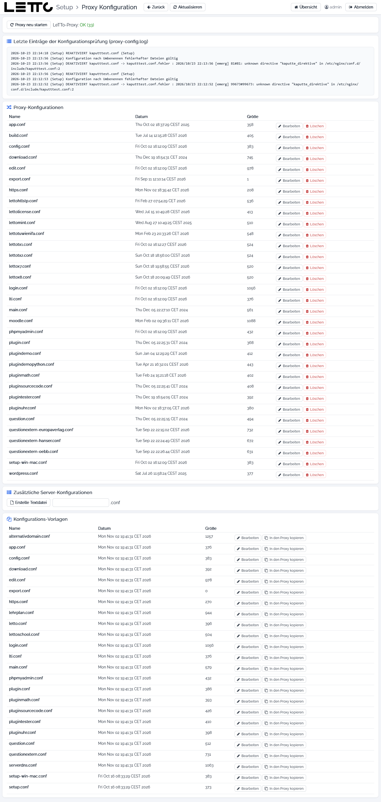

# Setup-Service: Proxy-Konfiguration

Aufruf: Button **Proxy Konfiguration** in der Zeile „Proxy“ im Tab [Services](../Services/index.md).

Der Reverse-Proxy `letto-proxy` (nginx) nimmt alle Anfragen an `https://<server>/…` an und leitet sie an die Container
weiter. Für jeden Service, jede Schule und jedes Plugin gibt es eine Konfigurationsdatei in
`/opt/letto/docker/proxy`. Auf dieser Seite werden diese Dateien verwaltet. Änderungen wirken erst nach
**Proxy neu starten**.

## Buttons oben

| Element | Wirkung |
|---|---|
| Zurück | in der Kopfzeile: zurück zur Hauptseite |
| Aktualisieren | in der Kopfzeile: Liste neu laden |
| Proxy neu starten | prüft zuerst die Konfiguration, startet den Proxy neu und wartet, bis er wieder funktioniert (siehe unten); die Ausgabe erscheint in der [Befehlsausgabe](../Befehlsausgabe/index.md) |
| LeTTo-Proxy | Zustand des Proxy; in Klammern die Anzahl der Konfigurationsdateien |

## Fehlerhafte Konfigurationsdateien

Eine fehlerhafte Datei würde nginx am Start hindern – damit wären alle Schulen und das Setup selbst nicht mehr über
`https://<server>/…` erreichbar. Deshalb gilt bei jedem Start und Neustart des Proxy:

* Die Konfiguration wird mit `nginx -t` geprüft. Jede fehlerhafte Datei in `/opt/letto/docker/proxy` oder
  `/opt/letto/docker/proxy/servers` wird in `<datei>.fehler` umbenannt (z. B. `edit.conf` → `edit.conf.fehler`), bis
  die übrige Konfiguration gültig ist. Der Proxy startet dann ohne diese Dateien.
* Das passiert sowohl, wenn das Setup den Proxy neu startet, als auch beim Start des Containers selbst (Server-Neustart,
  `docker restart letto-proxy`).
* Jede Umbenennung steht mit Zeitpunkt und nginx-Fehlermeldung in `/opt/letto/docker/storage/log/proxy/proxy-config.log`.
* Nach einem Restart über das Setup wird bis zu 5 Minuten gewartet, bis der Proxy `check.txt` ausliefert und das Setup
  über den Proxy erreichbar ist.

Gibt es deaktivierte Dateien, zeigt die Seite die Karte **Deaktivierte Konfigurationsdateien**:

| Element | Wirkung |
|---|---|
| Datei, Deaktiviert am | Name der umbenannten Datei und Zeitpunkt |
| Aktivieren und neu starten | entfernt die Endung `.fehler` und startet den Proxy neu (mit Rückfrage). Ist die Datei noch fehlerhaft, wird sie dabei wieder deaktiviert |

Vorgehen: die Datei `….conf.fehler` am Server bzw. im [Explorer](../Explorer/index.md) korrigieren, dann
**Aktivieren und neu starten**. Die Karte **Letzte Einträge der Konfigurationsprüfung** zeigt die letzten Zeilen von
`proxy-config.log`. Nicht umbenannt wird `https.conf` (Zertifikat) – ein Fehler dort oder in `default.conf` wird nur
gemeldet.

## Proxy-Konfigurationen

Die aktiven Dateien in `/opt/letto/docker/proxy`, z. B. `login.conf`, `config.conf` (Setup), `letto<schule>.conf`,
`plugin<name>.conf`, `https.conf`.

| Button | Wirkung |
|---|---|
| Bearbeiten | öffnet die Datei im [Datei-Editor](../Datei-Editor/index.md) |
| Löschen | löscht die Datei (mit Rückfrage); nach dem Neustart des Proxy ist der Service nicht mehr erreichbar |

## Zusätzliche Server-Konfigurationen

Eigene Server-Blöcke in `/opt/letto/docker/proxy/servers`, z. B. für eine zusätzliche Domain. **Erstelle Textdatei**
legt eine leere Datei mit dem Namen aus dem Feld daneben (Endung `.conf`) an; vorhandene Dateien haben **Bearbeiten**
und **Löschen**.

## Konfigurations-Vorlagen

Die Vorlagen des Setup-Service in `/opt/letto/docker/proxy/templates`, z. B. `alternativdomain.conf`,
`lettoschool.conf`, `serverdns.conf`.

| Button | Wirkung |
|---|---|
| Bearbeiten | Vorlage im Editor ansehen oder ändern |
| In den Proxy kopieren | kopiert die Vorlage nach einer Rückfrage in das Proxy-Verzeichnis; eine Datei gleichen Namens wird dabei überschrieben |

## siehe auch

* [Https-Zertifikat](../../Https-Zertifikat/index.md)
* [Betreiben hinter einem Apache-Server](../../BetreibenhintereinemApache-Server/index.md)

Zurück zur Übersicht: [Setup-Service](../index.md)
