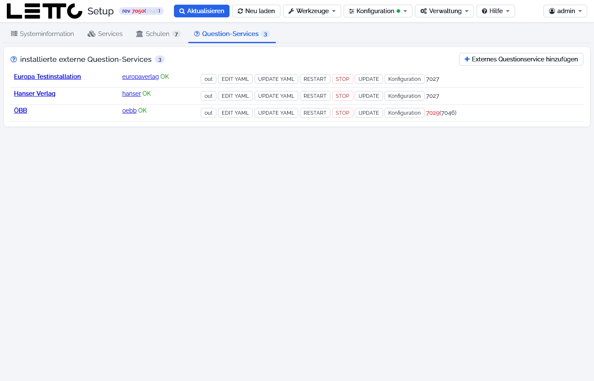

# Setup-Service: Tab Question-Services

Ein **externes Question-Service** ist ein eigener Container `letto-question-<name>` mit eigener Mongo-Datenbank, der
eine Fragesammlung unabhängig von einer Schule anbietet (z. B. für Verlage). Der Tab **Question-Services** der
[Hauptseite](../Hauptseite/index.md) listet sie in der Karte **installierte externe Question-Services**; die Zahl im Tab
ist ihre Anzahl. An einem normalen Schulserver ist die Liste leer
(„Auf diesem Server sind keine externen Question-Services installiert.“).

## Anzeige und Buttons je Question-Service

| Element | Bedeutung |
|---|---|
| Bezeichnung, Name | Link auf die Adresse des Question-Service |
| Status | **OK** oder Fehler, dahinter die Revision (rot = nicht aktuell, in Klammern die verfügbare) |
| out | Log des Containers (`docker logs letto-question-<name>`) |
| EDIT YAML | Compose-Datei `docker-questionextern-<name>.yml` im [Datei-Editor](../Datei-Editor/index.md) |
| UPDATE YAML | Compose-Datei aus der Vorlage neu erzeugen |
| RESTART | Container neu starten |
| STOP | Container stoppen (mit Rückfrage) |
| UPDATE | Image neu laden und Container neu starten |
| Konfiguration | öffnet die Seite [Externes Questionservice](../Externes-Questionservice/index.md) |

Der Button **Externes Questionservice hinzufügen** öffnet dieselbe Seite zum Anlegen eines neuen Question-Service.
Er wird nur angezeigt, wenn schon ein Question-Service existiert oder der Server ein LeTTo-Server (`letto.at`) bzw.
`localhost` ist.

Weiter: [Tab Services](../Services/index.md) · [Tab Schulen](../Schulen/index.md) ·
Zurück zur Übersicht: [Setup-Service](../index.md)
