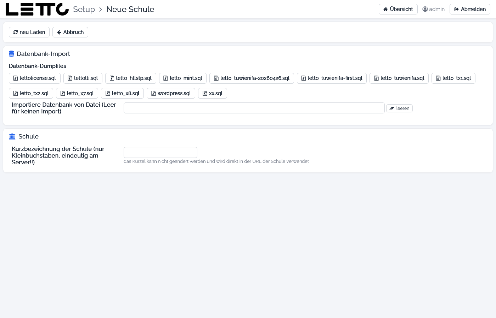
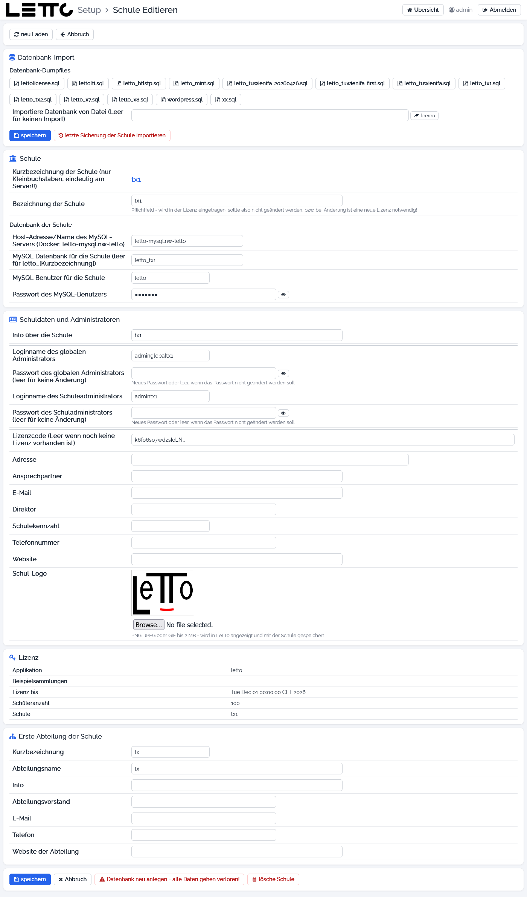
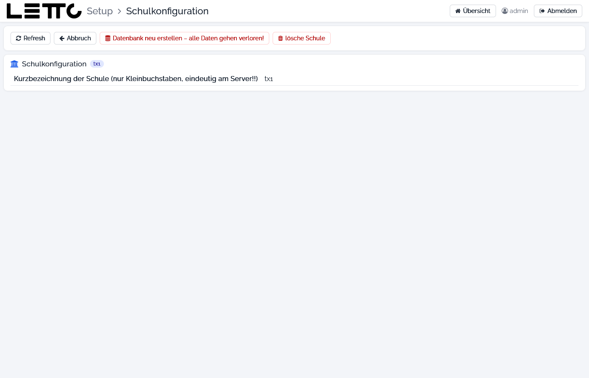

# Setup-Service: Schule anlegen und bearbeiten

Aufruf im Tab [Schulen](../Schulen/index.md) der Hauptseite:

* **Schule hinzufügen** – legt eine neue Schule an (Seite **Neue Schule**),
* **edit Daten** bei einer Schule – ändert eine bestehende Schule (Seite **Schule Editieren**).

Eine Schule besteht aus Einträgen `LETTO_<n>_…` in der `.env`, einer MySQL-Datenbank `letto_<schule>`, den Containern
`letto-server-<schule>` und `letto-data-<schule>` mit ihren Compose-Dateien und einer Proxy-Konfiguration. Beim Anlegen
erstellt das Setup das alles, holt Restkey und Lizenz vom Lizenzserver (oder verwendet eine Demo-Lizenz) und startet
die Container. Alle Aktionen laufen im Hintergrund und zeigen die [Befehlsausgabe](../Befehlsausgabe/index.md).

Eine Anleitung für die Installation einer Schule steht unter
[Schulinstallation](../../../../howto/admin/install/schulinstallation/index.md).

## Neue Schule

Zuerst wird das **Kürzel** eingegeben und gewählt, ob eine bestehende Datenbank importiert werden soll. Abhängig davon
blendet die Seite die weiteren Felder und Buttons ein und warnt z. B., wenn die Schule oder die Datenbank schon existiert
oder die Verbindung zum Datenbank-Server fehlschlägt.

### Datenbank-Import

| Element | Beschreibung |
|---|---|
| Datenbank-Dumpfiles | je Dump in `/opt/letto/docker/storage/database-dump` ein Button; ein Klick übernimmt den Dateinamen (bei `letto_<kürzel>.sql` auch das Kürzel). Eigene Dumps werden über die [Datensicherung](../Datensicherung/index.md) oder den [Explorer](../Explorer/index.md) dorthin gebracht |
| Importiere Datenbank von Datei (Leer für keinen Import) | Dump, der in die neue Schule importiert wird; **leeren** = ohne Import, die Schule startet mit leerer Datenbank |
| Neu anlegen und Datenbank importieren | Schule anlegen und den gewählten Dump importieren |
| Neu anlegen und bestehende Datenbank weiterverwenden | Schule auf einer bereits vorhandenen Datenbank `letto_<kürzel>` anlegen |
| Neu anlegen und bestehende Datenbank löschen | derzeit nicht umgesetzt |

### Schule

| Feld | Beschreibung |
|---|---|
| Kurzbezeichnung der Schule (nur Kleinbuchstaben, eindeutig am Server!!) | Kürzel aus Kleinbuchstaben, Ziffern und `-`, mindestens 2 Zeichen. Es ist Teil der Adresse der Schule (`https://<server>/letto<kürzel>`) und kann später nicht geändert werden |
| Bezeichnung der Schule | Pflichtfeld; wird in die Lizenz eingetragen – eine spätere Änderung erfordert eine neue Lizenz |

Die übrigen Karten (Schuldaten und Administratoren, Erste Abteilung) sind dieselben wie bei **Schule Editieren**. Beim
Anlegen gilt zusätzlich:

* Loginname des globalen Administrators leer = `adminglobal<kürzel>`, des Schuladministrators leer = `admin<kürzel>`.
* Die Passwörter sind mit zufälligen Passwörtern vorbelegt (mindestens 10 Zeichen) – vor dem Anlegen notieren.
* Datenbank-Benutzer und -Passwort werden automatisch gesetzt.

Der Button **hinzufügen** am Ende legt die Schule an, **Abbruch** kehrt zur Hauptseite zurück.

## Schule Editieren

### Buttons oben und Datenbank-Import

| Element | Wirkung |
|---|---|
| neu Laden | Daten neu aus der Datenbank laden |
| Abbruch | zurück zur Hauptseite |
| Datenbank-Dumpfiles, Importiere Datenbank von Datei | wie bei Neue Schule |
| speichern | Änderungen speichern |
| letzte Sicherung der Schule importieren | spielt den letzten Dump `letto_<kürzel>.sql` der Schule ein – **alle Änderungen seit der Sicherung gehen verloren** (mit Rückfrage) |
| Datenbank importieren | spielt den gewählten Dump in die Schule ein und ersetzt deren Daten (mit Rückfrage; nur sichtbar, wenn ein Dump gewählt ist) |

### Schule

| Feld | Beschreibung |
|---|---|
| Kurzbezeichnung der Schule | Kürzel (nicht änderbar) |
| Bezeichnung der Schule | Name der Schule, steht in der Lizenz |
| Host-Adresse/Name des MySQL-Servers | Datenbank-Server, bei Docker `letto-mysql.nw-letto` (nur Anzeige) |
| MySQL Datenbank für die Schule | Name der Datenbank, normalerweise `letto_<kürzel>` (nur Anzeige) |
| MySQL Benutzer für die Schule, Passwort des MySQL-Benutzers | Zugang der Schule zur Datenbank (nur Anzeige) |

### Schuldaten und Administratoren

| Feld | Beschreibung |
|---|---|
| Info über die Schule | Beschreibung; leer = Bezeichnung der Schule |
| Loginname des globalen Administrators | Benutzer mit globalen Rechten der Schule (darf auch ins Setup) |
| Passwort des globalen Administrators (leer für keine Änderung) | neues Passwort, mindestens 10 Zeichen |
| Loginname des Schuleadministrators | Administrator der Schule |
| Passwort des Schuladministrators (leer für keine Änderung) | neues Passwort, mindestens 10 Zeichen |
| Lizenzcode (Leer wenn noch keine Lizenz vorhanden ist) | Lizenzcode der Schule; wird normalerweise vom Lizenzserver geholt (**LICENSE** im Tab [Schulen](../Schulen/index.md)) |
| Adresse, Ansprechpartner, E-Mail, Direktor, Schulekennzahl, Telefonnummer, Website | Stammdaten der Schule |
| Schul-Logo | Logo, das in LeTTo angezeigt wird: PNG, JPEG oder GIF bis 2 MB; ohne eigenes Logo wird das LeTTo-Logo verwendet |

### Lizenz

Anzeige der aktuellen Lizenz: Applikation, Beispielsammlungen, Lizenz bis, Schüleranzahl und Schule.

### Erste Abteilung der Schule

Kurzbezeichnung, Abteilungsname, Info, Abteilungsvorstand, E-Mail, Telefon und Website der ersten Abteilung. Bleibt die
Kurzbezeichnung leer, wird eine Abteilung mit Kürzel und Namen der Schule angelegt.

### Buttons unten

| Button | Wirkung |
|---|---|
| speichern | Änderungen in der Schul-Datenbank (und Name/Lizenz in der `.env`) speichern |
| Abbruch | zurück, ohne zu speichern |
| Datenbank neu anlegen - alle Daten gehen verloren! | löscht die Datenbank der Schule und legt sie leer neu an (mit Rückfrage) |
| lösche Schule | stoppt die Container und entfernt die Schule mit ihren Dateien und Einträgen in der `.env`; die `.env` wird vorher gesichert (mit Rückfrage) |

Vor dem Löschen oder Neuanlegen einen Dump erstellen (**erzeuge SQL-Dump** im Tab [Schulen](../Schulen/index.md)).

## Schulkonfiguration

Der Button **Konfiguration** im Tab [Schulen](../Schulen/index.md) öffnet die Seite **Schulkonfiguration**. Sie ist für
weitere Einstellungen der Schule vorgesehen, zeigt derzeit aber nur das Kürzel. Die Buttons
**Datenbank neu erstellen – alle Daten gehen verloren!** und **lösche Schule** haben hier noch keine Funktion – dafür
die Seite **Schule Editieren** verwenden. **Refresh** lädt die Seite neu, **Abbruch** führt zur Hauptseite.

Zurück zur Übersicht: [Setup-Service](../index.md)
