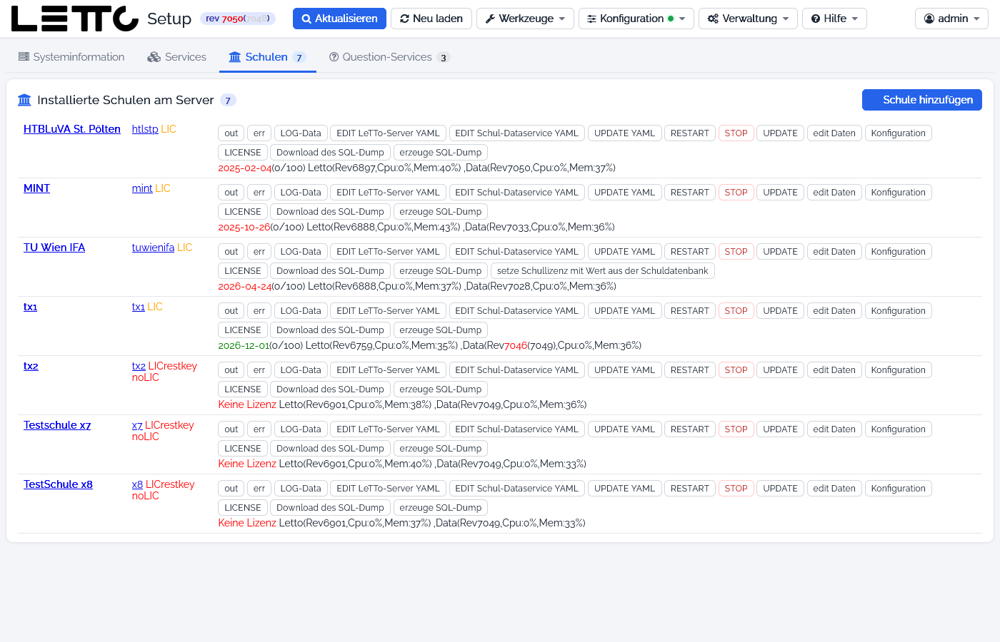

# Setup-Service: Tab Schulen

Der Tab **Schulen** der [Hauptseite](../Hauptseite/index.md) zeigt in der Karte **Installierte Schulen am Server** alle
Schulen dieses Servers. Die Zahl im Tab ist die Anzahl der Schulen. Jede Schule besteht aus zwei Containern:
dem LeTTo-Server `letto-server-<schule>` und dem Data-Service `letto-data-<schule>`.

## Anzeige je Schule

| Element | Bedeutung |
|---|---|
| Schulname | Bezeichnung der Schule, Link auf die Schule (`https://<server>/letto<schule>`) |
| Kürzel | Kurzbezeichnung der Schule, ebenfalls ein Link |
| LIC | Lizenzstatus; z. B. `LICrestkey noLIC`, wenn Restkey oder Lizenz fehlen |
| Datum (x/y) | Ablaufdatum der Lizenz – grün, orange (läuft in weniger als 20 Tagen ab) oder rot (abgelaufen) – und in Klammern die vergebenen/erlaubten Schülerlizenzen; **Keine Lizenz**, wenn die Schule keinen Lizenzcode hat |
| Letto(Rev…) / Data(Rev…) | Revision, CPU- und Speicherauslastung der beiden Container; rot = nicht die aktuelle Revision (in Klammern die verfügbare) |

## Buttons je Schule

| Button | Wirkung |
|---|---|
| out | Ausgabe-Log des LeTTo-Servers der Schule |
| err | Fehler-Log des LeTTo-Servers der Schule |
| LOG-Data | Log des Data-Service (`docker logs letto-data-<schule>`) |
| EDIT LeTTo-Server YAML | Compose-Datei `docker-lettoserver-<schule>.yml` im [Datei-Editor](../Datei-Editor/index.md) |
| EDIT Schul-Dataservice YAML | Compose-Datei `docker-data-<schule>.yml` im Editor |
| UPDATE YAML | erzeugt beide Compose-Dateien der Schule neu aus den Vorlagen (eigene Änderungen gehen verloren) |
| RESTART | startet beide Container der Schule neu |
| STOP | stoppt und entfernt beide Container – die Schule ist danach nicht erreichbar (keine Rückfrage) |
| UPDATE | lädt die Images neu und startet beide Container neu |
| edit Daten | öffnet [Schule bearbeiten](../Schule-bearbeiten/index.md): Schuldaten, Administratoren, Lizenz, Datenbank importieren, Schule löschen |
| Konfiguration | öffnet die [Schulkonfiguration](../Schule-bearbeiten/index.md#schulkonfiguration) (derzeit nur eine Platzhalterseite) |
| LICENSE | holt die Lizenz der Schule neu vom Lizenzserver |
| Download des SQL-Dump | lädt den zuletzt erstellten Dump `letto_<schule>.sql` herunter (nur wenn vorhanden) |
| erzeuge SQL-Dump | erstellt einen Dump der Schul-Datenbank in `/opt/letto/docker/storage/database-dump`; der Server der Schule wird dafür kurz gestoppt (mit Rückfrage) |

Nur bei Bedarf erscheinen außerdem:

| Button | Wann |
|---|---|
| Benutzer anlegen / Benutzer und Datenbank anlegen / Datenbank anlegen / Passwort setzen | Datenbank-Benutzer oder Datenbank der Schule fehlen bzw. das Passwort stimmt nicht mit `LETTO_<n>_MYSQL_*` der `.env` überein |
| Datenbank auf 6500 patchen | die Datenbank hat die Änderungen der Version 6500 noch nicht |
| setze Restkey mit Wert aus der Schuldatenbank / setze Restkey in der Datenbank mit setup-restkey | Restkey in `.env` und Schul-Datenbank sind verschieden – gleicht in die angegebene Richtung ab |
| setze Schullizenz mit Wert aus der Schuldatenbank / setze Schullizenz in der Datenbank mit Wert aus letto env-Datei | Lizenz in `.env` und Schul-Datenbank sind verschieden |

## Schule hinzufügen

Der Button **Schule hinzufügen** oben rechts öffnet [Schule bearbeiten](../Schule-bearbeiten/index.md) im Modus
„Neue Schule“. Ohne Schulen steht hier „Auf diesem Server sind noch keine Schulen installiert.“

## siehe auch

* Sicherung und Wiederherstellung der Schul-Datenbanken: [Datenbanken](../Datenbanken/index.md), [Datensicherung](../Datensicherung/index.md)
* [Tab Services](../Services/index.md) · [Tab Question-Services](../Question-Services/index.md)

Zurück zur Übersicht: [Setup-Service](../index.md)
