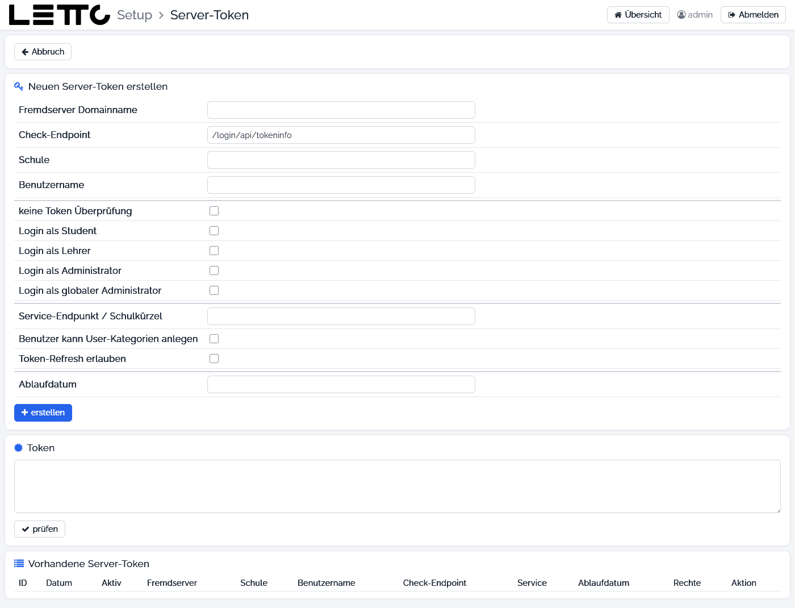

# Setup-Service: Server-Token

Aufruf: Menü **Konfiguration → Server-Token** auf der [Hauptseite](../Hauptseite/index.md).

Ein Server-Token erlaubt einem fremden Server, sich an diesem LeTTo-Server anzumelden – z. B. für die Verbindung
zweier Schulen oder für den Zugriff auf eine Fragesammlung. Die Tokens werden vom Login-Service (`letto-login`)
gespeichert und geprüft; er muss für diese Seite laufen.

## Buttons oben

| Button | Wirkung |
|---|---|
| Abbruch | zurück zur Hauptseite |

## Neuen Server-Token erstellen

| Feld | Bedeutung |
|---|---|
| Fremdserver Domainname | DNS-Name des entfernten Servers |
| Check-Endpoint | Endpunkt am Fremdserver, der den User-Token prüfen kann (Vorgabe `/login/api/tokeninfo`) |
| Schule | Schulkürzel der berechtigten Schule am Fremdserver |
| Benutzername | Benutzername des berechtigten Lehrers am Fremdserver |
| keine Token Überprüfung | der User-Token wird nicht am Fremdserver überprüft |
| Login als Student / Lehrer / Administrator / globaler Administrator | Rollen, mit denen die Anmeldung über diesen Token erfolgen darf |
| Service-Endpunkt / Schulkürzel | Endpunkt des Question-Service bei reinen Fragesammlungen oder Schulkürzel bei einer Schule-zu-Schule-Verbindung |
| Benutzer kann User-Kategorien anlegen | der Benutzer darf Benutzer-Kategorien anlegen |
| Token-Refresh erlauben | der Token darf verlängert werden |
| Ablaufdatum | Gültigkeitsdauer, z. B. `1y`, `30d` oder `hh:mm:ss`; leer = 1 Stunde |
| erstellen | erzeugt den Token; er erscheint im Feld **Token** |

## Token

Das Textfeld enthält den erzeugten oder geöffneten Token. Diesen Text am fremden Server eintragen.
**prüfen** testet den Token, indem damit eine Anmeldung versucht wird.

## Vorhandene Server-Token

Tabelle aller Tokens mit ID, Datum, Aktiv, Fremdserver, Schule, Benutzername, Check-Endpoint, Service, Ablaufdatum
und Rechten. Buttons je Token:

| Button | Wirkung |
|---|---|
| öffnen | übernimmt die Werte des Tokens in das Formular und das Feld Token |
| aktivieren / deaktivieren | schaltet den Token ein oder aus |
| löschen | löscht den Token (**ohne Rückfrage**); der fremde Server kann sich dann nicht mehr anmelden |

Zurück zur Übersicht: [Setup-Service](../index.md)
