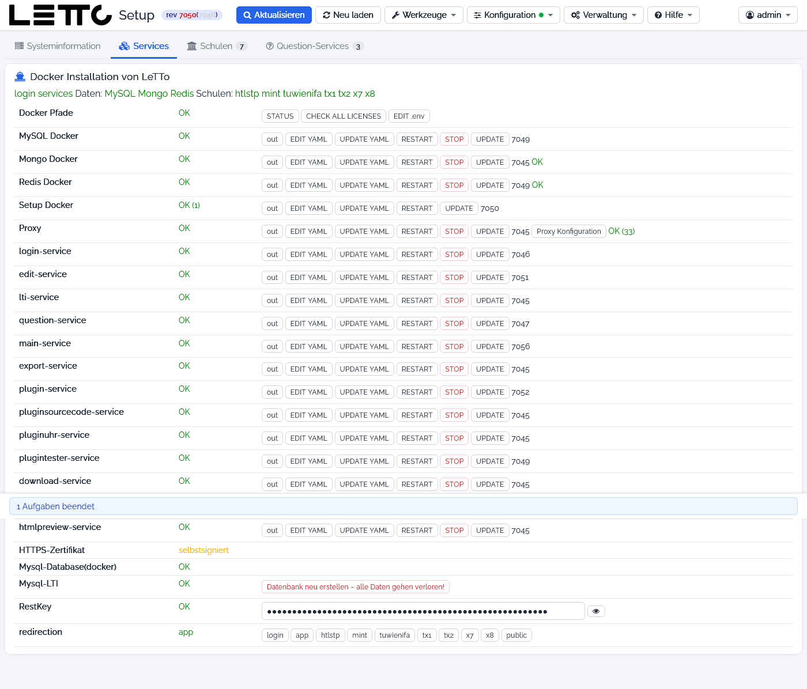

# Setup-Service: Tab Services

Der Tab **Services** der [Hauptseite](../Hauptseite/index.md) wird nach der Anmeldung angezeigt. Die Karte
**Docker Installation von LeTTo** listet alle Docker-Container von LeTTo mit ihrem Zustand und Buttons zum Starten,
Stoppen und Aktualisieren. Darüber steht eine Zeile mit allen Services, Datenbanken und Schulen – grün bedeutet
„läuft“, rot „Fehler“ oder „gestoppt“ (Details im Tooltip).

Alle Container-Befehle laufen als `docker compose …` im Verzeichnis `/opt/letto/docker/compose/letto` und zeigen ihren
Fortschritt in der [Befehlsausgabe](../Befehlsausgabe/index.md). Vor STOP fragt das Setup nach, alle anderen Buttons
wirken sofort.

## Spalten

| Spalte | Bedeutung |
|---|---|
| Name | Container bzw. Gruppe, z. B. MySQL Docker, Proxy, login-service |
| Status | **OK**, Fehler oder gestoppt (Details im Tooltip) |
| Buttons | Aktionen für diesen Container (siehe unten), dahinter die Revision des laufenden Images |

## Zeile Docker Pfade

| Button | Wirkung |
|---|---|
| Pfade erzeugen | nur sichtbar, wenn Verzeichnisse fehlen: legt `/opt/letto/docker` mit allen Unterverzeichnissen (`compose`, `proxy`, `storage` …) an |
| STATUS | öffnet den [Docker-Status](../Docker-Status/index.md) mit allen Containern, Netzwerken und Volumes |
| CHECK ALL LICENSES | holt für alle Schulen die Lizenz vom Lizenzserver und speichert sie in der `.env` und in den Schul-Datenbanken |
| EDIT .env | öffnet die zentrale Konfiguration `/opt/letto/docker/compose/letto/.env` im [Datei-Editor](../Datei-Editor/index.md) |

## Container-Zeilen

Für **MySQL Docker**, **Mongo Docker**, **Redis Docker**, **Setup Docker**, **Proxy** und jeden installierten Service
(z. B. `login-service`, `edit-service`, `lti-service`, `question-service`, `main-service`, `export-service`, die Plugins,
`download-service`, `app-service`, `htmlpreview-service`) gibt es dieselben Buttons:

| Button | Wirkung |
|---|---|
| out | zeigt das Log des Containers (`docker logs`) im [Datei-Editor](../Datei-Editor/index.md#datei-anzeigen) |
| EDIT YAML | öffnet die Compose-Datei des Containers (z. B. `docker-compose-mysql.yml`, `docker-service-login.yml`) im Editor |
| UPDATE YAML | ersetzt die Compose-Datei durch die aktuelle Vorlage aus dem Setup-Service; **eigene Änderungen in der Datei gehen verloren** |
| RESTART / START | startet den Container neu (`down`/`up`); START erscheint, wenn der Container nicht läuft |
| STOP | stoppt den Container nach einer Rückfrage (rot) – bei MySQL, Mongo, Redis oder Proxy fallen damit alle Schulen aus |
| UPDATE | lädt das Image mit dem Tag aus der Compose-Datei (`pull`) und startet den Container neu |
| Proxy Konfiguration | nur beim Proxy: öffnet die [Proxy-Konfiguration](../Proxy-Konfiguration/index.md) |

Besonderheiten beim **Setup Docker**: RESTART und UPDATE starten das Setup über einen Hilfscontainer selbst neu. Die
Sitzung geht dabei verloren – nach etwa 20 Sekunden die Seite neu laden und neu anmelden. Einen STOP-Button gibt es beim
Setup nicht, weil sich das Setup nicht selbst stoppen kann.

Welche Version (Tag) ein Container verwendet, wird auf der Seite [Update-Konfiguration](../Update-Konfiguration/index.md)
eingestellt. Dort können auch alle Container auf einmal aktualisiert werden.

## Weitere Zeilen

| Zeile | Anzeige und Buttons |
|---|---|
| HTTPS-Zertifikat | **OK**, **selbstsigniert** (z. B. bei `localhost`) oder nicht gesetzt. **CREATE lets encrypt CERTIFICATE** erstellt ein neues Zertifikat für `SERVER_NAME` und `DOMAIN_ALTERNATIV` aus der `.env`, **RENEW lets encrypt CERTIFICATE** erneuert ein vorhandenes; beides nur, wenn der Server nicht `localhost` heißt und der Proxy läuft. Siehe [Https-Zertifikat](../../Https-Zertifikat/index.md) |
| Mysql-Database(docker) | Zustand des MySQL-Containers; **RESET ROOT** (nur bei fehlerhaftem root-Login) setzt das root-Passwort auf `MYSQL_ROOT_PASSWORD` aus der `.env` zurück |
| Mysql-LTI | Zustand der LTI-Datenbank; je nach Zustand **Benutzer anlegen**, **Benutzer und Datenbank anlegen**, **Datenbank anlegen**, **Passwort setzen** (Werte `MYSQL_LTI_*` aus der `.env`) und **Datenbank neu erstellen – alle Daten gehen verloren!** (mit Rückfrage) |
| RestKey | **OK** und der Restkey (`LETTO_RESTKEY`, verdeckt, mit dem Auge-Symbol sichtbar). Der Restkey identifiziert den Server beim Lizenzserver. Fehlt er (**FAIL**), holt **Neuen Restkey erzeugen ( Server-Neuinstallation )** einen neuen vom Lizenzserver |
| redirection | Ziel der Startadresse `https://<server>/`: **login** (Anmeldeseite), **app**, eine Schule (Kürzel) oder **public** (öffentliche Seite). Setzt `REDIRECT` in der `.env` und startet den Proxy neu |

## Hinweise

* Änderungen in der `.env` oder in einer Compose-Datei wirken erst nach RESTART des betroffenen Containers.
* Die Datenbank-Container werden bei „Update all“ nicht aktualisiert. Ein Versionswechsel der Datenbanken erfolgt
  über die Seite [Datenbanken](../Datenbanken/index.md).

Weiter: [Tab Schulen](../Schulen/index.md) · [Tab Question-Services](../Question-Services/index.md) ·
Zurück zur Übersicht: [Setup-Service](../index.md)
