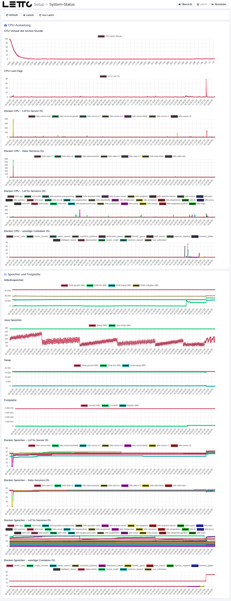

# Setup-Service: System-Status

Aufruf: Menü **Verwaltung → System-Status** auf der [Hauptseite](../Hauptseite/index.md) oder Button **Verlauf** im Tab
Systeminformation.

Der System-Status zeigt den Verlauf der Auslastung des Servers in Diagrammen. Das Setup-Service schreibt die Werte
laufend in `/opt/letto/docker/storage/log/setup/system-status.log`. Damit lässt sich z. B. erkennen, ob ein Server zu
wenig Speicher hat oder welcher Container die CPU belastet.

## Buttons

| Button | Wirkung |
|---|---|
| Refresh, neu Laden | Diagramme neu laden |
| zurück | zurück zur Hauptseite |

## CPU-Auslastung

| Diagramm | Inhalt |
|---|---|
| CPU-Verlauf der letzten Stunde | CPU-Last des Hosts in Prozent |
| CPU-Last (Tag) | CPU-Last des Hosts über den Tag |
| Docker-CPU – LeTTo-Server (%) | CPU-Last der LeTTo-Server der Schulen |
| Docker-CPU – Data-Services (%) | CPU-Last der Data-Services der Schulen |
| Docker-CPU – LeTTo-Services (%) | CPU-Last der übrigen LeTTo-Container (Login, Edit, Proxy, Datenbanken, Plugins …) |
| Docker-CPU – sonstige Container (%) | CPU-Last aller anderen Container am Host |

Bei den Docker-Diagrammen bedeutet 100 % eine voll ausgelastete CPU; ein Container kann mehrere CPUs nutzen und damit
über 100 % liegen.

## Speicher und Festplatte

| Diagramm | Inhalt |
|---|---|
| Arbeitsspeicher | RAM gesamt, frei, belegt und verfügbar (MB) |
| Java-Speicher | belegter Speicher und Java-Heap des Setup-Service (MB) |
| Swap | Swap gesamt, frei und belegt (MB) |
| Festplatte | Gesamt, Frei und Nutzbar (MB) |
| Docker-Speicher – … (%) | Speicherbelegung der Container im Verhältnis zu ihrem Limit, gruppiert wie bei der CPU |

Momentanwerte stehen auf der Seite [Host](../Host/index.md).

Zurück zur Übersicht: [Setup-Service](../index.md)
