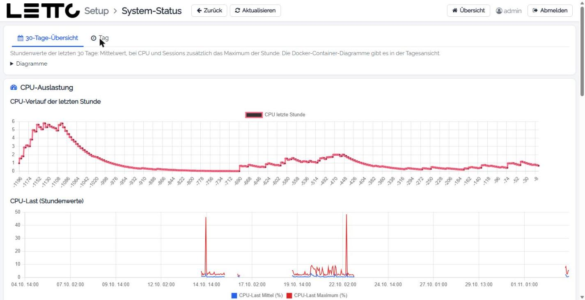
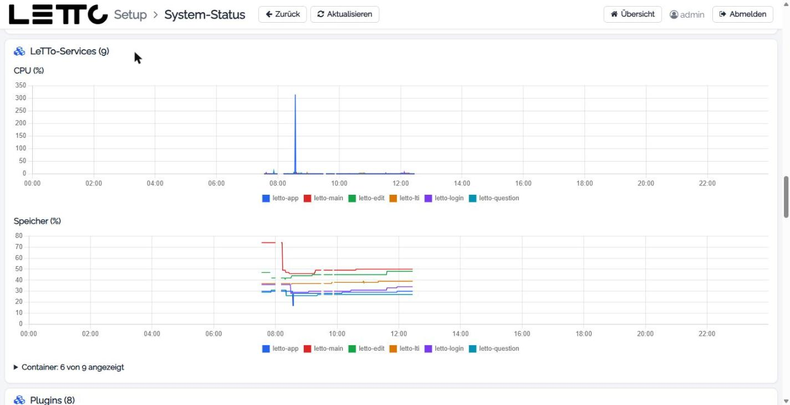

# Setup-Service: System-Status

Aufruf: Menü **Verwaltung → System-Status** auf der [Hauptseite](../Hauptseite/index.md) oder Button **Verlauf** im Tab
Systeminformation.

Der System-Status zeigt den Verlauf der Auslastung des Servers in Diagrammen: CPU, Arbeitsspeicher, Festplatte, die
Docker-Container und die Anzahl der aktiven Sessions pro Schule. Damit lässt sich z. B. erkennen, ob ein Server zu wenig
Speicher hat, welcher Container die CPU belastet oder zu welchen Zeiten eine Schule besonders viele Benutzer hat.

## Speicherung der Werte

Das Setup-Service misst jede Minute den Zustand des Servers und speichert ihn in der MongoDB (Datenbank `setup`,
Collection `systemstatus`).

- Die Werte der **letzten 30 Tage** bleiben erhalten. Ältere Werte löscht MongoDB selbst (TTL-Index
  `idx_systemstatus_time_ttl`), es ist keine Pflege nötig.
- Gespeichert werden CPU-Last, RAM, Swap, Java-Speicher, Festplatte, je Docker-Container CPU und Speicher in Prozent sowie
  die Anzahl der aktiven Sessions je Schule. Als aktiv zählt jede Session mit `active=true` in der Collection `sessions`
  der Datenbank `letto` (auch Lehrer und Gäste; es werden Sessions gezählt, nicht verschiedene Benutzer).
- Ist die MongoDB gerade nicht erreichbar, wird die Messung dieser Minute verworfen. Es entsteht eine Lücke im Diagramm,
  das Setup-Service läuft normal weiter.
- Bis zur Version 1.3 wurden die Werte in Tagesdateien (`system-status.log`, 5 Tage) gespeichert. Beim ersten Start der neuen
  Version werden diese Dateien einmalig in die MongoDB übernommen, danach werden sie nicht mehr geschrieben. Der TTL-Index
  wird dabei automatisch angelegt; er steht auch in der Liste der Indizes bei der Datenbankprüfung.

## Bedienung

Die Seite wird sofort angezeigt, die Diagrammdaten werden anschließend aus der MongoDB nachgeladen. Der Status
(„Daten werden geladen …“, Fehler oder „keine Daten“) steht unter dem Umschalter.

| Element | Wirkung |
|---|---|
| Zurück | in der Kopfzeile: zurück zur Hauptseite |
| Aktualisieren | in der Kopfzeile: Seite neu laden |
| Reiter **30-Tage-Übersicht** | Stundenwerte der letzten 30 Tage |
| Reiter **Tag** | Minutenwerte eines Tages |
| Datum, Pfeile, **Heute** | im Reiter Tag: Tag wählen bzw. einen Tag vor oder zurück; wählbar sind die letzten 30 Tage |
| **Diagramme** | Gruppen ein- oder ausblenden (CPU, Arbeitsspeicher und Swap, Festplatte, Sessions pro Schule, Docker-Container) |

Der zuletzt gewählte Reiter und Tag bleiben beim Aktualisieren erhalten, die Auswahl der Diagramm-Gruppen, der Schulen und
der Container im Browser auch nach dem Schließen der Seite.

## 30-Tage-Übersicht

Die Übersicht fasst die Minutenwerte zu Stundenwerten zusammen und lädt dadurch auch bei 30 Tagen schnell.

| Diagramm | Inhalt |
|---|---|
| CPU-Last (Stundenwerte) | Mittelwert und Maximum der CPU-Last des Hosts je Stunde |
| Arbeitsspeicher, Java-Speicher, Swap | Mittelwerte je Stunde in MB |
| Festplatte | Gesamt, Frei und Nutzbar in MB |
| Aktive Sessions (Maximum je Stunde) | Summe aller Schulen und ausgewählte Schulen |

Die Diagramme der Docker-Container gibt es nur in der Tagesansicht.

## Tagesansicht

Die Tagesansicht zeigt dieselben Diagramme mit **Minutenwerten**. Zusätzlich gibt es die Docker-Container. Lücken, z. B. weil
der Server nicht lief, bleiben als Unterbrechung der Linie sichtbar.

Über den Diagrammen steht außerdem der **CPU-Verlauf der letzten Stunde** (Sekundenwerte des Hosts). Dieses Diagramm kommt
aus dem Speicher des Setup-Service und beginnt nach einem Neustart wieder bei null.

### Sessions pro Schule

Das Diagramm zeigt die Summe aller Schulen als dicke Linie und dazu einzelne Schulen. Damit es übersichtlich bleibt, werden
anfangs die **5 Schulen mit den meisten Sessions** gezeigt. Unter dem Diagramm wählt man über **Schulen: x von y angezeigt**
andere Schulen aus oder nimmt mit **Top 5**, **alle** und **keine** schnell eine Auswahl vor. Die Schule `config` ist die
Anmeldung am Setup-Service selbst.

### Docker-Container

Die Container sind in Gruppen aufgeteilt, jede Gruppe hat eine eigene Karte mit je einem Diagramm für CPU und Speicher:

| Gruppe | Container |
|---|---|
| Infrastruktur | `letto-mysql`, `letto-mongo`, `letto-redis`, `letto-proxy`, `letto-setup`, `letto-download` |
| LeTTo-Services | übrige `letto-…`-Container (Main, Login, Edit, Question, Export, LTI, App …) |
| Plugins | `letto-plugin…` |
| Externe Question-Services | `letto-question-…` |
| Schulen – Data-Services | `letto-data-…` |
| Schulen – LeTTo-Server | `letto-server-…` |
| Sonstige Container | alle anderen Container am Host |

Jede Gruppe zeigt anfangs die **6 Container mit der höchsten Last** des Tages. Mit **Container: x von y angezeigt** wählt man
weitere Container dazu oder blendet welche aus; **Top 5**, **alle** und **keine** setzen die Auswahl schnell.

- **CPU (%)**: 100 % bedeutet eine voll ausgelastete CPU; ein Container kann mehrere CPUs nutzen und damit über 100 % liegen.
- **Speicher (%)**: Speicherbelegung des Containers im Verhältnis zu seinem Limit.

## Speicher und Festplatte

| Diagramm | Inhalt |
|---|---|
| Arbeitsspeicher | RAM gesamt, frei, belegt und verfügbar (MB) |
| Java-Speicher | belegter Speicher und Java-Heap des Setup-Service (MB) |
| Swap | Swap gesamt, frei und belegt (MB) |
| Festplatte | Gesamt, Frei und Nutzbar (MB) |

Momentanwerte stehen auf der Seite [Host](../Host/index.md).

## Fehlersuche

| Beobachtung | Ursache und Abhilfe |
|---|---|
| „Die Daten konnten nicht geladen werden.“ | MongoDB nicht erreichbar oder die Sitzung ist abgelaufen: Seite neu laden, bei Bedarf neu anmelden und den Container `letto-mongo` prüfen |
| „Für diesen Zeitraum liegen keine Daten vor.“ | für den gewählten Tag wurde nichts gespeichert, z. B. weil das Setup-Service oder die MongoDB nicht lief |
| Keine Sessions im Diagramm | an dem Tag waren keine Sessions aktiv, oder `letto.sessions` war nicht lesbar (dann fehlen die Werte nur für diese Minuten) |
| Auswahl der Schulen oder Container wie zurückgesetzt | die Auswahl liegt im Browser (lokaler Speicher) und gilt je Browser und Rechner |

Zurück zur Übersicht: [Setup-Service](../index.md)
