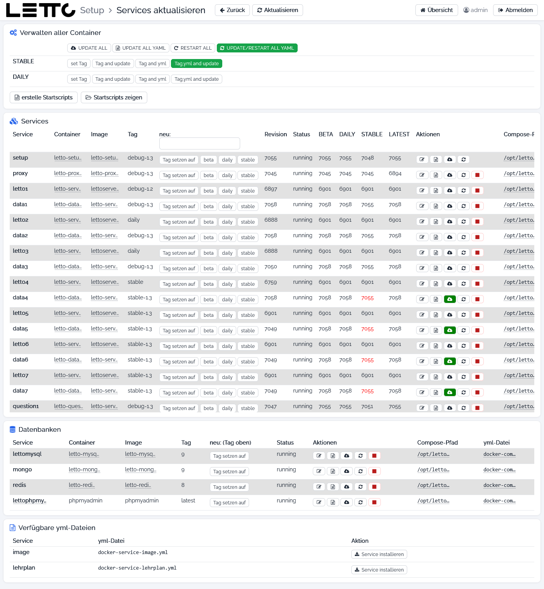

# Setup-Service: Update-Konfiguration

Aufruf: Menü **Konfiguration → Update-Konfiguration** auf der [Hauptseite](../Hauptseite/index.md). Ist ein Update
verfügbar, ist der Menüeintrag hervorgehoben. Die Seite heißt **Services aktualisieren**.

Jeder Container verwendet ein Image `lettohub/<image>:<tag>`. Der Tag steht in der `image:`-Zeile seiner
Compose-Datei und bestimmt, welche Version beim nächsten Update geladen wird:

| Tag | Bedeutung |
|---|---|
| `stable-1.3` | getestete Version – für Schulen empfohlen |
| `daily-1.3` | tägliche Entwicklungsversion |
| `beta-1.3` | Vorabversion zum Testen |

Auf dieser Seite werden die Tags gesetzt und alle oder einzelne Container aktualisiert. Eine Schritt-für-Schritt-Anleitung
steht unter [Update](../../Update/index.md).

## Kopfzeile

| Button | Wirkung |
|---|---|
| zurück | zurück zur Hauptseite |
| Refresh | Versionsinformationen neu laden (beim ersten Aufruf kann das einige Minuten dauern – „Daten werden geladen“) |

## Verwalten aller Container

| Button | Wirkung |
|---|---|
| UPDATE ALL | lädt für alle Container außer den Datenbanken (MySQL, Mongo, Redis) die Images neu und startet sie neu: Plugins, Schulen, externe Question-Services, Services, Proxy; am Ende startet sich das Setup neu |
| UPDATE ALL YAML | bringt alle Compose-Dateien auf den Stand der Vorlagen des Setup-Service; danach ist ein Neustart nötig |
| RESTART ALL | startet alle Container außer den Datenbanken neu, am Ende auch das Setup |
| UPDATE/RESTART ALL YAML | grün, wenn ein Update verfügbar ist – der empfohlene Weg für ein vollständiges Update: aktualisiert zuerst das Setup selbst, dann alle Compose-Dateien, alle Container und die Startskripte und prüft die Datenbanken. Nach dem Neustart des Setups neu anmelden, das Update läuft dann automatisch weiter. Benötigt etwa 20 GB freien Platz |

Die Zeilen **STABLE** und **DAILY** setzen den Tag aller Services (nicht der Datenbanken) auf `stable-1.3` bzw.
`daily-1.3`:

| Button | Wirkung |
|---|---|
| set Tag | nur den Tag in allen Compose-Dateien setzen |
| Tag and update | Tag setzen und alle Container aktualisieren |
| Tag and yml | Tag setzen und alle Compose-Dateien aus den Vorlagen erneuern |
| Tag,yml and update | Tag setzen, Compose-Dateien erneuern und alle Container aktualisieren (grün, wenn ein Update verfügbar ist) |

| Button | Wirkung |
|---|---|
| erstelle Startscripts | erzeugt Skripte zum Starten, Stoppen, Neustarten und Aktualisieren jedes Containers in `/opt/letto/docker/scripts/linux` und `/opt/letto/docker/scripts/windows` |
| Startscripts zeigen | öffnet das Skript-Verzeichnis im [Explorer](../Explorer/index.md) |

Länger laufende Aktionen öffnen die [Befehlsausgabe](../Befehlsausgabe/index.md). Diese Buttons wirken ohne Rückfrage –
vorher prüfen, ob gerade gearbeitet wird.

## Absicherung der Updates von Setup und Proxy

Setup und Proxy sind die beiden Container, ohne die ein Server nicht mehr konfigurierbar ist. Deren Updates und
Neustarts sind deshalb abgesichert – das gilt für die einzelnen Buttons UPDATE/RESTART in der Karte Services ebenso
wie für UPDATE ALL, RESTART ALL und UPDATE/RESTART ALL YAML.

**Proxy** (`letto-proxy`)

1. Vor dem Umschalten auf ein neues Image wird es probeweise als `letto-proxy-test` gestartet – mit einer Kopie der
   Konfiguration, ohne Ports. Liefert der Testcontainer `check.txt` nicht aus, bleibt der laufende Proxy unverändert, der
   Tag zeigt wieder auf das laufende Image und die Befehlsausgabe meldet den Grund.
2. Fehlerhafte Konfigurationsdateien werden deaktiviert, siehe [Proxy-Konfiguration](../Proxy-Konfiguration/index.md).
3. Funktioniert der Proxy nach dem Umschalten 5 Minuten lang nicht, geht das Setup automatisch auf das vorige Image
   (gleiche Image-ID) zurück.

**Setup** (`letto-setup`)

1. Vor dem Umschalten wird das neue Image als `letto-setup-test` im **Prüfmodus** gestartet: es bekommt die
   Verzeichnisse nur lesend, kein Netzwerk und nur den Docker-Socket, schreibt nichts und startet keine Aufgaben. Dabei
   wird auch geprüft, ob die Docker-Version im neuen Image mit dem Docker des Servers zusammenarbeitet.
2. Schlägt das fehl, wird das Update abgebrochen, das laufende Setup bleibt unverändert, und die Befehlsausgabe sagt,
   was zu tun ist – z. B. Docker am Server aktualisieren oder „Setup-Image passt nicht zu diesem Server, bitte an LeTTo
   melden“.
3. Das Umschalten übernimmt der Hilfscontainer `letto-setup-agent` (Image `lettohub/dockeragent`), weil sich das Setup
   dabei selbst beendet. Funktioniert das neue Setup nach 5 Minuten nicht, startet der Agent wieder das vorige Image.
4. Nach einem Rückweg oder Fehler zeigt die [Hauptseite](../Hauptseite/index.md) den Hinweis **Letztes Update/Restart des
   Setups nicht erfolgreich** mit dem Grund, bis er mit **Hinweis ausblenden** quittiert wird. Ein zurückgenommenes Image
   wird nicht erneut eingespielt, erst ein neueres. Beim UPDATE/RESTART ALL YAML werden die übrigen Container dann ohne
   Neustart des Setups aktualisiert.

**Login** (`letto-login`, für die Anmeldung aller Schulen): Funktioniert er nach einem Update oder Neustart 5 Minuten lang
nicht, startet das Setup wieder das vorige Image.

Spätestens nach etwa 10 Minuten ist das Setup in jedem Fall wieder erreichbar. Normale Updates dauern durch die
Testläufe nur rund 10 Sekunden länger.

| Datei | Inhalt |
|---|---|
| `/opt/letto/docker/storage/log/proxy/proxy-config.log` | deaktivierte Proxy-Dateien, Rückwege des Proxy |
| `/opt/letto/docker/storage/log/setup/setup-update.log` | Update/Restart des Setups durch den Agent (Zeiten in UTC) |
| `/opt/letto/docker/scripts/tmp/setup-update-ergebnis.txt` | Ergebnis des letzten Laufs (`.gelesen`, sobald der Hinweis ausgeblendet wurde) |
| `/opt/letto/docker/scripts/tmp/setup-update-abgelehnt.txt` | Image-IDs, die nach einem Update zurückgenommen wurden; eine Zeile löschen, um dieses Image doch wieder zuzulassen |

## Karte Services

Eine Zeile je Container (Setup, Proxy, Schulen `letto<n>`/`data<n>`, Question-Services, Services, Plugins):

| Spalte | Bedeutung |
|---|---|
| Service, Container, Image | Name, Containername und Image (gekürzt, ganzer Text im Tooltip) |
| Tag | aktueller Tag aus der Compose-Datei |
| neu: | **Tag setzen auf** setzt den Tag aus dem Eingabefeld im Spaltenkopf; **beta**, **daily**, **stable** setzen den jeweiligen Tag für diesen Container |
| Revision | Revision des laufenden Containers |
| Status | z. B. running |
| BETA, DAILY, STABLE, LATEST | verfügbare Revision je Tag; rot, wenn sie von der laufenden abweicht |
| Aktionen | Symbole für EDIT YAML, UPDATE YAML, UPDATE (grün, wenn ein Update verfügbar ist), RESTART und STOP (rot, mit Rückfrage; nicht beim Setup); bei Services, die entfernt werden dürfen, zusätzlich löschen (mit Rückfrage – stoppt den Service und löscht seine yml-Datei) |
| Compose-Pfad, yml-Datei | Verzeichnis und Compose-Datei des Containers |

## Karte Datenbanken

Dieselbe Tabelle für MySQL, Mongo, Redis und phpMyAdmin. Bei Datenbanken kann nur ein Tag von Hand gesetzt werden
(**Tag setzen auf**), beta/daily/stable sind gesperrt. Ein Versionswechsel einer Datenbank sollte über die Seite
[Datenbanken](../Datenbanken/index.md) erfolgen (mit Backup vorher).

## Verfügbare yml-Dateien

Services, die das Setup kennt, die aber noch nicht installiert sind (z. B. `image`, `lehrplan`). **Service
installieren** erzeugt die Compose-Datei `docker-service-<name>.yml` aus der Vorlage, legt bei Bedarf die
Proxy-Konfiguration an, startet den Service und den Proxy neu.

## siehe auch

* [Update](../../Update/index.md) – Ablauf eines Updates
* [Tab Services](../Services/index.md) – Update einzelner Container

Zurück zur Übersicht: [Setup-Service](../index.md)
