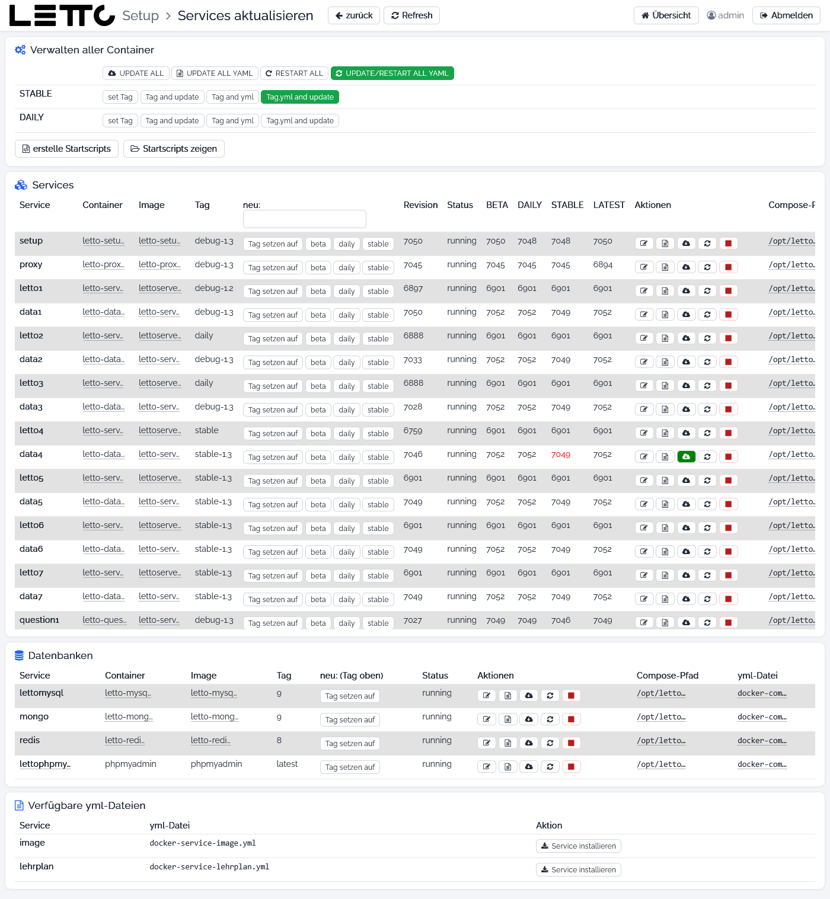

# Setup-Service: Update-Konfiguration

Aufruf: Menü **Konfiguration → Update-Konfiguration** auf der [Hauptseite](../Hauptseite/index.md). Ist ein Update
verfügbar, ist der Menüeintrag hervorgehoben. Die Seite heißt **Services aktualisieren**.

Jeder Container verwendet ein Image `lettohub/<image>:<tag>`. Der Tag steht in der `image:`-Zeile seiner
Compose-Datei und bestimmt, welche Version beim nächsten Update geladen wird:

| Tag | Bedeutung |
|---|---|
| `stable-1.3` | getestete Version – für Schulen empfohlen |
| `daily-1.3` | tägliche Entwicklungsversion |
| `beta-1.3` | Vorabversion zum Testen |

Auf dieser Seite werden die Tags gesetzt und alle oder einzelne Container aktualisiert. Eine Schritt-für-Schritt-Anleitung
steht unter [Update](../../Update/index.md).

## Kopfzeile

| Button | Wirkung |
|---|---|
| zurück | zurück zur Hauptseite |
| Refresh | Versionsinformationen neu laden (beim ersten Aufruf kann das einige Minuten dauern – „Daten werden geladen“) |

## Verwalten aller Container

| Button | Wirkung |
|---|---|
| UPDATE ALL | lädt für alle Container außer den Datenbanken (MySQL, Mongo, Redis) die Images neu und startet sie neu: Plugins, Schulen, externe Question-Services, Services, Proxy; am Ende startet sich das Setup neu |
| UPDATE ALL YAML | bringt alle Compose-Dateien auf den Stand der Vorlagen des Setup-Service; danach ist ein Neustart nötig |
| RESTART ALL | startet alle Container außer den Datenbanken neu, am Ende auch das Setup |
| UPDATE/RESTART ALL YAML | grün, wenn ein Update verfügbar ist – der empfohlene Weg für ein vollständiges Update: aktualisiert zuerst das Setup selbst, dann alle Compose-Dateien, alle Container und die Startskripte und prüft die Datenbanken. Nach dem Neustart des Setups neu anmelden, das Update läuft dann automatisch weiter. Benötigt etwa 20 GB freien Platz |

Die Zeilen **STABLE** und **DAILY** setzen den Tag aller Services (nicht der Datenbanken) auf `stable-1.3` bzw.
`daily-1.3`:

| Button | Wirkung |
|---|---|
| set Tag | nur den Tag in allen Compose-Dateien setzen |
| Tag and update | Tag setzen und alle Container aktualisieren |
| Tag and yml | Tag setzen und alle Compose-Dateien aus den Vorlagen erneuern |
| Tag,yml and update | Tag setzen, Compose-Dateien erneuern und alle Container aktualisieren (grün, wenn ein Update verfügbar ist) |

| Button | Wirkung |
|---|---|
| erstelle Startscripts | erzeugt Skripte zum Starten, Stoppen, Neustarten und Aktualisieren jedes Containers in `/opt/letto/docker/scripts/linux` und `/opt/letto/docker/scripts/windows` |
| Startscripts zeigen | öffnet das Skript-Verzeichnis im [Explorer](../Explorer/index.md) |

Länger laufende Aktionen öffnen die [Befehlsausgabe](../Befehlsausgabe/index.md). Diese Buttons wirken ohne Rückfrage –
vorher prüfen, ob gerade gearbeitet wird.

## Karte Services

Eine Zeile je Container (Setup, Proxy, Schulen `letto<n>`/`data<n>`, Question-Services, Services, Plugins):

| Spalte | Bedeutung |
|---|---|
| Service, Container, Image | Name, Containername und Image (gekürzt, ganzer Text im Tooltip) |
| Tag | aktueller Tag aus der Compose-Datei |
| neu: | **Tag setzen auf** setzt den Tag aus dem Eingabefeld im Spaltenkopf; **beta**, **daily**, **stable** setzen den jeweiligen Tag für diesen Container |
| Revision | Revision des laufenden Containers |
| Status | z. B. running |
| BETA, DAILY, STABLE, LATEST | verfügbare Revision je Tag; rot, wenn sie von der laufenden abweicht |
| Aktionen | Symbole für EDIT YAML, UPDATE YAML, UPDATE (grün, wenn ein Update verfügbar ist), RESTART und STOP (rot, mit Rückfrage; nicht beim Setup); bei Services, die entfernt werden dürfen, zusätzlich löschen (mit Rückfrage – stoppt den Service und löscht seine yml-Datei) |
| Compose-Pfad, yml-Datei | Verzeichnis und Compose-Datei des Containers |

## Karte Datenbanken

Dieselbe Tabelle für MySQL, Mongo, Redis und phpMyAdmin. Bei Datenbanken kann nur ein Tag von Hand gesetzt werden
(**Tag setzen auf**), beta/daily/stable sind gesperrt. Ein Versionswechsel einer Datenbank sollte über die Seite
[Datenbanken](../Datenbanken/index.md) erfolgen (mit Backup vorher).

## Verfügbare yml-Dateien

Services, die das Setup kennt, die aber noch nicht installiert sind (z. B. `image`, `lehrplan`). **Service
installieren** erzeugt die Compose-Datei `docker-service-<name>.yml` aus der Vorlage, legt bei Bedarf die
Proxy-Konfiguration an, startet den Service und den Proxy neu.

## siehe auch

* [Update](../../Update/index.md) – Ablauf eines Updates
* [Tab Services](../Services/index.md) – Update einzelner Container

Zurück zur Übersicht: [Setup-Service](../index.md)
