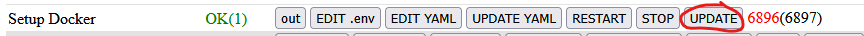
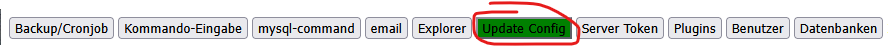
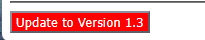
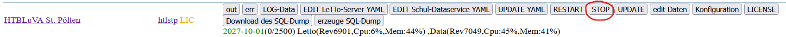

# Update rev70xx
Datum 20.10.2026

zurück zu [Administration](../index.md)

##  Update auf die Stable-Version 1.3 (Rev 7044) vom Oktober 2026 

Neuerungen der Version 1.3 siehe [Neuigkeiten](../../Einstieg/Neuigkeiten/index.md).

Mit der Version 1.3 wird die Docker-Container-Struktur umgestellt. Alle compose-Dateien liegen danach im Verzeichnis `/opt/letto/docker/compose/letto`, die bisherigen Verzeichnisse `/opt/letto/docker/compose/setup` und `/opt/letto/docker/compose/mysql` werden entfernt. Alle LeTTo-Container erhalten den Tag `stable-1.3`.

###  Voraussetzung 
* Voraussetzung für das Update ist die letzte Stable-Version 1.2. Falls notwendig zuerst das Setup-Service über den Button UPDATE bei Setup Docker aktualisieren.  
* Ist die letzte Stable-Version 1.2 installiert, erscheint im Setup-Service unter Update Config ein roter Button **Update to Version 1.3**.    

###  Vorgangsweise 
* 1. **Komplette Sicherung des Hosts am Hypervisor** (Snapshot oder Backup der virtuellen Maschine)
* 2. **Update auf die letzte Ubuntu 24.04 Version** Das Update auf Ubuntu 26.04 bitte noch nicht durchführen, die Korrekturen für 26.04 kommen erst im November 2026. Das Update kann mit dem Script [update-ubuntu.sh](https://download.letto.at/download/install-1.3/scripts/debian-ubuntu/update-ubuntu.sh) (bzw. [update-debian.sh](https://download.letto.at/download/install-1.3/scripts/debian-ubuntu/update-debian.sh) unter Debian) erfolgen oder händisch:
<pre>    apt-get update -y
    apt-get dist-upgrade -y
    apt-get autoremove -y
    reboot</pre>
* 3. **Stoppen der Schulen** über den Button STOP bei jeder Schule  
* 4. **Update starten:** Wechsel zu Update Config und Drücken des roten Buttons **Update to Version 1.3**
  * Der Durchlauf des Linux-Scripts kann **bis zu 30 Minuten** dauern.
  * Am Ende wird das Setup-Service neu gestartet. Danach bitte 1 Minute warten, die Seite neu laden und wieder anmelden.
  * **Das Update-Script nicht ein zweites Mal starten!** Beim Start wird die Sicherung in `/opt/letto/docker/compose/backup` neu angelegt, bei einem zweiten Durchlauf würde die Sicherung der Version 1.2 mit bereits geänderten Dateien überschrieben.
  * Sollten Probleme auftreten, muss das Installationsscript [update-letto-1.3.sh](https://download.letto.at/download/install-1.3/scripts/debian-ubuntu/update-letto-1.3.sh) ab der fehlerhaften Stelle händisch weiter ausgeführt werden (siehe [Ablauf des Update-Scripts](#ablauf-des-update-scripts)).

###  Update über die Kommandozeile 
Das Update-Script kann auch ohne Setup-Service direkt in der Ubuntu-bash als root ausgeführt werden:
<pre>    wget https://download.letto.at/download/install-1.3/scripts/debian-ubuntu/update-letto-1.3.sh -O /tmp/update-letto-1.3.sh
    bash /tmp/update-letto-1.3.sh</pre>
Der Parameter `-a` bzw. `--agent` wird nur vom Setup-Service verwendet. Damit wird der Neustart des Setup-Services am Ende über einen eigenen Docker-Container (`lettohub/dockeragent`) durchgeführt, da sich das Setup-Service nicht selbst neu starten kann.

###  Ablauf des Update-Scripts 
Das Script `update-letto-1.3.sh` bricht bei einem Fehler sofort ab. Die folgenden Schritte werden der Reihe nach ausgeführt:
* 1. Prüfung, ob LeTTo 1.2 installiert ist (Verzeichnis `/opt/letto/docker/compose/setup` muss existieren)
* 2. Sicherung der Verzeichnisse `setup`, `letto` und `mysql` aus `/opt/letto/docker/compose` nach `/opt/letto/docker/compose/backup`
* 3. Übernahme der Einträge aus `setup/.env` in `letto/.env` (vorhandene Einträge bleiben erhalten), `REDIRECT=app` wird gesetzt. Kopien der alten Dateien liegen in `letto/setup.env.bak` und `letto/letto.env.bak`.
* 4. Download der Hilfsscripts und der neuen yml-Dateien nach `/opt/letto/docker/compose/downloadtmp`
* 5. Stoppen von MySQL und Sicherung der Datenbanken nach `/opt/letto/docker/storage/database-dump/lettomysql-backup.tar.gz`
* 6. Sicherung von MongoDB und Redis nach `/opt/letto/docker/storage/database-dump/` und Stoppen der beiden Container
* 7. Kopieren der Hilfsscripts nach `/opt/letto/docker/compose/letto`
* 8. Schulen: aus jeder `docker-compose-<schule>.yml` werden die neuen Dateien `docker-lettoserver-<schule>.yml` und `docker-data-<schule>.yml` erzeugt, die Schule wird gestartet und die alte Datei gelöscht
* 9. Neue compose-Dateien für MySQL, MongoDB, Redis, Setup, Proxy und Login, danach Neustart von Proxy, Login, MySQL, MongoDB und Redis
* 10. Services: alle `docker-service-*.yml` werden aktualisiert und neu gestartet. Externe Question-Services (`docker-service-question-*.yml`) werden zu `docker-questionextern-*.yml`.
* 11. Neustart des Setup-Services über das erzeugte Script `/opt/letto/docker/restartsetup.sh`. Dabei werden die alten Verzeichnisse `setup` und `mysql` gelöscht.

###  Scripts im Download-Verzeichnis 
Alle Scripts liegen unter [https://download.letto.at/download/install-1.3/scripts/debian-ubuntu/](https://download.letto.at/download/install-1.3/scripts/debian-ubuntu/). Die Hilfsscripts werden vom Update-Script nach `/opt/letto/docker/compose/letto` kopiert und können dort auch später verwendet werden.

| Datei              | im Update-Script | Funktion                                                                                                                                                                         |
|--------------------|------------------|----------------------------------------------------------------------------------------------------------------------------------------------------------------------------------|
| update-letto-1.3.sh | -               | Update-Script von Version 1.2 auf 1.3                                                                                                                                            |
| settag.sh          | ja               | `settag.sh <yml-Datei> <tag>` setzt den Tag aller lettohub-Images in einer yml-Datei, z.B. `settag.sh docker-service-edit.yml stable-1.3`                                          |
| startall.sh        | kopiert          | startet alle Container aus `/opt/letto/docker/compose/letto` in der Reihenfolge docker-compose-\*, Schulen, externe Question-Services, docker-service-\*                         |
| stopall.sh         | kopiert          | stoppt alle Container aus `/opt/letto/docker/compose/letto` in umgekehrter Reihenfolge                                                                                           |
| replaceschool.sh   | kopiert          | `replaceschool.sh <yml-Datei> [Vorlage]` erzeugt eine Schul-yml-Datei neu aus einer Vorlage. Schulnummer, Kommentar, Image-Tags und Debug-Ports werden aus der alten Datei übernommen. |
| replacetag.sh      | kopiert          | `replacetag.sh <yml-Datei> [Vorlage]` erzeugt eine yml-Datei neu aus einer Vorlage und übernimmt dabei die Image-Tags der alten Datei                                              |
| replacequestion.sh | nein             | `replacequestion.sh <yml-Datei> [Vorlage]` wie replaceschool.sh, aber für externe Question-Services (Nummer, Tags und Debug-Port)                                                 |
| update-ubuntu.sh   | nein             | Aktualisierung der Pakete eines Ubuntu-Servers (dist-upgrade, autoremove, clean), meldet ob ein Neustart notwendig ist                                                            |
| update-debian.sh   | nein             | wie update-ubuntu.sh für Debian, muss als root ausgeführt werden                                                                                                                 |
| install-letto-ubuntu-docker.sh | nein | Neuinstallation von LeTTo, nicht für das Update verwenden                                                                                                                        |
