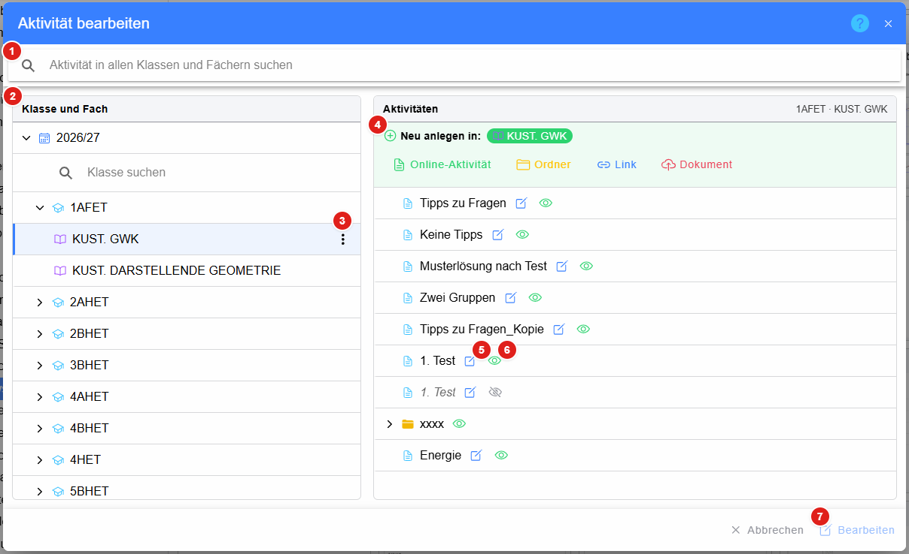
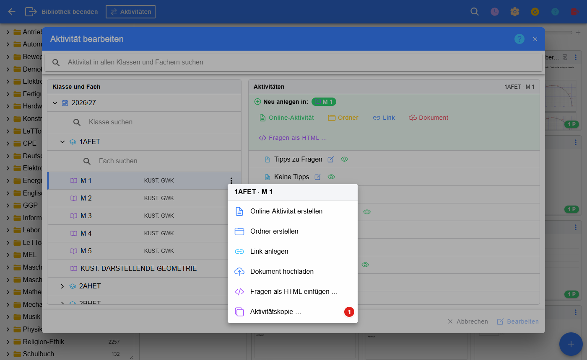
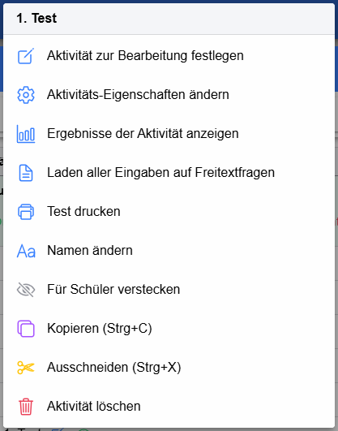
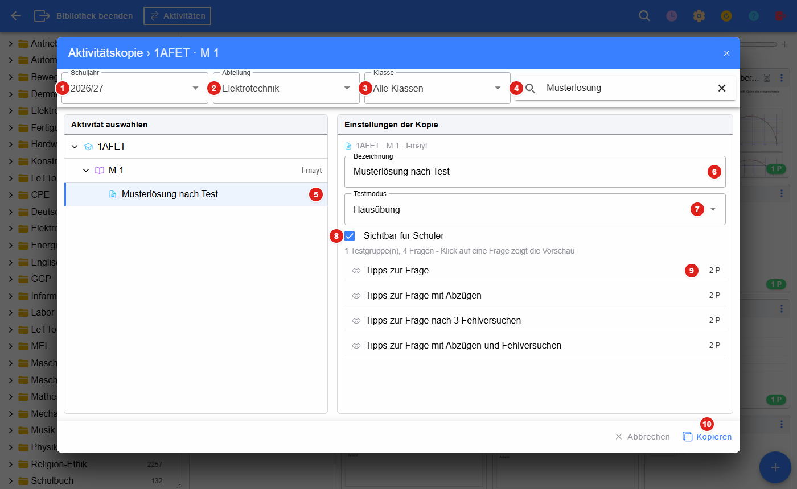
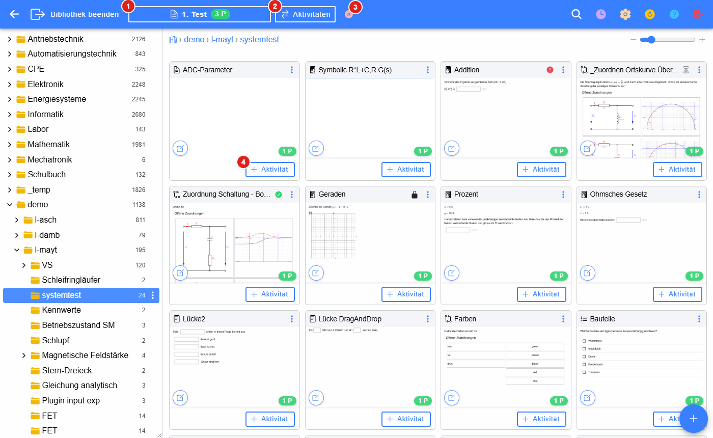
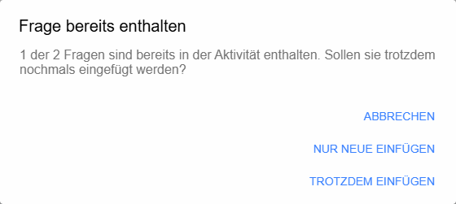
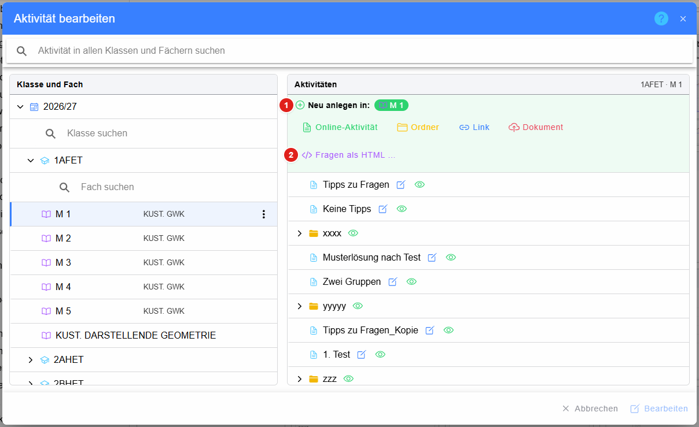
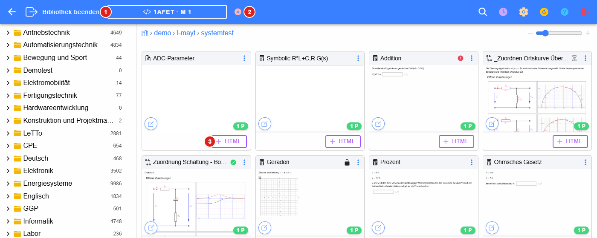
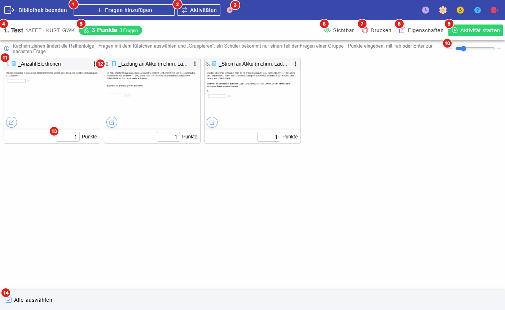

# Aktivitäten in der Bibliothek

In der [Bibliothek](../index.md) werden Online-Aktivitäten (Tests, Hausübungen, Rechenübungen …) direkt aus der
Fragensammlung zusammengestellt. Dazu wird eine Aktivität **zur Bearbeitung festgelegt**; danach können Fragen aus allen
Ordnern hinzugefügt werden.

## Aktivität bearbeiten

Der Knopf **Aktivitäten** in der [Kopfzeile](../index.md#kopfzeile) öffnet den Dialog **Aktivität bearbeiten**.

1. **Suche** über die Aktivitäten aller Klassen und Fächer
2. **Klasse und Fach** – nach Schuljahr gegliedert; welche Schuljahre angezeigt werden, wird in den
   [Einstellungen](../Einstellungen/index.md) festgelegt. Die drei Punkte beim gewählten Fach öffnen dessen Kontextmenü.
3. **Aktionen des Fachs**
4. **Neu anlegen** im gewählten Fach: Online-Aktivität, Ordner, Link oder Dokument
5. **Bearbeiten** (Stift) – die Aktivität sofort zur Bearbeitung festlegen und ihre Fragen öffnen. Das Symbol links vom
   Namen zeigt die **Ergebnisse** der Aktivität.
6. **Sichtbarkeit** für die Schüler (Auge offen = sichtbar, durchgestrichen = versteckt) – ein Klick schaltet um
7. **Bearbeiten** – die markierte Aktivität zur Bearbeitung festlegen; ein **Doppelklick** auf die Aktivität macht dasselbe

Nach dem Festlegen bzw. dem Anlegen einer neuen Aktivität öffnet sich gleich die Seite mit den
[Fragen der Aktivität](#fragen-der-aktivität).

Beim Fach steht die **Bezeichnung**, die in der [Klassenzuordnung](../../Konfiguration/Klassenzuordnung/index.md)
vergeben wurde (zB. „M 1“), daneben der Name des Gegenstands. Alle Änderungen im Dialog (Anlegen, Umbenennen,
Verschieben, Kopieren, Einfügen, Sichtbarkeit, Löschen) sind sofort auch auf der Startseite und in den anderen
Ansichten der App sichtbar – ein Neuladen ist nicht nötig.

### Kontextmenü eines Fachs oder Ordners

Die drei Punkte beim gewählten Fach bzw. die rechte Maustaste auf einen Ordner öffnen das Kontextmenü:

* **Online-Aktivität erstellen**, **Ordner erstellen**, **Link anlegen**, **Dokument hochladen** – im Fach bzw. im Ordner
* **Einfügen** – eine vorher kopierte bzw. ausgeschnittene Aktivität einfügen
* **Fragen als HTML einfügen …** – siehe [Fragen als HTML einfügen](#fragen-als-html-einfügen)
* **Aktivitätskopie …** (1) – eine Aktivität aus einem beliebigen Schuljahr, einer beliebigen Klasse und einem
  beliebigen Fach hierher kopieren, siehe [Aktivitätskopie](#aktivitätskopie)

### Kontextmenü einer Aktivität

Die rechte Maustaste (am Handy ein langer Druck) auf eine Aktivität öffnet ihr Kontextmenü:

* **Aktivität zur Bearbeitung festlegen** – wie **Bearbeiten**
* **Aktivitäts-Eigenschaften ändern**
* **Ergebnisse der Aktivität anzeigen** – öffnet die [Test-Ergebnisse](../../Tests/Test-Ergebnisse/index.md); auch das
  Listen-Symbol links neben der Aktivität zeigt die Ergebnisse
* **Laden aller Eingaben auf Freitextfragen** – alle Antworten der Schüler auf Freitextfragen als JSON exportieren (zB.
  für eine externe bzw. KI-gestützte Beurteilung) und die Bewertungen danach wieder **importieren**
  (siehe [Freitext-Export](../../Fragen/FreitextExport/index.md))
* **Test drucken** – PDF, TeX oder ZIP der Aktivität
* **Namen ändern**, **Für Schüler verstecken** bzw. anzeigen
* **Kopieren (Strg+C)** / **Ausschneiden (Strg+X)** – Aktivität in ein anderes Fach bzw. einen anderen Ordner übernehmen
* **Aktivität löschen**

## Aktivitätskopie

Mit **Aktivitätskopie …** im [Kontextmenü eines Fachs oder Ordners](#kontextmenü-eines-fachs-oder-ordners) wird eine
bestehende Aktivität – auch aus früheren Schuljahren, anderen Klassen und Fächern anderer Lehrer – in das gewählte Fach
bzw. den gewählten Ordner kopiert. Der Zielort steht in der Titelzeile des Dialogs.

1. **Schuljahr** – vorausgewählt ist das aktuelle Schuljahr
2. **Abteilung** – vorausgewählt ist die Abteilung der Zielklasse; **Alle Abteilungen** zeigt die ganze Schule
3. **Klasse** – auf eine Klasse einschränken
4. **Suche** nach Aktivität, Fach oder Lehrer
5. **Aktivität auswählen** – Baum aus Klasse › Fach (mit Lehrer) › Ordner › Aktivität. Gewählt werden können
   Online-Aktivitäten und Ordner; ein Ordner wird mit seinem ganzen Inhalt kopiert. Versteckte Aktivitäten sind kursiv.
6. **Bezeichnung** der Kopie – vorgegeben ist der Name des Originals
7. **Testmodus** der Kopie (nur bei Online-Aktivitäten) – beim Wechsel wird die Sichtbarkeit passend zum Modus gesetzt
8. **Sichtbar für Schüler**
9. **Fragen** der Aktivität nach Testgruppen – ein Klick zeigt die Vorschau der Frage
10. **Kopieren** – die Kopie anlegen; ein **Doppelklick** auf die Aktivität im Baum macht dasselbe

Die Kopie erscheint sofort im Fach bzw. Ordner und ist markiert.

## Fragen hinzufügen

Ist eine Aktivität zur Bearbeitung festgelegt, zeigt die Kopfzeile der Bibliothek ihren Namen und ihre Punkte:

1. **Name und Punkte** der Aktivität – ein Klick öffnet die [Fragen der Aktivität](#fragen-der-aktivität)
2. **Aktivitäten** – eine andere Aktivität wählen
3. **Beenden** – die Bearbeitung der Aktivität beenden
4. **+ Aktivität** – die Frage zur Aktivität hinzufügen. Hat die Aktivität mehrere Testgruppen bzw. Bereiche, wird das Ziel
   gewählt. Der Knopf verschwindet sofort nach dem Klick, die Frage kann also nicht versehentlich doppelt eingefügt werden.

Fragen, die in diesem Fach schon in einer **anderen** Aktivität verwendet werden, sind in der Kachel mit
**Schon verwendet in …** gekennzeichnet – so vermeidet man, dieselbe Frage zweimal zu stellen. Fragen, die schon in der
bearbeiteten Aktivität sind, zeigen statt **+ Aktivität** den Bereich, in dem sie liegen.

Mehrere Fragen auf einmal werden über [Mehrere auswählen](../Fragen/index.md#mehrere-fragen-auswählen) und
**Zur Aktivität hinzufügen** übernommen. Ist noch keine Aktivität in Bearbeitung, wird sie dabei gewählt oder neu angelegt.

### Dieselbe Frage mehrmals

Eine Frage darf mehrmals in derselben Aktivität vorkommen. Ist sie schon enthalten – zB. beim Hinzufügen mehrerer
Fragen, über das Menü der Frage, die Suche oder das Einfügen auf der Seite der Aktivität –, erscheint eine Rückfrage:

* **Abbrechen** – nichts einfügen
* **Nur neue einfügen** – nur die Fragen einfügen, die noch nicht enthalten sind (nur bei mehreren Fragen)
* **Trotzdem einfügen** – alle Fragen einfügen, auch die schon enthaltenen

Bei Aktivitäten mit mehreren Bereichen zählt nur der Bereich, in den eingefügt wird.

## Fragen als HTML einfügen

Fragen können auch als **HTML-Fragen** direkt in ein Fach oder einen Ordner gestellt werden (zB. als Musterlösung oder
Übungsangabe ohne Test). Der Knopf **Fragen als HTML …** im Bereich **Neu anlegen in** des Dialogs
[Aktivität bearbeiten](#aktivität-bearbeiten) bzw. **Fragen als HTML einfügen …** im
[Kontextmenü](#kontextmenü-eines-fachs-oder-ordners) arbeitet so:

* Sind in der Bibliothek Fragen **markiert** (oder sonst **kopiert**), werden sie sofort als HTML-Fragen am Zielort
  eingefügt.
* Ist nichts markiert, wird – wie beim Hinzufügen zu einer Aktivität – nur der **Zielort festgelegt**. Die Fragen werden
  danach in der Bibliothek mit **+ HTML** eingefügt.

1. **Neu anlegen in** – Zielort: das Fach oder der gewählte Ordner
2. **Fragen als HTML …** – Fragen einfügen bzw. den Zielort festlegen

Ist ein Zielort festgelegt, zeigt die Bibliothek das in der Kopfzeile an:

1. **Zielort** der HTML-Fragen – ein Klick öffnet den Dialog, um einen anderen Zielort zu wählen
2. **Beenden** – das Einfügen von HTML-Fragen beenden
3. **+ HTML** – die Frage als HTML-Frage am Zielort einfügen. Ist sie dort schon, steht stattdessen **am Zielort**.

Auch im Menü einer Frage und für mehrere ausgewählte Fragen gibt es dann **Als HTML in … einfügen**. Ist eine Frage
schon als HTML-Frage am Zielort, erscheint dieselbe [Rückfrage](#dieselbe-frage-mehrmals) wie bei Aktivitäten. Wird eine
Aktivität zur Bearbeitung festgelegt, endet das Einfügen von HTML-Fragen.

## Fragen der Aktivität

Die Seite zeigt alle Fragen der Aktivität als Kacheln in der Reihenfolge, in der sie die Schüler bekommen.

1. **Fragen hinzufügen** – zurück in die Bibliothek
2. **Aktivitäten** – eine andere Aktivität wählen
3. **Beenden** – Bearbeitung der Aktivität beenden
4. **Name** der Aktivität, Klasse und Fach
5. **Punktesumme** und Anzahl der Fragen
6. **Sichtbar / Unsichtbar** – Sichtbarkeit für die Schüler umschalten
7. **Drucken** – PDF, TeX oder ZIP der Aktivität
8. **Eigenschaften** der Aktivität
9. **Aktivität starten** – wie in der Liste der Aktivitäten der App
10. **Größe der Kacheln** – dieselbe Einstellung wie in der Bibliothek
11. **Nummer** der Frage – die Reihenfolge wird durch **Ziehen** der Kacheln geändert
12. **Aktionen** der Frage: Frage bearbeiten, Vorschau, In der Bibliothek anzeigen, Mehrere auswählen,
    Von der Bibliothek entkoppeln, Aus Aktivität entfernen
13. **Punkte** der Frage in dieser Aktivität – mit **Tab** oder **Enter** geht es zur nächsten Frage
14. **Alle auswählen** – Kästchen für alle Fragen setzen bzw. entfernen

Hat die Aktivität mehrere **Testgruppen** (A, B, …) oder **Bereiche**, werden sie unter der Titelzeile als Reiter
angezeigt; die Punktesumme gilt dann für den gewählten Bereich, **Gesamt** für die ganze Testgruppe.

### Fragen gruppieren

Werden mehrere Fragen ausgewählt, erscheint unten **Gruppieren**: Die gewählten Fragen werden zu einer Gruppe
zusammengefasst, aus der jeder Schüler nur einen Teil bekommt (zB. 2 aus 5). Gruppierte Fragen haben einen farbigen
Rahmen und ein Band mit der Anzahl; dort wird die Anzahl geändert oder die Gruppierung aufgehoben
(siehe [Fragen gruppieren](../../Tests/FragenGruppieren/index.md)).

### Fragen bearbeiten und entkoppeln

Eine Frage der Aktivität ist normalerweise **dieselbe Frage wie in der Bibliothek**. Wird sie aus der Aktivität heraus
bearbeitet, wird sie auch in der Bibliothek geändert. Aktivitäten, in denen Schüler die Frage schon beantwortet haben,
bekommen dabei automatisch eine eigene Kopie der alten Version, damit bestehende Ergebnisse unverändert bleiben
(siehe [Einstellungen](../Einstellungen/index.md), „Fragenänderungen bei bereits beurteilten Aktivitäten“).

Mit **Entkoppeln** (bzw. **Von der Bibliothek entkoppeln** im Menü der Frage) bekommt die Aktivität eine **eigene
Kopie** der Frage. Änderungen daran wirken nicht mehr auf die Bibliothek. Entkoppelte Fragen sind in der Kachel mit einem
eigenen Symbol gekennzeichnet.

### Fragen anderer Lehrer anpassen

Fragen aus Ordnern ohne Änderungsrecht (zB. von Kolleginnen und Kollegen oder aus allgemeinen Sammlungen) können in
der Aktivität trotzdem **bearbeitet** werden. Der [Editor](../Editor/index.md) zeigt dann in der Titelzeile den
orangen Hinweis **wird getrennt**. Beim Speichern bekommt die Aktivität automatisch eine eigene Kopie der Frage – sie
wird von der Fragensammlung getrennt, das Original bleibt unverändert. Der Editor bearbeitet danach gleich die Kopie
weiter.

### siehe auch

* [Online-Tests](../../Tests/Online-Tests/index.md)
* [Test-Ergebnisse](../../Tests/Test-Ergebnisse/index.md)
* [Fragen gruppieren](../../Tests/FragenGruppieren/index.md)
