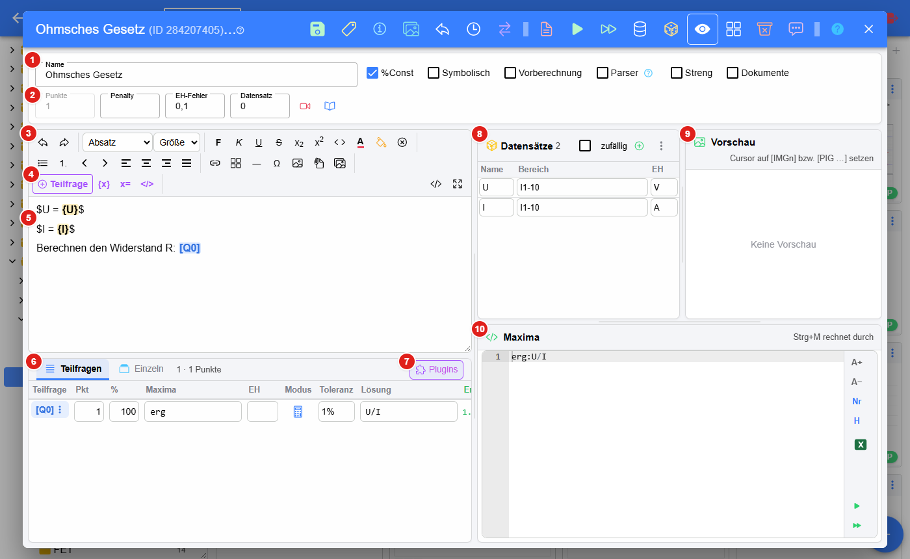
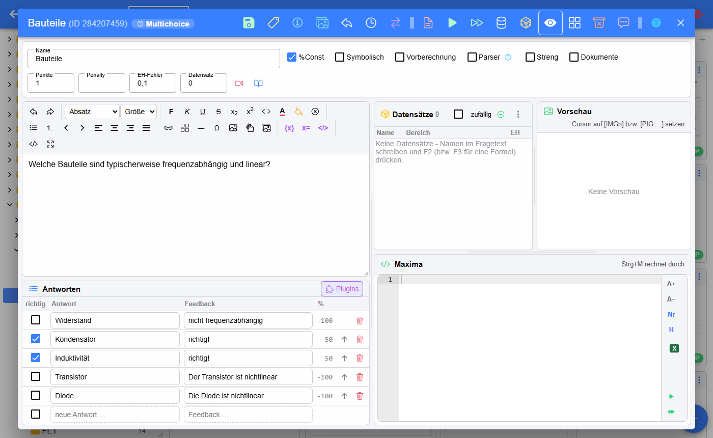
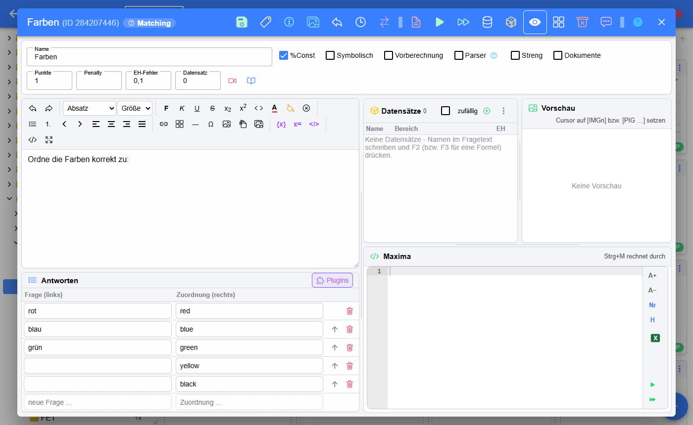
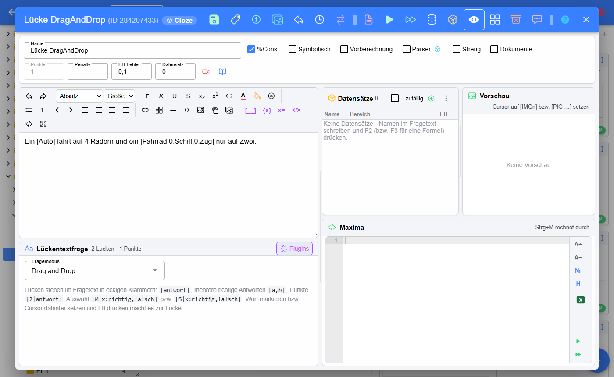
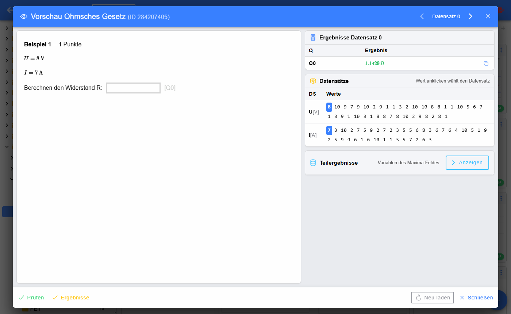
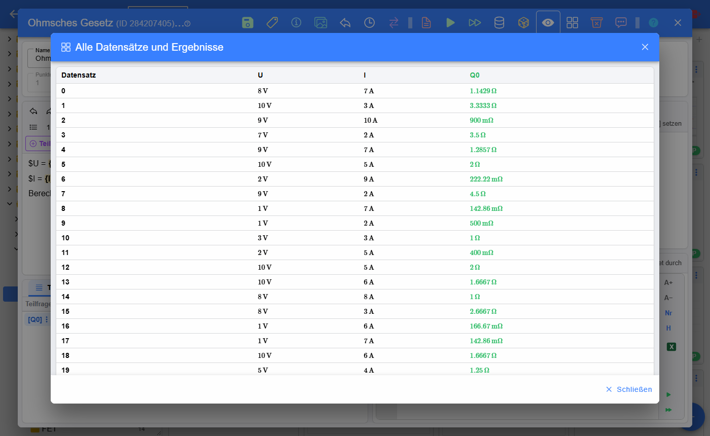
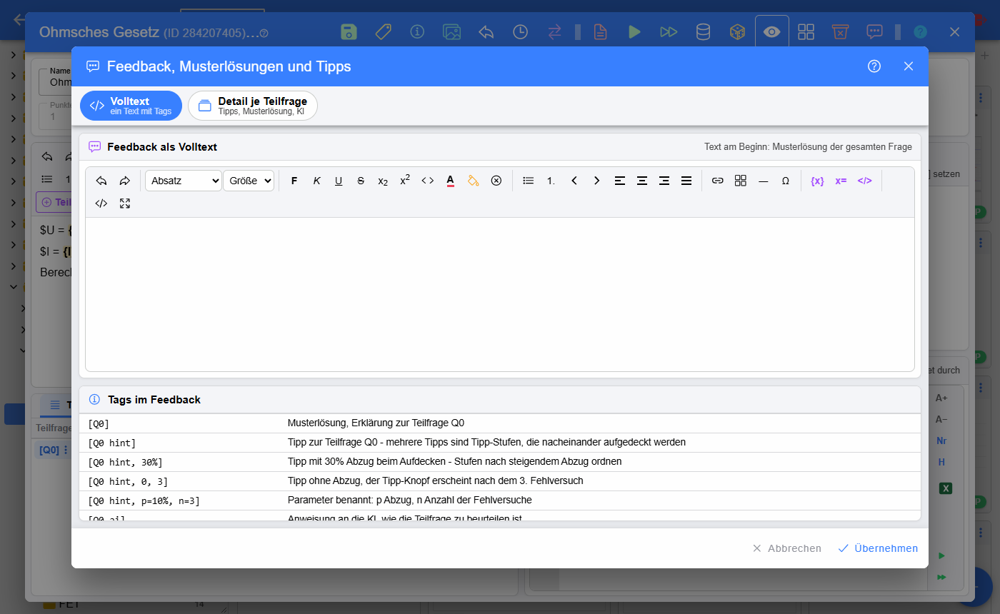

# Editor der Bibliothek

Im **Editor** werden Fragen der [Bibliothek](../index.md) erstellt und bearbeitet. Er öffnet sich über den Stift in einer
[Kachel](../Fragen/index.md#kachel-einer-frage), über **Frage bearbeiten** im Kontextmenü oder beim Anlegen einer neuen
Frage.

1. **Name** der Frage und **Optionen**: %Const, Symbolisch, Vorberechnung, Parser (Berechnung mit dem internen Parser statt
   Maxima), Streng, Dokumente (Schüler können Dateien zur Frage hochladen) – siehe
   [Editor der alten Oberfläche](../../Fragen/BeispielsammlungEditieren/index.md)
2. **Beurteilung**: Punkte, Penalty, EH-Fehler (Abzug bei falscher Einheit) und der angezeigte Datensatz, daneben
   Video- und Buch-Link der Frage
3. **Werkzeugleiste** des Texteditors (Format, Listen, Links, Tabellen, Sonderzeichen, Bilder …), siehe
   [Editor für den Angabetext](../../Fragen/EditorfürdenAngabetext/index.md)
4. **Teilfrage** – fügt an der Cursorposition eine neue Teilfrage `[Qn]` ein (auch mit **Strg+Q** bzw. **Alt+Q**);
   daneben Variable `{x}`, Formel `x=` und HTML-Ansicht
5. **Fragetext** – Teilfragen erscheinen als blaue Marken `[Q0]`, Variablen als gelbe Marken `{U}`
6. **Teilfragen** – Tabelle aller Teilfragen mit Punkten, Prozent, Maxima-Ausdruck, Einheit, Modus, Toleranz und Lösung;
   über das Menü bei `[Q0]` wird die Teilfrage bearbeitet, verschoben oder gelöscht. Der Reiter **Einzeln** zeigt eine
   Teilfrage mit allen Einstellungen.
7. **Plugins** – [Plugins der Frage](../../Plugins/DefinitionvonPlugins/index.md) definieren
8. **Datensätze** – Variablen mit Wertebereich und Einheit, siehe [Datensätze](../../Berechnungen/Datensätze/index.md).
   **zufällig** mischt die Datensätze, **+** legt eine neue Variable an.
9. **Vorschau** – zeigt das Bild bzw. Plugin, auf dem der Cursor gerade steht (`[IMGn]` bzw. `[PIG …]`), auch in den
   Antworten von Multiple-Choice- und Zuordnungsfragen
10. **Maxima** – Berechnungen der Frage; **Strg+M** rechnet die Frage durch. Rechts: Schriftgröße, Zeilennummern, Hilfe,
    Excel-Import sowie Durchrechnen

## Werkzeugleiste

| Nr. | Beschreibung |
|---|---|
| 1 | **Speichern** (Strg+S) |
| 2 | **Kennzeichnen** – Kennzeichnung der Frage; die Farbe zeigt den Zustand: rot fehlerhaft, grün kontrolliert, grau in Bearbeitung, blau gesperrt (siehe [Kennzeichnung](../Fragen/index.md#kennzeichnung)) |
| 3 | **Zusatzinformationen** – Beschreibung, Autor, Lizenz, Kompetenzen … |
| 4 | **Bilder und Dateien** des Fragetexts |
| 5 | **Frage zurücksetzen** – neu aus der Datenbank laden, ungespeicherte Änderungen gehen verloren |
| 6 | **History** – frühere Versionen des Fragetexts |
| 7 | **Zuletzt bearbeitete Fragen** – direkt zu einer anderen zuletzt bearbeiteten Frage wechseln |
| 8 | **PDF** der Frage |
| 9 | **Durchrechnen** mit Maxima bzw. Parser (Strg+M) |
| 10 | **Durchrechnen und Ergebnis anzeigen** |
| 11 | **Teilergebnisse** – Werte aller Variablen des Maxima-Feldes je Datensatz |
| 12 | **Zahlenwerte neu würfeln** – Vorsicht: nicht rückgängig zu machen |
| 13 | **Fragen-Vorschau** (siehe unten) |
| 14 | **Alle Datensätze und Ergebnisse** als Tabelle |
| 15 | **Überflüssige Datensätze löschen** – Variablen, die im Fragetext und in Maxima nicht mehr verwendet werden |
| 16 | **Feedback, Musterlösungen und Tipps** (siehe unten) |
| 17 | **Hilfe** zum Fragetyp |
| 18 | **Schließen** – bei ungespeicherten Änderungen wird nachgefragt |

## Fragetypen

Der untere Bereich des Editors hängt vom [Fragetyp](../../Fragen/Fragetypen/index.md) ab.

### Multiple-Choice-Frage

Statt der Teilfragen gibt es die Tabelle **Antworten**: Kästchen **richtig**, Antworttext, Feedback zur Antwort und der
Prozentwert (richtige Antworten teilen sich 100 %, falsche ziehen ab). Mit dem Pfeil wird eine Antwort nach oben
verschoben, mit dem Mistkübel gelöscht; in der letzten Zeile wird eine neue Antwort eingegeben. Steht der Cursor in
einer Antwort auf einem Bild- oder Plugin-Tag, zeigt die **Vorschau** dieses Bild.

### Zuordnungsfrage

Die Antworten bestehen aus Paaren, die die Schüler einander zuordnen. Antworten ohne Partner sind zusätzliche falsche
Antworten.

### Lückentextfrage

Bei Lückentextfragen stehen die Lücken direkt im Fragetext in eckigen Klammern, zB. `[Auto]` oder
`[Fahrrad,0:Schiff,0:Zug]`. Unten wird nur der **Fragemodus** gewählt: Texteingabe, Drag and Drop, Auswahl (Dropdown) …
Ein Wort markieren bzw. den Cursor dahinter setzen und **F8** drücken macht es zur Lücke.

## Fragen-Vorschau

Das Auge in der Werkzeugleiste speichert die Frage und zeigt sie wie die Schüler – mit den Ergebnissen, den Datensätzen
(ein Klick auf einen Wert wählt den Datensatz) und den Teilergebnissen.

## Alle Datensätze und Ergebnisse

Die Tabelle zeigt für jeden Datensatz die Werte aller Variablen und die Ergebnisse der Teilfragen – praktisch, um
unpassende Zahlenwerte (zB. sehr kleine oder große Ergebnisse) zu finden.

## Feedback, Musterlösungen und Tipps

Der Dialog hat zwei Ansichten:

* **Volltext** – das ganze Feedback als ein Text. Musterlösungen und Tipps zu einzelnen Teilfragen werden mit Tags
  markiert (Tabelle unten im Dialog), zB. `[Q0]` für die Musterlösung der Teilfrage Q0 oder `[Q0 hint, 30%]` für einen
  Tipp mit 30 % Abzug.
* **Detail je Teilfrage** – Tipps, Musterlösung und KI-Anweisung getrennt für jede Teilfrage; mehrere Tipps werden als
  Stufen nacheinander aufgedeckt.

Siehe auch [Feedback](../../Fragen/Feedback/index.md).

### siehe auch

* [Editor der alten Oberfläche](../../Fragen/BeispielsammlungEditieren/index.md)
* [Toolbar der alten Oberfläche](../../Fragen/Toolbar/index.md)
* [Berechnungen](../../Berechnungen/index.md)
