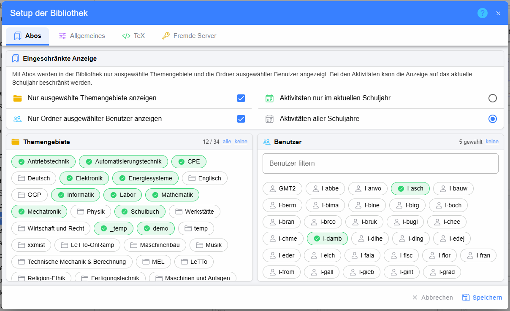
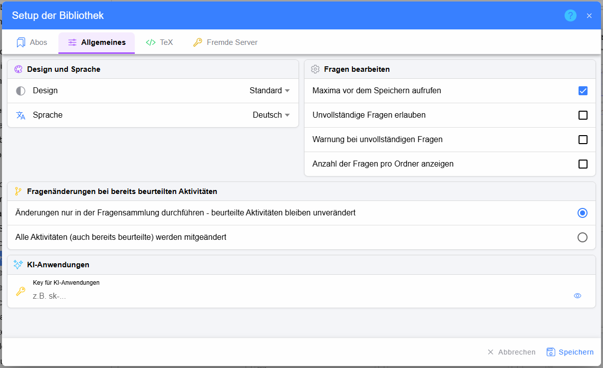
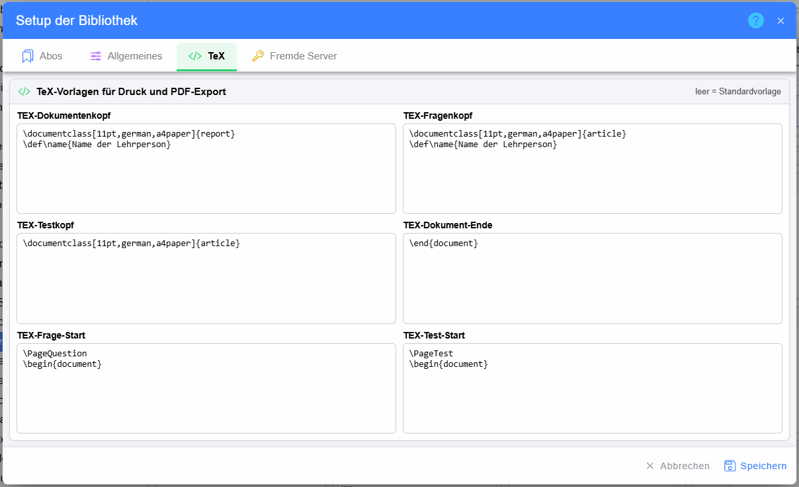
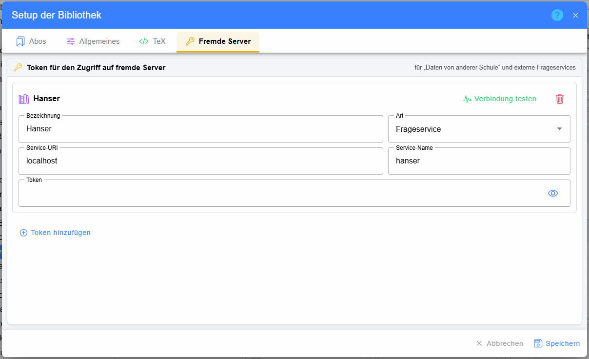

# Einstellungen der Bibliothek

Das Zahnrad in der [Kopfzeile](../index.md#kopfzeile) der Bibliothek öffnet das **Setup der Bibliothek**. Die
Einstellungen werden mit **Speichern** übernommen und gelten für den angemeldeten Benutzer.

## Abos

Mit Abos wird die Anzeige auf die Bereiche beschränkt, die man tatsächlich braucht:

* **Nur ausgewählte Themengebiete anzeigen** – im Ordnerbaum erscheinen nur die unter **Themengebiete** gewählten
  Hauptthemen (grün markiert; **alle** / **keine** wählt alle bzw. keines aus)
* **Nur Ordner ausgewählter Benutzer anzeigen** – in den Hauptthemen erscheinen nur die User-Ordner der unter
  **Benutzer** gewählten Lehrpersonen (das Feld darüber filtert die Liste)
* **Aktivitäten nur im aktuellen Schuljahr** bzw. **aller Schuljahre** – welche Schuljahre im Dialog
  [Aktivität bearbeiten](../Aktivitaeten/index.md) angezeigt werden

## Allgemeines

* **Design** und **Sprache** der Bibliothek (Deutsch, Englisch, Französisch, Spanisch)
* **Fragen bearbeiten**
  * **Maxima vor dem Speichern aufrufen** – die Frage wird beim Speichern durchgerechnet
  * **Unvollständige Fragen erlauben** bzw. **Warnung bei unvollständigen Fragen**
  * **Anzahl der Fragen pro Ordner anzeigen** – die Zahl rechts im [Ordnerbaum](../Ordner/index.md)
* **Fragenänderungen bei bereits beurteilten Aktivitäten** – ob eine geänderte Frage nur in der Fragensammlung geändert
  wird (bereits beurteilte Aktivitäten behalten die alte Version) oder auch in allen Aktivitäten
* **KI-Anwendungen** – eigener Schlüssel (API-Key) für die KI-gestützte Beurteilung von Freitextfragen

## TeX

Eigene TeX-Vorlagen für den Druck und PDF-Export von Fragen, Ordnern und Tests: Dokumentenkopf, Fragenkopf, Testkopf,
Dokument-Ende sowie Frage- und Test-Start. Ein leeres Feld verwendet die Standardvorlage.

## Fremde Server

Zugänge zu anderen Servern mit einem **Token**:

* **Daten von anderer Schule** – die Fragensammlung einer anderen LeTTo-Schule erscheint schreibgeschützt im Ordnerbaum
  bzw. im [Kontextmenü eines Ordners](../Ordner/index.md#kontextmenü)
* **Frageservice** – externes Frageservice (zB. eines Verlags), an das Ordner exportiert werden können

Je Zugang werden Bezeichnung, Art, Service-URI, Service-Name und das Token eingetragen. **Verbindung testen** prüft den
Zugang, **Token hinzufügen** legt einen weiteren an.
