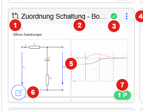
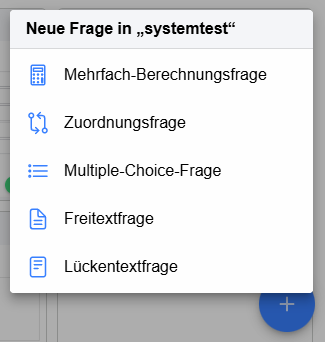
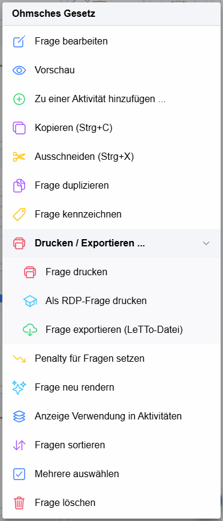
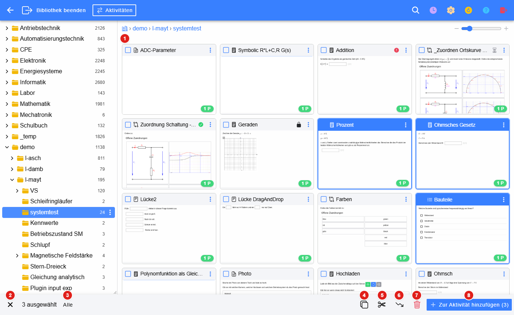
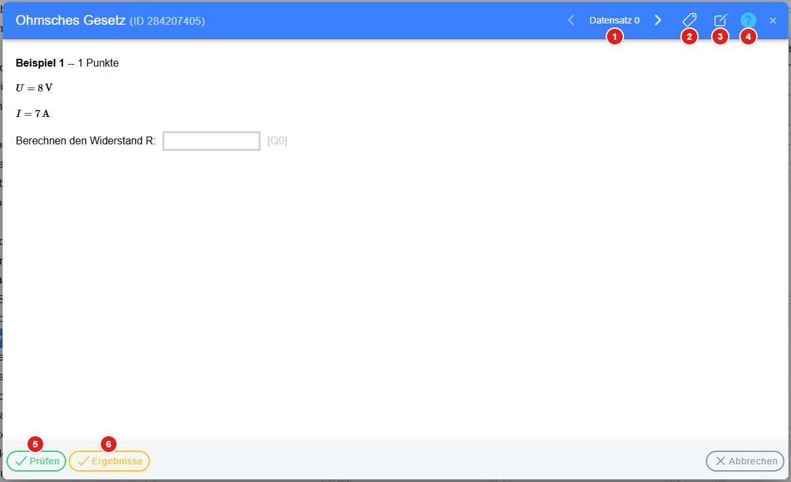
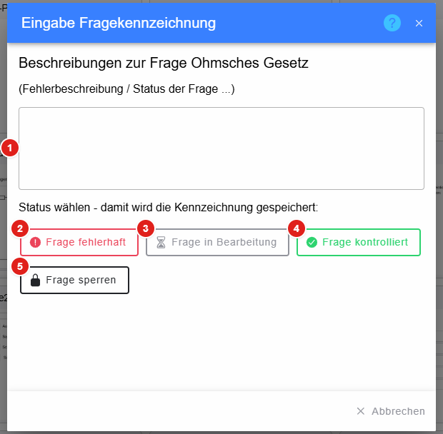

# Fragen in der Bibliothek

Die Fragen des geöffneten Ordners werden in der [Bibliothek](../index.md) als **Kacheln** mit einem Vorschaubild angezeigt.
Die Größe der Kacheln wird mit dem Schieberegler rechts oben eingestellt (siehe [Bibliothek](../index.md)).

## Kachel einer Frage

1. **Fragetyp** als Symbol (Berechnungsfrage, Zuordnungsfrage, Multiple-Choice, Freitext, Lückentext, siehe
   [Fragetypen](../../Fragen/Fragetypen/index.md))
2. **Name der Frage** – ein Klick auf die Titelzeile **markiert** die Frage (blau). Mit **Strg** werden weitere Fragen dazu
   markiert bzw. wieder entfernt, mit **Umschalt** ein ganzer Bereich. Markierte Fragen werden mit **Strg+C** kopiert bzw.
   mit **Strg+X** ausgeschnitten.
3. **Kennzeichnung** der Frage (siehe [Kennzeichnung](#kennzeichnung)):
   rotes Rufzeichen = fehlerhaft, Sanduhr = in Bearbeitung, grünes Häkchen = kontrolliert, Schloss = gesperrt
4. **Aktionen** – öffnet das [Kontextmenü](#kontextmenü) (wie die rechte Maustaste)
5. **Vorschaubild** – ein Klick öffnet die [Vorschau](#vorschau). Fehlt das Bild, wird es beim ersten Öffnen der Vorschau
   erzeugt.
6. **Bearbeiten** – öffnet die Frage im [Editor](../Editor/index.md)
7. **Punkte** der Frage

Wird gerade eine [Aktivität bearbeitet](../Aktivitaeten/index.md), haben die Kacheln unten zusätzlich den Knopf
**+ Aktivität**, und Fragen, die schon in einer anderen Aktivität dieses Fachs verwendet werden, sind mit
**Schon verwendet in …** gekennzeichnet.

## Fragen verschieben

Kacheln werden mit der Maus gezogen (am Handy: kurz halten und ziehen):

* innerhalb des Ordners – die **Reihenfolge** der Fragen ändern,
* auf einen Ordner im Ordnerbaum oder eine Ordner-Kachel – die Frage in diesen Ordner **verschieben**.

## Neue Frage

Der runde **+**-Knopf rechts unten legt eine neue Frage im geöffneten Ordner an. Zuerst wird der Fragetyp gewählt, dann
öffnet sich der [Editor](../Editor/index.md).

## Kontextmenü

Das Kontextmenü einer Frage öffnet sich mit der **rechten Maustaste** auf die Kachel, über die **drei Punkte** in der
Titelzeile oder am Handy mit einem **langen Druck**. Es enthält nur die Einträge, für die man im Ordner die Rechte hat.

* **Frage bearbeiten** – öffnet den [Editor](../Editor/index.md)
* **Vorschau** – siehe [Vorschau](#vorschau)
* **Zu einer Aktivität hinzufügen …** – die Frage in eine Online-Aktivität übernehmen (siehe
  [Aktivitäten](../Aktivitaeten/index.md))
* **Kopieren (Strg+C)** / **Ausschneiden (Strg+X)** – die Frage in die Zwischenablage legen. Der Inhalt der
  Zwischenablage wird in der Pfadzeile angezeigt. Eingefügt wird über das Kontextmenü einer anderen Frage
  (**Einfügen am Ende**, **Einfügen vor dieser Frage**, **Frage verlinken**) oder des Ordners.
* **Frage duplizieren** – Kopie der Frage direkt dahinter
* **Frage kennzeichnen** – siehe [Kennzeichnung](#kennzeichnung)
* **Drucken / Exportieren …** – **Frage drucken** (PDF), **Als RDP-Frage drucken** (Angabe für die Reife- und
  Diplomprüfung) und **Frage exportieren (LeTTo-Datei)**
* **Penalty für Fragen setzen** – Abzug bei falscher Antwort in Rechen- bzw. Hausübungen
* **Frage neu rendern** – Vorschaubild der Kachel neu erzeugen
* **Anzeige Verwendung in Aktivitäten** – in welchen Aktivitäten die Frage vorkommt
* **Zeige Originalfrage** – nur bei verlinkten Fragen: öffnet den Ordner der eigentlichen Frage
* **Fragen sortieren** – alle Fragen des Ordners alphabetisch sortieren
* **Mehrere auswählen** – siehe [Mehrere Fragen auswählen](#mehrere-fragen-auswählen)
* **Frage löschen**

## Mehrere Fragen auswählen

Über **Mehrere auswählen** im Kontextmenü bekommen alle Kacheln ein Kästchen. Ein Klick auf eine Kachel wählt sie aus
bzw. ab, unten erscheint eine Leiste mit den Aktionen für alle ausgewählten Fragen.

1. **Kästchen** zum Auswählen – ausgewählte Fragen sind blau hinterlegt
2. **Auswahl beenden**
3. **Alle** Fragen des Ordners auswählen
4. **Kopieren** in die Zwischenablage
5. **Ausschneiden** (zum Verschieben in einen anderen Ordner)
6. **Penalty** für alle ausgewählten Fragen setzen
7. **Löschen**
8. **Zur Aktivität hinzufügen** – alle ausgewählten Fragen in eine Aktivität übernehmen; ist noch keine Aktivität in
   Bearbeitung, wird sie im Dialog [Aktivität bearbeiten](../Aktivitaeten/index.md) gewählt oder neu angelegt

## Vorschau

Ein Klick auf das Vorschaubild öffnet die Frage so, wie sie die Schüler sehen.

1. **Datensatz** – mit den Pfeilen werden die Zahlenwerte der verschiedenen [Datensätze](../../Berechnungen/Datensätze/index.md)
   durchgeschaltet
2. **Kennzeichnen** – siehe [Kennzeichnung](#kennzeichnung)
3. **Bearbeiten** – öffnet die Frage im [Editor](../Editor/index.md)
4. **Hilfe**
5. **Prüfen** – die eingegebenen Antworten beurteilen, wie es ein Schüler im Übungsmodus sieht
6. **Ergebnisse** – die richtigen Ergebnisse einblenden

## Kennzeichnung

Mit der Kennzeichnung wird der Zustand einer Frage festgehalten, zB. wenn ein Fehler gefunden wurde oder die Frage
kontrolliert ist. Die Kennzeichnung erscheint als Symbol in der Kachel und in der Kopfzeile des Editors.

1. **Beschreibung** – Fehlerbeschreibung bzw. Kommentar zur Frage (wird beim Darüberfahren über das Symbol angezeigt)
2. **Frage fehlerhaft** – rotes Rufzeichen
3. **Frage in Bearbeitung** – graue Sanduhr
4. **Frage kontrolliert** – grünes Häkchen
5. **Frage sperren** – Schloss, die Frage kann nicht mehr geändert werden

Ein Klick auf einen Status speichert die Kennzeichnung sofort. Ist die Frage schon gekennzeichnet, gibt es zusätzlich
**Kommentar entfernen**, um die Kennzeichnung wieder zu löschen.

### siehe auch

* [Ordner](../Ordner/index.md)
* [Editor](../Editor/index.md)
* [Fragenliste (alte Oberfläche)](../../Fragen/Fragenliste/index.md)
