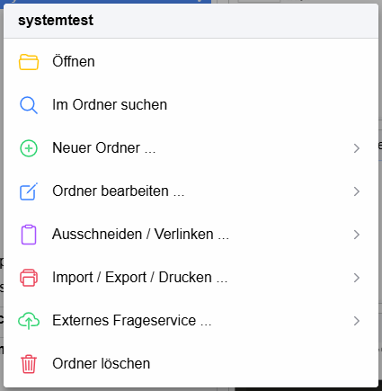
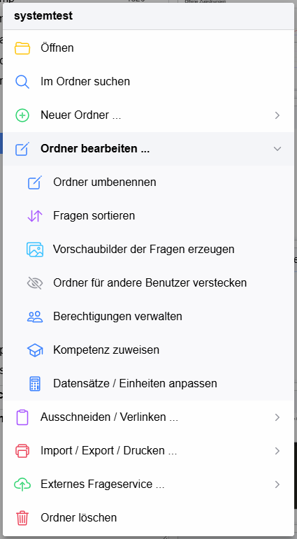
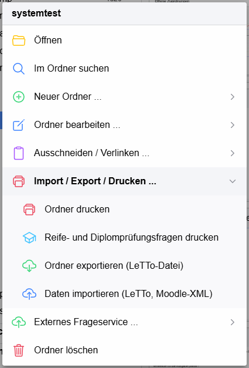

# Ordner der Bibliothek

Die Fragen der [Bibliothek](../index.md) sind in Ordnern (in LeTTo auch **Kategorien** genannt) organisiert.

## Ordnerbaum

Links in der Bibliothek steht der Ordnerbaum (am Handy über das Menü-Symbol eingeblendet).

* Die **oberste Ebene** enthält die Hauptthemen (zB. Elektronik, Mathematik). Sie werden vom Administrator angelegt.
* Innerhalb eines Hauptthemas kann jede Lehrperson einen **User-Ordner** mit ihrem Loginnamen anlegen und darin ihre eigene
  Ordnerstruktur aufbauen. Im eigenen Bereich hat man alle Rechte, die Ordner anderer Lehrpersonen kann man ansehen und
  Fragen daraus verwenden, aber nicht ändern.
* Der **Pfeil** links vom Ordner klappt den Ordner auf und zu, ohne ihn zu öffnen. Ein **Klick auf den Namen** öffnet den
  Ordner: Rechts erscheinen seine Unterordner als Ordner-Kacheln und seine Fragen als [Fragen-Kacheln](../Fragen/index.md).
* Rechts neben dem Namen steht die **Anzahl der Fragen** im Ordner und allen Unterordnern (abschaltbar in den
  [Einstellungen](../Einstellungen/index.md)).
* Der **Zurück-Knopf** links oben in der Kopfzeile zeigt den zuletzt angezeigten Ordner – so springt man zB. nach dem
  Öffnen einer Frage aus einem anderen Ordner schnell wieder zurück.
* Unter den eigenen Ordnern stehen die **fremden Server** (Exchange-Server, Demo-Server). Ihre Fragensammlungen sind
  schreibgeschützt; Fragen daraus können angesehen, kopiert und in Aktivitäten verwendet werden.
  Welche Server angezeigt werden, wird in den [Einstellungen](../Einstellungen/index.md) festgelegt.

Welche Hauptthemen und welche User-Ordner angezeigt werden, kann über die **Abos** in den
[Einstellungen](../Einstellungen/index.md) eingeschränkt werden.

## Ordner verschieben

Ordner werden mit der Maus (am Handy: kurz halten und ziehen) im Baum oder als Ordner-Kachel verschoben:

* Wird ein Ordner auf die **Mitte** eines anderen Ordners gezogen, wird dieser grün markiert – der Ordner wird dort hinein
  verschoben.
* Am **oberen bzw. unteren Rand** eines Ordners entsteht eine Lücke – der Ordner wird an dieser Stelle eingereiht
  (Reihenfolge der Ordner ändern).

Fragen-Kacheln können ebenso auf einen Ordner im Baum oder auf eine Ordner-Kachel gezogen werden.

## Kontextmenü

Das Kontextmenü eines Ordners öffnet sich mit der **rechten Maustaste** auf den Ordner, über die drei Punkte rechts neben
dem gewählten Ordner oder am Handy mit einem **langen Druck**. Es zeigt nur die Einträge, für die man im Ordner die Rechte
hat. Einträge mit **…** öffnen ein Untermenü.

* **Öffnen** – Ordner anzeigen
* **Im Ordner suchen** – [Suche](../Suche/index.md), auf diesen Ordner eingeschränkt
* **Einfügen (Strg+V)** – erscheint, wenn kopierte bzw. ausgeschnittene Fragen oder ein ausgeschnittener Ordner in der
  Zwischenablage liegen
* **Neuer Ordner …**
  * **Neuer Ordner** – Unterordner anlegen
  * **Neue Frage …** – neue Frage in diesem Ordner, der Fragetyp wird danach gewählt
  * **Globalen Ordner einfügen** (nur Administrator) bzw. **User-Ordner einfügen** (in einem Hauptthema, wenn es noch keinen
    eigenen Ordner gibt)
* **Ordner bearbeiten …** (siehe unten)
* **Ausschneiden / Verlinken …**
  * **Ausschneiden** – Ordner zum Verschieben vormerken; eingefügt wird er über das Kontextmenü des Zielordners
  * **Frage verlinken** – eine kopierte Frage als Verweis einfügen (die Frage existiert nur einmal, wird aber in beiden
    Ordnern angezeigt)
* **Import / Export / Drucken …** (siehe unten)
* **Externes Frageservice …** – Ordner an ein externes Frageservice (zB. eines Verlags) übertragen bzw. das Frageservice
  öffnen; erscheint nur, wenn in den [Einstellungen](../Einstellungen/index.md) ein Frageservice eingetragen ist
* **Daten von anderer Schule …** – Fragensammlungen anderer Schulen, für die in den
  [Einstellungen](../Einstellungen/index.md) ein Zugang eingetragen ist
* **Ordner löschen** – enthält der Ordner noch Fragen oder Unterordner, wird nachgefragt

### Ordner bearbeiten

* **Ordner umbenennen**
* **Fragen sortieren** – alle Fragen des Ordners alphabetisch nach dem Namen sortieren
* **Vorschaubilder der Fragen erzeugen** – fehlende Vorschaubilder der Kacheln für alle Fragen des Ordners erstellen
* **Ordner für andere Benutzer verstecken** bzw. wieder anzeigen (nur Administrator)
* **Berechtigungen verwalten** – anderen Benutzern in diesem Ordner das Recht geben, Fragen einzufügen, zu ändern oder zu
  löschen (siehe [Berechtigungen verwalten](../../Fragen/Dialoge/Berechtigungenverwalten/index.md))
* **Kompetenz zuweisen** – Kompetenz, die neuen Fragen in diesem Ordner automatisch zugewiesen wird
  (siehe [Einzelne Kompetenz zuweisen](../../Fragen/Dialoge/EinzelneKompetenzzuweisen/index.md))
* **Datensätze / Einheiten anpassen** – Standardwerte und Einheiten für Variablen in diesem Ordner
  (siehe [Datensätze / Einheiten anpassen](../../Fragen/Dialoge/Datensätze_Einheitenanpassen/index.md))

### Import / Export / Drucken

* **Ordner drucken** – PDF bzw. TeX aller Fragen im Ordner (siehe [PDF](../../Fragen/PDF/index.md))
* **Reife- und Diplomprüfungsfragen drucken** – Angabeblätter für mündliche Prüfungen
  (siehe [Reife- und Diplomprüfungsfragen](../../Fragen/Reife-undDiplomprüfungsfragen/index.md))
* **Ordner exportieren (LeTTo-Datei)** – alle Fragen und Unterordner als LTO-Datei
  (siehe [Daten exportieren](../../Fragen/Dialoge/Datenexportieren/index.md))
* **Daten importieren (LeTTo, Moodle-XML)** – Fragen aus einer LTO- oder Moodle-XML-Datei in diesen Ordner importieren
  (siehe [Fragen importieren](../../Fragen/Dialoge/Fragenimportieren/index.md))

Die fertigen Dokumente können über die **Wolke** in der [Kopfzeile](../index.md#kopfzeile) heruntergeladen werden.

### siehe auch

* [Fragen](../Fragen/index.md)
* [Ordnerverwaltung (alte Oberfläche)](../../Fragen/Ordnerverwaltung/index.md)
