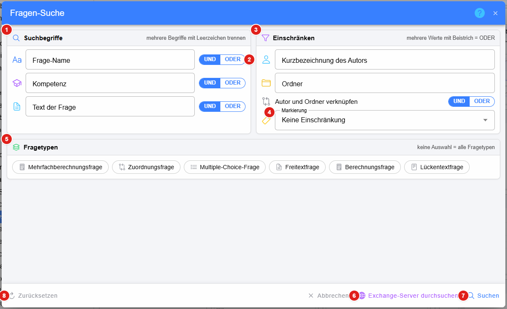

# Suche in der Bibliothek

Die Lupe in der [Kopfzeile](../index.md#kopfzeile) der Bibliothek öffnet die **Fragen-Suche** über die ganze
Fragensammlung. Über **Im Ordner suchen** im [Kontextmenü eines Ordners](../Ordner/index.md#kontextmenü) sind Ordner und Autor schon
mit diesem Ordner vorbelegt.

1. **Suchbegriffe** – im Namen der Frage, in den zugewiesenen Kompetenzen bzw. im Text der Frage. Mehrere Begriffe werden
   mit Leerzeichen getrennt.
2. **UND / ODER** – ob alle Begriffe eines Feldes vorkommen müssen (UND) oder einer genügt (ODER)
3. **Einschränken** auf Autoren (Kurzbezeichnung, zB. `l-mayt`) bzw. Ordner. Mehrere Werte werden mit Beistrich
   getrennt und gelten als ODER. Ob Autor **und** Ordner oder Autor **oder** Ordner zutreffen müssen, wird mit dem
   Schalter darunter festgelegt.
4. **Markierung** – nur Fragen mit einer bestimmten [Kennzeichnung](../Fragen/index.md#kennzeichnung) (zB. alle
   fehlerhaften Fragen)
5. **Fragetypen** – nur die gewählten Fragetypen; ohne Auswahl werden alle Fragetypen gesucht
6. **Exchange-Server durchsuchen** – dieselbe Suche in der Fragensammlung des Exchange-Servers
7. **Suchen** – die gefundenen Fragen werden im Dialog aufgelistet; **Im Ordner anzeigen** öffnet den Ordner der Frage
   und zeigt ihre [Vorschau](../Fragen/index.md#vorschau)
8. **Zurücksetzen** – alle Felder leeren

### siehe auch

* [Suche von Fragen in der Fragensammlung (alte Oberfläche)](../../Fragen/SuchevonFrageninderFragensammlung/index.md)
