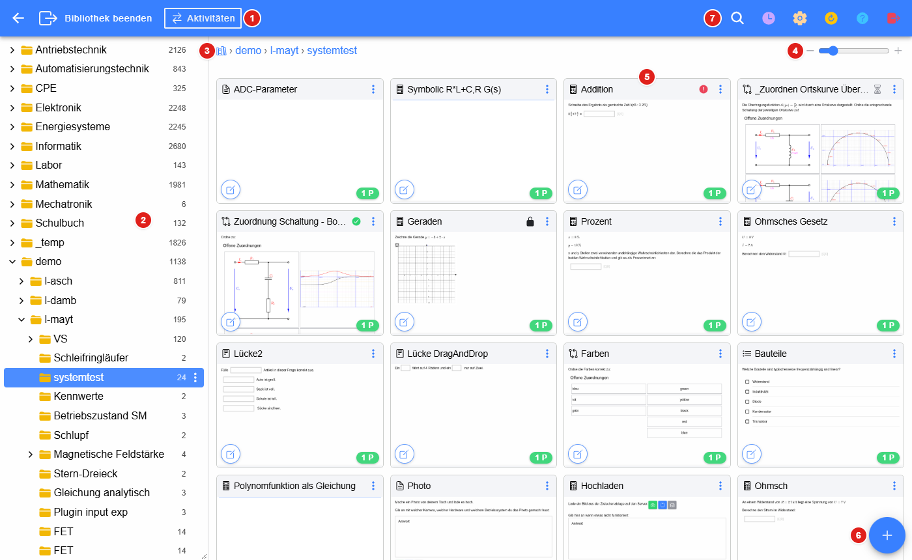
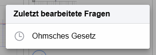
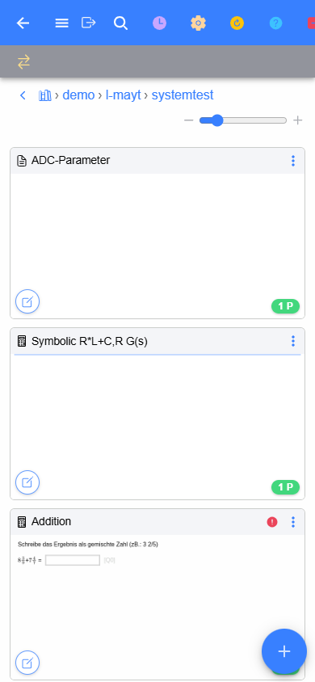
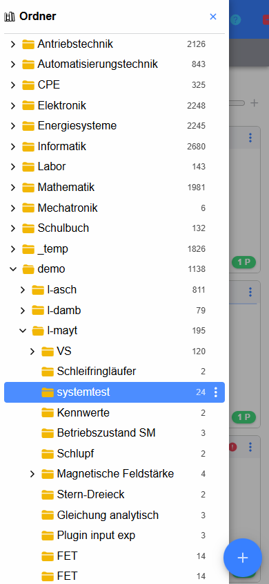

# Bibliothek

Die **Bibliothek** ist die Fragensammlung der LeTTo-App. Hier werden Fragen in Ordnern verwaltet, angesehen, bearbeitet
und zu Online-Aktivitäten (Tests, Hausübungen …) zusammengestellt. Sie ersetzt die
[Beispielsammlung](../Fragen/Beispielsammlung/index.md) der alten Oberfläche.

Geöffnet wird die Bibliothek im Menü der App über **Bibliothek**. Über **Bibliothek beenden** kommt man zurück in die App.

1. **Kopfzeile links** – Zurück zum vorigen Ordner, Bibliothek beenden und [Aktivitäten](Aktivitaeten/index.md)
   (Aktivität zum Bearbeiten wählen)
2. **Ordnerbaum** – alle Ordner der Fragensammlung, siehe [Ordner](Ordner/index.md)
3. **Pfad** des angezeigten Ordners – ein Klick auf einen Teil des Pfades öffnet diesen Ordner, das Bibliotheks-Symbol
   ganz links zeigt die oberste Ebene
4. **Größe der Kacheln** – mit dem Schieberegler bzw. **−** / **+** werden die Kacheln kleiner oder größer, ein
   Doppelklick stellt die Standardgröße wieder her. Die Einstellung gilt auch für die Fragen einer Aktivität und bleibt im
   Browser gespeichert.
5. **Fragen als Kacheln** mit Vorschaubild, siehe [Fragen](Fragen/index.md)
6. **Neue Frage** in diesem Ordner anlegen
7. **Kopfzeile rechts** – Suche, zuletzt bearbeitete Fragen, Einstellungen, Neu laden, Hilfe und Logout

## Kopfzeile

| Nr. | Knopf | Beschreibung |
|---|---|---|
| 1 | Zurück | zeigt den zuletzt angezeigten Ordner (erscheint, sobald ein anderer Ordner gewählt wurde) |
| 2 | Bibliothek beenden | zurück in die App |
| 3 | Aktivitäten | [Aktivität zum Bearbeiten wählen](Aktivitaeten/index.md) – während eine Aktivität bearbeitet wird, stehen hier ihr Name und ihre Punkte |
| 4 | Lupe | [Fragen suchen](Suche/index.md) |
| 5 | Uhr | zuletzt bearbeitete Fragen |
| 6 | Zahnrad | [Einstellungen der Bibliothek](Einstellungen/index.md): Abos, Design, Sprache, TeX-Vorlagen, fremde Server |
| 7 | Pfeil im Kreis | Ordnerbaum und Fragen neu vom Server laden |
| 8 | Fragezeichen | Hilfe zur aktuellen Seite |
| 9 | Logout | vom System abmelden |

Sind Druck- oder Export-Dokumente erzeugt worden (zB. PDF eines Ordners), erscheint zusätzlich eine **Wolke** mit der
Anzahl der fertigen Dokumente – ein Klick zeigt sie zum Herunterladen an.

### Zuletzt bearbeitete Fragen

Das Uhr-Symbol listet die zuletzt bearbeiteten Fragen. Ein Klick öffnet den Ordner der Frage und zeigt die
[Vorschau](Fragen/index.md#vorschau) der Frage; von dort geht es mit dem Stift in den [Editor](Editor/index.md).

## Am Handy

Bei schmalen Bildschirmen wird der Ordnerbaum ausgeblendet. Er wird über das **Menü-Symbol** links oben eingeblendet;
die Aktivität in Bearbeitung steht in einer eigenen zweiten Zeile.

| Fragen | Ordnerbaum |
|---|---|
|  |  |

Am Handy wird statt der rechten Maustaste ein **langer Druck** auf eine Kachel oder einen Ordner verwendet, um das
Kontextmenü zu öffnen. Kacheln werden durch kurzes Halten und Ziehen verschoben.

## Inhalt

* [Ordner](Ordner/index.md) – Ordnerbaum, Kontextmenü, Ordner verschieben
* [Fragen](Fragen/index.md) – Kacheln, Kontextmenü, Auswahl mehrerer Fragen, Vorschau, Kennzeichnung
* [Suche](Suche/index.md) – Fragen in der Sammlung suchen
* [Aktivitäten](Aktivitaeten/index.md) – Online-Aktivitäten zusammenstellen und bearbeiten
* [Editor](Editor/index.md) – Fragen bearbeiten
* [Einstellungen](Einstellungen/index.md) – Setup der Bibliothek

### siehe auch

* [Beispielsammlung (alte Oberfläche)](../Fragen/Beispielsammlung/index.md)
* [Fragetypen](../Fragen/Fragetypen/index.md)
* [Editor für den Angabetext](../Fragen/EditorfürdenAngabetext/index.md)
* [Online-Tests](../Tests/Online-Tests/index.md)
