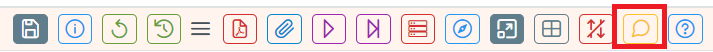
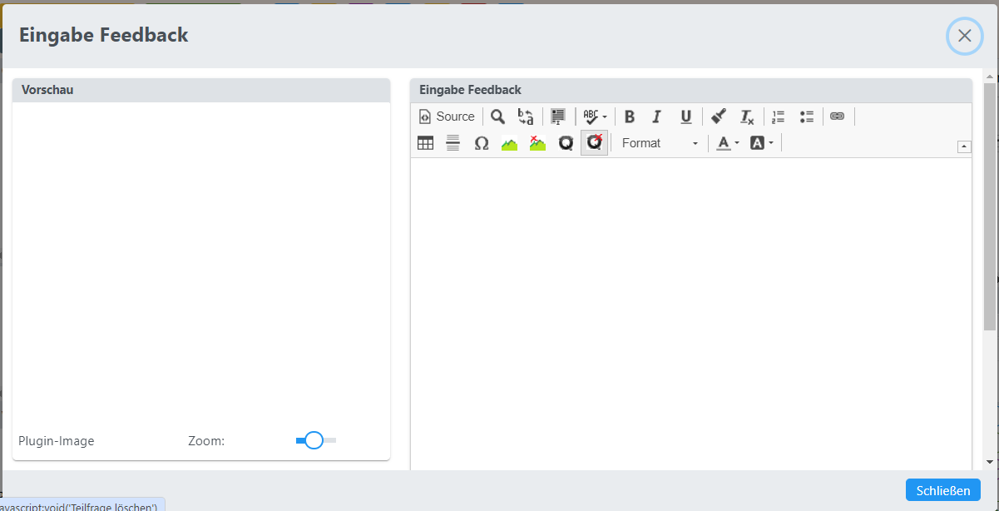
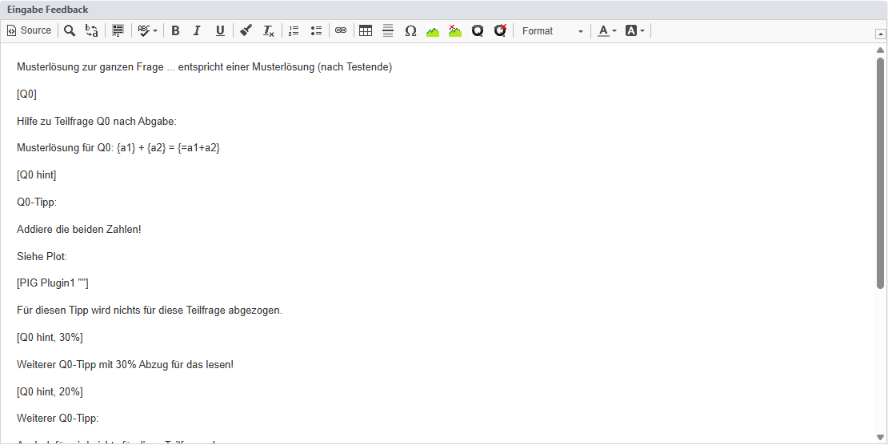
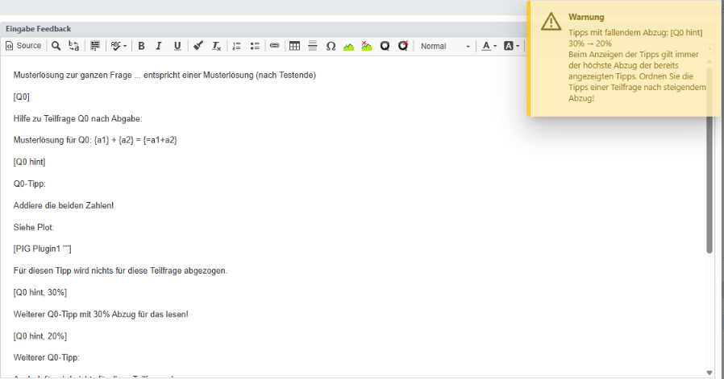
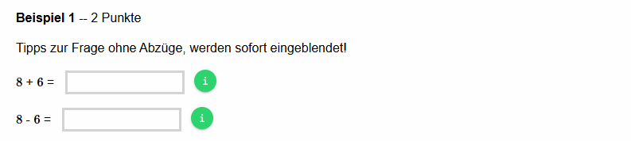
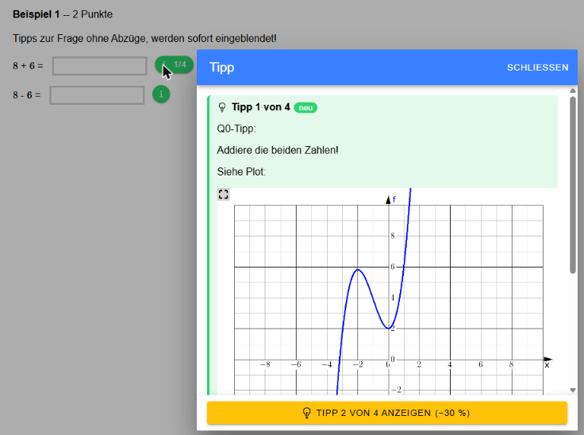
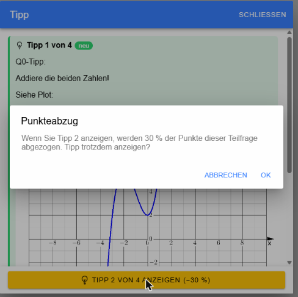
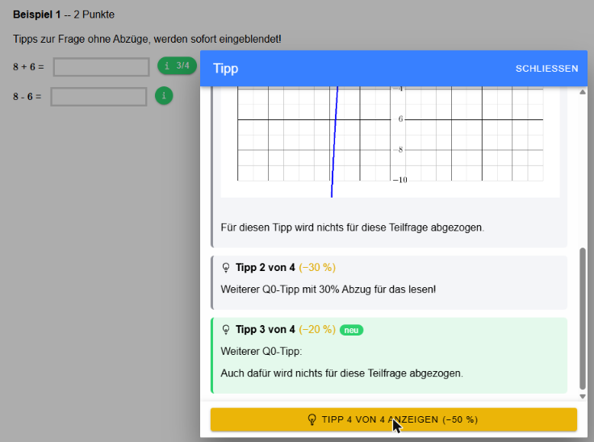
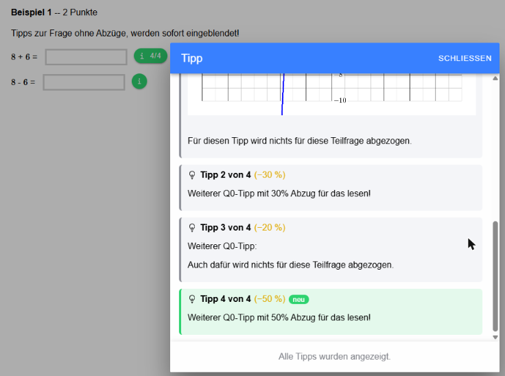

# Feedback / Tipps zu Fragen

Mit dem Feedback-Eingabefeld können für Fragen Musterlösungen zu den Beispielen 
und Tipps, die während der Aktivitäts-Ausführung angezeigt werden, definiert werden.

### Öffnen des Feedback-Dialoges über die Toolbar-Leiste
<br>
Dabei öffnet sich ein Dialog, in dem die Musterlösung und die Tipps eingegeben werden können.
<br>
Das Einfügen von Bildern und die Verwendung von Plugins ist wie bei der Eingabe des Fragetextes möglich.

## Syntax

### Allgemeiner Teil
* `[hint]`: Allgemeiner Tipp, es kann die gleiche Syntax wie bei den Teilfragen verwendet werden.

Ein allgemeiner **hint** kann auch ohne dem [hint]-Tag definiert werden. 
Einfach am Beginn des Feedback-Texts den allgemeinen Hint formulieren. Nur wenn es Einschränkungen für die Anzeige 
des **hints** geben soll, dann muss der [hint]-Tag verwendet werden.

Ist nur eine Teilfrage definiert oder ist die Frage eine Freitextfrage, dann wird dieser Teil
der Feedbackdefinition für die gesamte Frage genommen. Es wird also der allgemeine
Teil als Feedbackdefinition für die erste Teilfrage verwendet.

### Default-Lösungen und Tipps pro Teilfrage

Mit einer ähnlichen Syntax können Musterlösungen und Tipps zu allen Teilfragen
einer Mehrfach-Berechnungsfrage definiert werden.

* `[Qx]`: Musterlösung, Erklärung zu einer Teilfrage, x ist die Nummer der Teilfrage
* `[Qx hint]`: Tipp, der dem Schüler zu dieser Teilfrage angezeigt werden kann. Zur Testlaufzeit wird dem Schüler dann ein Button präsentiert, der weiterführende Informationen und Tipps bereitstellt.
* `[Qx hint, 30%]`: Tipp wie oben, nur werden dem Schüler beim Anzeigen dieses Tipps -30% für die richtige Lösung abgezogen.
* `[Qx hint, 0, 3]`: Tipp wie oben mit 0% Abzügen, der Tipp wird erst nach dem 3. Versuch angeboten
* `[Qx hint, p=10%, n=3]`: Tipp mit Zahlenzuordnung: p=...Penalty, n: Anzahl an Versuchen, nach dem der Tipp angezeigt wird.
* `[Qx hint, p=0.1, n=3]`: Tipp mit Zahlenzuordnung: p=...Penalty: 10%, n: Anzahl an Versuchen, nach dem der Tipp angezeigt wird.

Die Parameter können durch Beistriche **oder Leerzeichen** getrennt werden: `[Q0 hint 30%]` ist gleichbedeutend 
mit `[Q0 hint, 30%]`, ebenso `[Q0 hint p=10% n=3]` mit `[Q0 hint, p=10%, n=3]`.

Allgemein formuliert:
`[SQ-Name hint, p=prozent, n=versuchsanzahl]`:
Wenn die Reihenfolge der Zahlenangaben nicht bekannt ist, dann kann durch
* p=prozent: Abzüge beim Einblenden des Tipps in %, folgende Eingaben sind möglich: **10%**, **0.1**: Eingaben entsprechen 10 Prozent 
* n=versuchsanzahl: Nach dem n.ten Fehlversuch wird der Tipp-Button zu der Teilfrage eingeblendet
eine Syntax gewählt werden, wo die Reihenfolge keinen Einfluss hat.

Diese Parameter sind optional!

### Mehrere Tipps zu einer Teilfrage (Tipp-Stufen)

Zu einer Teilfrage (bzw. mit `[hint]` zur ganzen Frage) können **mehrere Tipps** definiert werden. Sie bilden 
aufbauende **Tipp-Stufen**, die dem Schüler während der Aktivität in der Reihenfolge der Definition 
nacheinander angezeigt werden: zuerst Tipp 1, auf Wunsch Tipp 2 usw. Jede Stufe hat ihre eigenen Parameter 
(Abzug, Anzahl an Versuchen).

Beispiel: zwei Tipps ohne Abzug, danach ein Tipp mit 30% und ein Tipp mit 50% Abzug.

```
[Q0]
Musterlösung für Q0: {a1} + {a2} = {=a1+a2}

[Q0 hint]
Addiere die beiden Zahlen! Siehe Plot: [PIG Plugin1 ""]

[Q0 hint]
Weiterer Tipp, auch dafür wird nichts abgezogen.

[Q0 hint 30%]
Weiterer Tipp mit 30% Abzug.

[Q0 hint 50%]
Fast schon die Lösung, 50% Abzug.
```

**Die Reihenfolge der Tipps ist entscheidend!** Für die Beurteilung gilt immer der **höchste Abzug** aller bereits 
angezeigten Tipps einer Teilfrage, die Abzüge werden nicht addiert. Im obigen Beispiel kostet Tipp 3 also 30%, 
nach Tipp 4 werden insgesamt 50% abgezogen (nicht 80%).

Tipps sollten daher nach **steigendem Abzug** geordnet werden. Folgt auf einen Tipp mit 30% ein Tipp mit 20%, 
dann kostet der zweite Tipp nichts mehr, obwohl bei ihm 20% angegeben sind.
Der Editor prüft die Reihenfolge beim Verlassen des Feedback-Eingabefeldes und gibt bei fallenden Abzügen eine 
**Warnung** aus, hier für `[Q0 hint, 30%]` gefolgt von `[Q0 hint, 20%]`:

<br>


### KI-Beurteilungs-Grundlagen pro Teilfrage

* `[Qx ai]` Text, der die Anweisungen an die KI enthält, wie die Teilfrage zu beurteilen ist.


# Konfiguration des Feedbacks in einer Aktivität (Aktuell in Definition ... )
Dieser Anschnitt dient im Moment nur der Spezifikation des zukünftigen Verhaltens von Aktivitäten, ist noch nicht umgesetzt!

## Penalty
Festlegung, wie das Verhalten in der Aktivität bei wiederholten fehlerhaften Versuchen, 
Definition von Punkte-Abzügen bei Fehlversuchen:
* Kein Penalty bei Fehlversuchen
* Penalty wie in der Frage defniert (entspricht der Checkbock ***Punkteabzug bei fehlerhafter Eingabe***)
* Penalty für alle Fragen der Aktivität in Prozent, wird für für alle Fragen der Aktivität angewendet.

## Anzeige von Tipps
Anzeige von Tipps zum Lösen der Frage, die aus dem Feedback-Feld der Frage bezogen werden:
* Keine Anzeige von Tipps in dieser Aktivität.
* Anzeige der Tipps, wie in der Frage spezifiziert.
* Anzeige von Tipps, Penalty und Anzahl an Fehlversuchen wird in der Aktivität festgelegt. Gilt dann für alle Beispiele, die Tipps im Feedback-Feld gespeichert haben.

## Anzeige von Feedbacks nach Beendigung des Tests durch den Lehrer
Konfiguration des Verhaltens einer Aktivität nach Beendigung des Tests durch den Lehrer, 
Konfiguration, welche Ergebnisse für den Schüler sichtbar sind:
* keine Fragen sichtbar
* Fragen ohne Schülerantworten sichtbar
* Fragen mit Schülerantworten ohne korrekte Ergebnisse
* Anzeige von Ergebnissen bei Berechnungsfragen (ohne Multiple-Choice, Zuordnungen, ...)
* Anzeige von allen automatischen Ergebnissen 
* Anzeige von allen Informationen mit Anzeige von Musterlösungen aus dem Feedback-Feld


# Tipps während der Testdurchführung

## Voraussetzung: Feedback-Einstellung der Aktivität
Welche Teile des Feedbacks der Schüler sieht, wird in den Einstellungen der Aktivität unter **Feedback** festgelegt:

| Einstellung | Während der Aktivität | Nach Testende |
|---|---|---|
| **Kein Feedback** | keine Tipps | keine Musterlösungen, keine Tipps |
| **Feedback nach Aktivität** | keine Tipps | Musterlösungen |
| **Feedback nach Frage** | Tipps (schrittweise, mit Abzügen) | Musterlösungen und alle Tipps |

Tipps werden also nur bei **Feedback nach Frage** während der Aktivität angeboten. 
Musterlösungen (`[Qx]`) sind erst nach dem Testende sichtbar.
In der Beispielsammlung und in der Lehreransicht fremder Versuche gibt es keine Einschränkungen, 
dort werden alle Tipps sofort und ohne Abzug angezeigt.

## Der Tipp-Button
Neben jeder Teilfrage, zu der Tipps definiert sind, erscheint ein grüner **Info-Button**. 
Tipps zur ganzen Frage (`[hint]`) werden über den Button **Hilfe zur Frage** in der Fußleiste aufgerufen, 
sie verhalten sich genauso wie die Tipps zu einer Teilfrage.



Der Button wird nur angeboten, solange
* die Aktivität noch läuft (der Versuch ist nicht abgegeben),
* die Teilfrage noch **nicht korrekt** beantwortet ist und
* ein Tipp verfügbar ist bzw. schon angezeigt wurde. Ist bei einem Tipp eine Anzahl an Versuchen (`n=...`) angegeben,
  dann wird er erst nach so vielen Antwortversuchen angeboten.

## Ablauf beim Abrufen der Tipps

### 1. Klick auf den Info-Button
Der Klick öffnet den **Tipp-Dialog**. Ist noch kein Tipp angezeigt und bewirkt der erste Tipp **keinen Abzug**, 
dann wird er sofort eingeblendet. Der neue Tipp ist grün hervorgehoben und mit **neu** markiert. 
Am Info-Button wird ab jetzt angezeigt, wie viele Tipps bereits angezeigt wurden (zB **1/4**).



Hat bereits der erste Tipp einen Abzug, dann öffnet sich der Dialog ohne Tipp mit dem Hinweis, 
wie viele Tipps es gibt. Der Tipp wird dann wie unten beschrieben über den Button im Dialog angezeigt.

Alle **weiteren Tipps** werden ausschließlich im Dialog angefordert. Ein erneuter Klick auf den Info-Button 
öffnet nur den Dialog mit den bisher angezeigten Tipps, so können diese jederzeit noch einmal nachgelesen 
werden, ohne dass dabei weitere Tipps aufgedeckt werden oder Punkte verloren gehen.

### 2. Nächsten Tipp anzeigen
Am unteren Rand des Dialogs wird der nächste Tipp angeboten, zB **Tipp 2 von 4 anzeigen**:
* **grüner Button**: der Tipp bewirkt keinen (zusätzlichen) Abzug und wird sofort angezeigt.
* **oranger Button mit Abzug** (zB **−30 %**): vor dem Anzeigen muss der Punkteabzug bestätigt werden.
  Mit **Abbrechen** bleibt der Tipp verborgen und es wird nichts abgezogen.



Jeder Tipp wird in einem eigenen Block **Tipp n von m** angezeigt. Bei Tipps mit Abzug steht der Abzug im Titel. 
Der zuletzt angezeigte Tipp ist grün hervorgehoben und mit **neu** markiert, der Dialog scrollt automatisch zu ihm.



Im obigen Bild ist für Tipp 3 zwar ein Abzug von 20% definiert, weil aber bereits Tipp 2 mit 30% angezeigt wurde, 
kostet Tipp 3 nichts mehr (es gilt der höchste Abzug) und wird über den grünen Button ohne Nachfrage eingeblendet. 
Erst Tipp 4 mit 50% erhöht den Abzug wieder und muss bestätigt werden.

Ist ein weiterer Tipp erst nach weiteren Antwortversuchen verfügbar, dann steht statt des Buttons der Hinweis 
**Ein weiterer Tipp ist nach ... weiteren Antwortversuchen verfügbar.**

### 3. Alle Tipps angezeigt
Sind alle Tipps angezeigt, dann steht am Info-Button zB **4/4** und im Dialog der Hinweis 
**Alle Tipps wurden angezeigt.**



## Punkteabzug
* Welche Tipps angezeigt wurden, wird am Server in der Antwort des Schülers gespeichert. Ein Neuladen der Seite 
  oder ein anderer Rechner ändert daran nichts, angezeigte Tipps bleiben angezeigt.
* Bei der Beurteilung der Teilfrage gilt der **höchste Abzug** aller angezeigten Tipps (zB 50% nach Tipp 4 im 
  obigen Beispiel). Der Abzug bezieht sich auf die Punkte der Teilfrage bzw. bei `[hint]` auf die Punkte der Frage.
* Ist die Teilfrage korrekt beantwortet oder der Versuch abgegeben, dann werden keine weiteren Tipps mehr angeboten.
* Nach dem Testende (bei **Feedback nach Frage**) sieht der Schüler alle Tipps und die Musterlösungen ohne weitere Abzüge.

