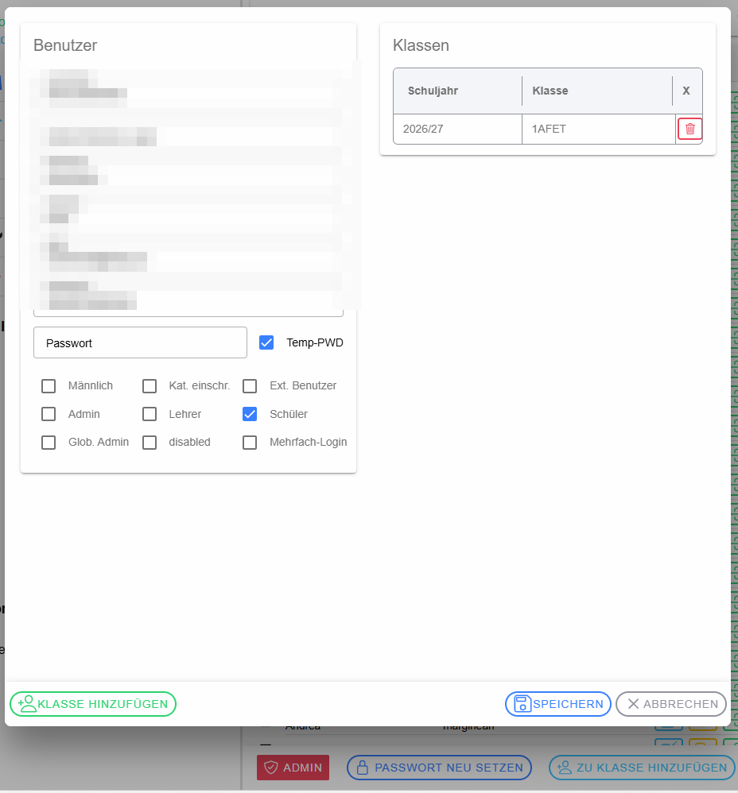
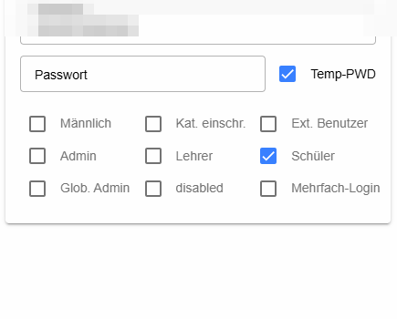
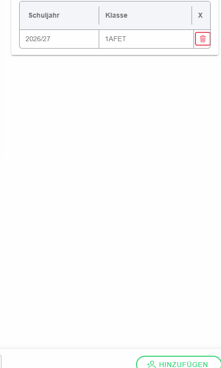

# Dialog „Benutzer anlegen / bearbeiten“

Der Dialog wird beim Anlegen eines neuen Benutzers oder über das Stift-Symbol eines bestehenden Benutzers geöffnet.

## Benutzerdaten

Links werden **Login-Name**, **Active-Directory-Login**, **Nachname**, **Vorname**, **E-Mail** und – sofern verwendet – eine **Sokrates-ID** gepflegt. **Login-Name** und **Nachname** sind Pflichtfelder; ohne sie kann nicht gespeichert werden. Fehlt der Login-Name, wird der Active-Directory-Login (in Kleinbuchstaben) vorgeschlagen.

Der Dialog lädt immer genau den Benutzer, dessen Stift-Symbol angeklickt wurde – auch bei Benutzern ohne Login-Name.

## Passwort

Im Passwortfeld kann ein Passwort festgelegt bzw. neu gesetzt werden. **Temporäres Passwort** kennzeichnet ein nur vorläufig vergebenes Passwort.

## Rollen und Optionen

Die Checkboxen steuern Eigenschaften und Berechtigungen des Benutzers: **Männlich** hinterlegt die entsprechende Geschlechtsangabe; **Kat. einschr.** schränkt die veränderbaren Kategorien/Abonnements ein; **Ext. Benutzer** kennzeichnet einen externen Benutzer. **Admin** vergibt Schul-/Organisationsadministrationsrechte, **Lehrer** die Lehrerrolle, **Schüler** die Schülerrolle und **Global** globale Administrationsrechte. **Deaktiviert** sperrt den Benutzer. **Mehrfach-Login** erlaubt die dafür vorgesehene parallele Nutzung desselben Kontos.

## Klassen und Lehrer-Kataloge

Rechts werden bestehende **Klassen-Zuordnungen** angezeigt. Bei Schülern sind dies die Klassen je Schuljahr; bei Lehrern werden zusätzlich Gegenstand/Katalog-Zuordnungen geführt. Der **Papierkorb** entfernt die jeweilige Zuordnung endgültig (Tooltip „Klassenzuordnung endgültig löschen“ bzw. „Lehrerzuordnung endgültig löschen“). Über die Auswahl des Schuljahrs können weitere Zuordnungen für das passende Jahr verwaltet werden. Ist eine Klasse mit dem gewählten Gegenstand schon zugeordnet, erscheint eine Rückfrage; nach der Bestätigung entsteht ein weiterer, eigener Katalog (siehe [Klassenzuordnung](../../../Klassenzuordnung/index.md)).

## Speichern und Abbrechen

**Speichern** übernimmt die Änderungen. Der Dialog schließt sich erst, wenn das Speichern gelungen ist; sonst bleibt er mit der Fehlermeldung offen. Danach wird die Benutzerliste neu geladen. **Abbrechen** bzw. das Schließen des Dialogs verwirft nicht gespeicherte Änderungen.

Administratoren können einen bestehenden Benutzer mit **Benutzer löschen** direkt im Dialog löschen; er verschwindet danach auch aus der Ergebnisliste.
