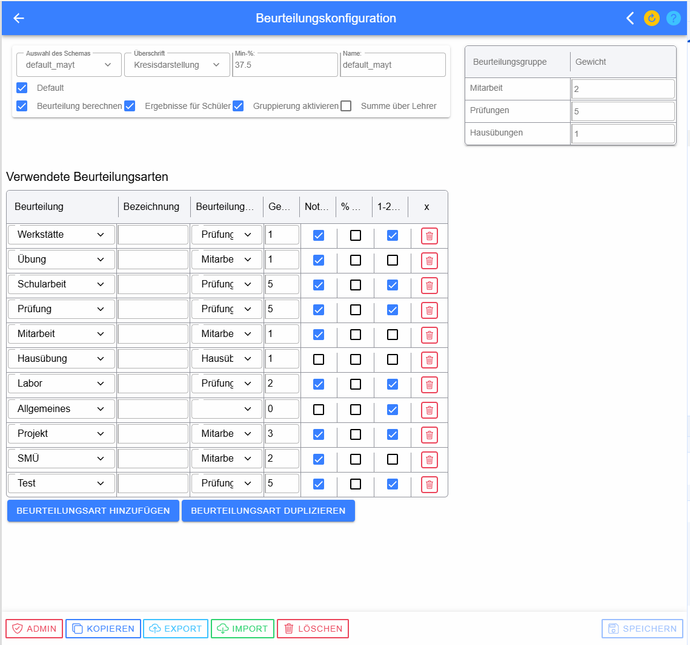
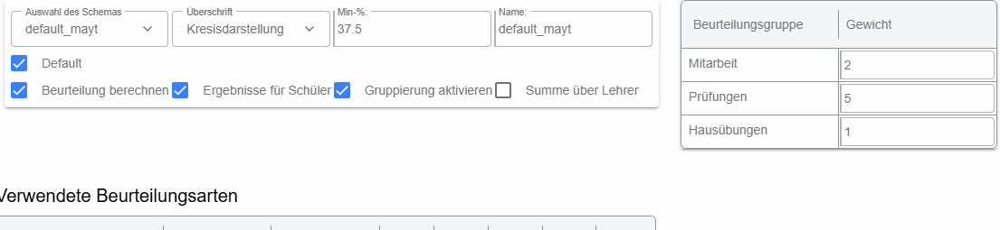
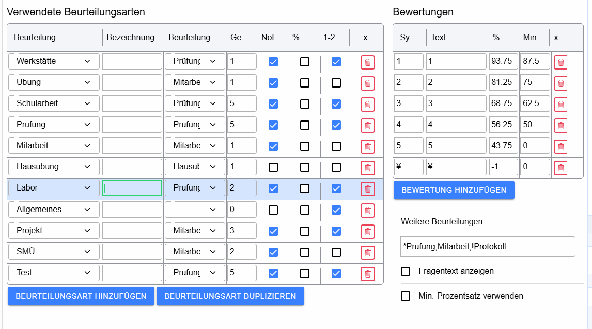
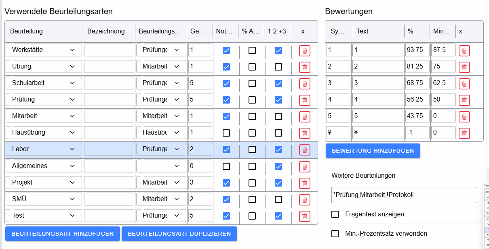

# Beurteilungskonfiguration

Beurteilungsschemata definieren, wie Leistungen in LeTTo erfasst und in eine Gesamtbeurteilung überführt werden. Dazu gehören Beurteilungsarten, Gewichtungen, zulässige Noten/Symbole, Prozentgrenzen und zusammengesetzte Beurteilungen.

## Schema-Einstellungen

Über **Auswahl des Schemas** wird das zu bearbeitende Schema gewählt. **Überschrift**, **Min.-Prozent** und **Name** definieren grundlegende Eigenschaften. **Default** kennzeichnet das Standardschema. Je nach Rolle können lokale bzw. globale Schemata nur eingeschränkt bearbeitbar sein.

## Verwendete Beurteilungsarten

Jede Zeile beschreibt eine Beurteilungsart, etwa Übung, Schularbeit, Prüfung, Mitarbeit, Hausübung, Labor oder Test. **Beurteilung** wählt die zugrunde liegende Art. **Bezeichnung** erlaubt einen abweichenden Namen. **Gruppierung** fasst Beurteilungsarten für die Auswertung zusammen; **Gewicht** bestimmt ihre relative Bedeutung.

Die Checkbox **Not.** erlaubt die Noten-/Prozenteingabe. **%-An.** steuert, ob Prozentwerte angezeigt werden. **1-2** bzw. **1-2 +3** erlaubt **Zwischennoten** wie `1-2`, `2-3`, `+2` oder `3-`; der zugehörige Prozentwert wird zwischen den definierten Bewertungsstufen entsprechend ermittelt. Der Papierkorb löscht die Beurteilungsart.

**Beurteilungsart hinzufügen** legt eine neue Art an. **Beurteilungsart duplizieren** kopiert eine bestehende Art einschließlich ihrer Bewertungen und eignet sich daher besonders für ähnliche Varianten.

## Bewertungen

Für die markierte Beurteilungsart wird rechts festgelegt, welche **Symbole/Noten** zulässig sind. **Symbol** ist die Eingabe im Katalog, **Text** die Bezeichnung, **%** der zugeordnete Prozentwert und **Min.-%** die Untergrenze, ab der die Bewertung gilt. Der Papierkorb löscht die Zeile; **Bewertung hinzufügen** ergänzt eine weitere Bewertungsstufe.

Negative Prozentwerte können verwendet werden, um reine Dokumentationseinträge von der Berechnung auszunehmen. Ein Wert von `0 %` geht dagegen als tatsächliche Leistung mit null Prozent in die Berechnung ein.

## Weitere Beurteilungen / zusammengesetzte Beurteilungen

Im Feld **Weitere Beurteilungen** wird festgelegt, ob sich eine Beurteilung aus Teilbeurteilungen zusammensetzt. Die Teilbereiche werden durch Beistriche getrennt, z. B. `Mitarbeit, Dokumentation`. Gewichte können direkt angefügt werden, etwa `Prüfung 2, Mitarbeit 1, Protokoll 5`; damit zählt das Protokoll fünfmal so stark wie die Mitarbeit.

Ein `!` vor oder nach einer Teilbeurteilung kennzeichnet eine für den Abschluss erforderliche Teilnote, z. B. `Prüfung 2, Mitarbeit 1, !Protokoll 5`. Solange diese fehlt, gilt die Beurteilung als noch nicht vollständig. Ein `*` kann bei einer erzwungenen Teilbeurteilung verwendet werden, wenn ein Schüler von diesem Teil befreit ist.

**Fragentext anzeigen** ermöglicht bei der Beurteilung die zusätzliche Erfassung der Aufgabenstellung. **Min.-Prozentsatz verwenden** berücksichtigt bei der Prozentberechnung die im Schema definierte Untergrenze.

## Neues Schema aus Vorlage

Statt mit einem leeren Schema zu beginnen, kann über **Vorlage** ein neues Schema aus einer Vorlage erstellt werden:

* **Standard 5-stufig** – eine Beurteilungsart mit den Noten 1–5 (ab 87,5 / 75 / 62,5 / 50 / 0 %)
* **Plus/Minus** – Mitarbeit mit +, ~ und - (ab 75 / 25 / 0 %)
* **Schularbeit + Mitarbeit 2:1** – Prüfungen (Schularbeit, Noten 1–5) zählen doppelt so viel wie die Mitarbeit (+/~/-)

Das Schema wird nur im Formular angelegt; nach dem Anpassen wird es mit **Speichern** übernommen. Die Beurteilungsarten
und Gruppierungen der Vorlage werden – wie beim Import – über ihren Namen den Definitionen der Schule zugeordnet
(siehe [Import und Kopie](#import-und-kopie-zuordnung-globaler-definitionen)).

## Default-Schema

Es gibt genau **ein globales Default-Schema** und **je Lehrer ein eigenes Default-Schema**. Wird ein Schema als Default
gespeichert, verliert das bisherige Default-Schema (desselben Lehrers bzw. das bisherige globale) die Markierung.
Bei einem gespeicherten Default-Schema ist die Checkbox **Default** gesperrt: Ein Default-Schema kann nicht abgewählt
werden, sondern nur ersetzt, indem ein anderes Schema als Default festgelegt wird.

## Prüfung des Schemas (Prüfbericht)

Jedes Schema wird beim Bearbeiten laufend am Server geprüft – kurz nach jeder Änderung und noch einmal beim Speichern.
Im Kopf der Seite zeigt eine **Ampel** das Ergebnis:

* **grün** – Schema in Ordnung (ggf. mit Hinweisen),
* **gelb** – Warnungen, Speichern ist möglich,
* **rot** – Fehler, **Speichern ist erst nach der Korrektur möglich**.

Die Meldungen lassen sich aufklappen. Ein Klick auf eine Meldung springt zum betroffenen Feld (Name, Gruppe,
Beurteilungsart oder Notenstufe) und markiert es.

| Schwere | Beispiele |
|---|---|
| **Fehler** | Beurteilungsart ohne bzw. mit nicht vorhandener globaler Art; Gruppe fehlt im Schema bzw. global oder ist doppelt; keine Notenstufen (außer bei Online-Arten); keine Stufe mit Untergrenze 0 %; Symbol fehlt oder ist doppelt; Prozentwert außerhalb von 0–100; negative Gewichtung; Schema ohne Name oder ohne Beurteilungsart |
| **Warnung** | gleiche Art mit gleicher Bezeichnung; Online-Art ohne Notenstufen; mehrere Stufen mit derselben Untergrenze; Prozentwert unter der Untergrenze; leere Teilbeurteilung |
| **Hinweis** | Gewichtung 0 (zB. „Allgemeines“); Beurteilungsart ohne Gruppe bei aktiver Gruppierung |

Dieselben Regeln gelten für alle Wege, auf denen ein Schema gespeichert wird. Ist das Schema eines Katalogs fehlerhaft,
zeigt die Notenübersicht den Hinweis **„Beurteilungsschema unvollständig – Noten sind nicht (richtig) berechenbar“**
statt stillschweigend mit Ersatzwerten zu rechnen.

## Notenskala

Unter den Bewertungen der gewählten Beurteilungsart zeigt ein **Balken von 0 bis 100 %**, welcher Prozentbereich zu
welcher Notenstufe gehört – genau so, wie der Server aus einem Prozentwert die Note bestimmt. Beim Darüberfahren wird der
Bereich angezeigt. Hervorgehoben werden:

* **Lücken** – unter einer Grenze gibt es keine Note (eine Stufe braucht die Untergrenze 0 %),
* **gleiche Untergrenzen** – von mehreren Stufen mit derselben Untergrenze wird nur eine vergeben.

### Markierungen (Prozentwert -1)

Notenstufen mit dem Prozentwert **-1** (zB. E, T, K, Ø) sind **Markierungen**: Sie dokumentieren etwas im Katalog,
werden aber **nie** aus einem Prozentwert vergeben und gehen nicht in die Berechnung ein. Sie erscheinen daher nicht in
der Notenskala und werden bei den Prozentregeln der Prüfung nicht berücksichtigt.

## Was wäre wenn? – Beispielrechnung

Die aufklappbare Karte **Was wäre wenn?** rechnet Beispielwerte mit dem aktuellen Stand des Formulars durch – auch mit
noch nicht gespeicherten Änderungen. Je Zeile werden **Beurteilungsart**, **Note oder %** (zB. `2`, `+` oder `70 %`) und
das **Gewicht der Beurteilung** eingegeben; **Beispielwert hinzufügen** ergänzt eine Zeile.

Gerechnet wird am Server mit derselben Berechnung wie in der Notenübersicht. Angezeigt wird der **Rechenweg**:

1. Umrechnung jeder Eingabe in einen Prozentwert (ggf. mit Mindestprozent),
2. die Gruppen mit ihren Beurteilungen und Gewichtungen,
3. Beurteilungsarten, die keiner Gruppe zugeordnet sind und daher nicht in die Berechnung eingehen,
4. der Gesamt-Prozentwert mit der Formel.

## Hilfetexte

Zu den Feldern, Checkboxen und Spaltenüberschriften der Schema-Seite gibt es Tooltips: Bleibt die Maus kurz über dem
Feld, erscheint eine kurze Erklärung mit einem Beispiel, wie sich die Einstellung auswirkt – etwa bei **Min-%** und **Min.-Prozentsatz
verwenden**, den Gewichten von Gruppe und Beurteilungsart, Zwischennoten, **Summe über Lehrer**, der Untergrenze einer
Notenstufe und den Markierungen.

## Import und Kopie: Zuordnung globaler Definitionen

Beurteilungsarten und Gruppierungen eines Schemas verweisen auf **globale Definitionen der Schule**. Beim Import, beim
Kopieren und bei Vorlagen werden diese **über den Namen bzw. die Abkürzung** zugeordnet (nicht über eine interne Nummer,
die in einer anderen Schule etwas anderes bedeuten kann).

Bleibt dabei etwas offen, öffnet sich der Dialog **Globale Definitionen zuordnen**: Für jede Beurteilungsart bzw.
Gruppierung, die es in dieser Schule nicht gibt (oder die deaktiviert ist), wird eine Definition der Schule gewählt.
Administratoren können stattdessen **Neu anlegen** wählen; die neue Definition wird beim Speichern angelegt. Solange
nicht alles zugeordnet ist, kann das Schema nicht übernommen werden.

## Admin-Modus

Im Admin-Modus hat die Seite die Reiter **Beurteilungsschema**, **Globale Stammdaten** und **Schemen prüfen**.

### Globale Stammdaten

Globale Beurteilungsarten und Gruppierungen dürfen **nur Administratoren** anlegen und ändern.

* **Verwendungsprüfung:** Eine globale Definition, die noch in Schemen, Tests oder Beurteilungen verwendet wird, kann
  nicht gelöscht werden.
* **Deaktivieren statt löschen:** Deaktivierte Definitionen können nicht mehr neu zugeordnet werden; vorhandene Schemen
  und Beurteilungen funktionieren weiter. Endgültig gelöscht werden kann nur, was nicht mehr verwendet wird.
* Wird bei einem Lehrer-Schema eine noch verwendete Beurteilungsart entfernt, erhält der Lehrer eine Meldung.

Globale Daten und das Schema werden gemeinsam in einem Schritt gespeichert – entweder alles oder nichts.

### Schemen prüfen

Der Reiter **Schemen prüfen** prüft **alle Beurteilungsschemen der Schule** mit denselben Regeln wie beim Speichern.
Schemen mit Fehlern können so lange nicht gespeichert werden und liefern falsche oder keine Noten.

* Übersicht: Anzahl der Schemen **mit Fehlern**, **nur mit Warnungen** und **in Ordnung**; **Neu prüfen** wiederholt die Prüfung.
* Filter: **nur Fehler**, **Fehler und Warnungen**, **alle**.
* Je Schema: Ampel, Anzahl der Fehler/Warnungen/Hinweise, Besitzer (bzw. **globales Schema**), Verwendung (direkt
  zugeordnete Klassen und Tests) und die aufklappbaren Meldungen.
* **Öffnen** – ein globales Schema direkt zum Reparieren öffnen.
* **Ansehen** – ein Lehrer-Schema schreibgeschützt mit Prüfbericht ansehen. Zum Reparieren unter
  [Benutzer](../Benutzer/index.md) in die Rolle des Lehrers wechseln.

Bestehende Schemen werden dabei nicht automatisch verändert – Fehler werden nur gemeldet.
