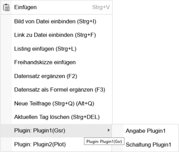

# Plugins
### Plugin
#### Allgemeines:
* Plugins sind kleine Unterprogramme, welche in allen Fragetypen verwendet werden können und Graphiken, Texte und Berechnungen automatisch generieren können.
* Die Definition eines Plugins erfolgt über einen Definitionsstring und dem Plugin-Typ. zB. erzeugt der Pluginstring "R+C" der Plugins "WSR" eine Serienschaltung von einem Widerstand und einem Kondensator
* Die genaue Definition wie der Plugin-String eingegeben werden muss ist in der Hilfe des jeweiligen Plugins ersichtlich
* aktuell sind in LeTTo folgende Plugins realisiert:
  * [Gsr](../Gsr/index.md): zeichnet elektrische Schaltungen und liefert auch die Maxima-Berechnung dazu - siehe [Video](https://youtu.be/TIG0KI59k6I)
  * [Wsr](../Wsr/index.md): zeichnet lineare elektrische Schaltungen und liefert auch die Maxima-Berechnung dazu  - siehe [Video](https://youtu.be/YL-T-61QUh4)
  * [Dsr](../Dsr/index.md): zeichnet lineare Drehstromschaltungen und liefert auch die Maxima-Berechnung dazu  - siehe [Video](https://youtu.be/Z62GKTSbKDA)
  * [Elektronik](../Elektronik/index.md): zeichnet elektroniksche Schaltungen mit OPV und Transistor
  * [Zp](/notimplemented/index.md): zeichnet eine elektrische Schaltung als Zweipol auf den Bildschirm. Dieses Plugin ist nur aus Kompatibilitätsgründen  vorhanden. Es sollte statt dessen nur mehr "Wsr" verwendet werden.
  * [SourceCode](../CodeCheck/index.md): automatische Bewertung von Sourcecode(aktuell nur Java)
  * [Graph](../Graph/index.md): zeichnet ein Zeitsignal in ein virtuelles Oszilloskop  - siehe [Video](https://youtu.be/O7dSg1LACq8)
  * [DigiGraph](../DigiGraph/index.md): zeichnet digitale Signale in ein virtuelles Oszilloskop 
  * [Plot](../Plot/index.md): zeichnet Funktionsgraphen  - siehe [Video](https://youtu.be/s0ju5sV31yU)
  * [Freihand](../Freihand/index.md): Stellt für den Schüler ein Zeichenfenster zur Verfügung, in dem der Schüler Freihand zeichnen kann
  * [MultiMeter](../MultiMeter/index.md): einfache Multimeter für die Anzeige von elektrischen Größen und interaktive Schülereingaben  - siehe [Video](https://youtu.be/FYuSCteWRQc)
* Sobald ein Plugin definiert ist, kann über die rechte Maustaste im Fragetext-Editor auf die verfügbaren Plugin-Textmodule zugegriffen werden.
 
Folgende Module stehen zur Verfügung:
* Angabe: Hier wird aus dem Plugin ein Angabetext automatisch generiert und in den Text eingefügt. Dieser Text ändert sich nicht, falls am Plugin-String etwas geändert wird, muss also nach einer Plugin-String-Änderung neu eingefügt werden.
* Graphik: Hiermit  wird ein Graphig Tag in eckigen Klammern [PIG ... ](PIG ... ) im Fragetext eingefügt. Die Berechnung der Graphik erfolgt dann zur Laufzeit und wird deshalb individuell für jeden Schüler mit seinen Datensätzen berechnet. Der PIG-Tag kann je nach Plugin auch Parameter enthalten welcher zur Konfiguration der Graphik verwendet werden können. Diese Parameter sind vom Plugin abhängig und werden deshalb in der Plugin-Hilfe des Plugins beschrieben. Die Paramter des PIG-Tags können im Fragetext ganz normal verändert werden. 

Ein Anführungszeichen " muss im Definitionsstring mit einem Backslash verblockt werden.
<pre> [PIG Plugin2 "text(2,2,tex=&#92;"&#92;alpha&#92;")"/](PIG Plugin2 "text(2,2,tex=&#92;"&#92;alpha&#92;")"/) </pre>
* Im [Maxima-Feld](../BeispielsammlungEditieren/index.md#maxima-feld) kann mit der rechten Maustaste auf das Berechnungsmodul eines Plugins zugegriffen werden, falls das Plugin eine Maxima-Berechung ausgeben kann.

####  Plugin-Entwicklung 

* Als Vorlage für eigene Plugins steht das Referenz-Plugin (Java) mit einem Demo-Plugin einer einfachen Uhr auf GitHub zur Verfügung: https://github.com/LeTTo-GmbH/plugin-demo-java
  * Dokumentation: [Referenz-Plugin (Java)](../Plugins/referenz-plugin-java/index.md)
  * [Eigenes Plugin erstellen](../Plugins/referenz-plugin-java/eigenes-plugin/index.md): Schritt-für-Schritt-Anleitung aus dem Demoprojekt
  * [Architektur](../Plugins/referenz-plugin-java/architektur/index.md): Aufbau des Services und Ablauf zwischen LeTTo-Server und Plugin
  * [Plugin-API](../Plugins/referenz-plugin-java/plugin-api/index.md): Methoden, die ein Plugin überschreibt (`BasePlugin`)
* Die Kommunikation erfolgt über eine REST-Schnittstelle, siehe [REST-Schnittstelle](../Plugins/referenz-plugin-java/rest-schnittstelle/index.md)
  * ApiController: die eigentliche Plugin-Schnittstelle zwischen LeTTo und Plugin (nur aus dem Docker-Netzwerk erreichbar)
  * ApiExternOpenController: offene Endpoints für Ajax und allgemeine Informationen (von extern erreichbar)
  * ConfigHttpController: Konfigurationsdialog des Plugins, wenn er über ein iframe in LeTTo eingebunden wird (von extern erreichbar)
  * InfoController: Ping, Version und Service-Informationen für Health-Check etc.
  * Die Datentransfer-Klassen der REST-Schnittstelle sind unter [DTOs und Enums](../Plugins/referenz-plugin-java/dtos/index.md) beschrieben.
  * Am eigenen Server liefert jedes installierte Plugin seine Swagger-Doku unter https://servername/&lt;endpoint&gt;/swagger-ui.html und die JavaDoc unter https://servername/&lt;endpoint&gt;/open/javadoc/index.html
* Das Plugin muss am eigenen LeTTo-Server der Schule wo es genutzt werden soll über das Setup-Service [https://servername/config](https://name/config) registriert werden und eingebunden sein.
  * Die Doku für die Endpoints des Setup-Services liegt ebenfalls als Swagger-Doku vor (https://build.letto.at/config/swagger-ui/index.html) 
  * Für die Registratur eines Plugins benötigt man den Endpoint /config/auth/user/registerplugin aus dem config-controller
  * Das Referenz-Plugin registriert sich beim Start automatisch, siehe [Build und Deployment](../Plugins/referenz-plugin-java/build-deployment/index.md#registrierung-am-letto-server)
* Um selbst entwickelte Plugins testen zu können kann der Plugintester(https://servername/plugintester)  verwendet werden, welcher über das Setup-Service (https://servername/config) installiert werden kann.

[Plugins](../Plugins/index.md)

