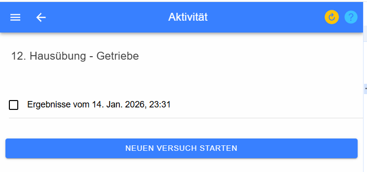

# Starten einer Aktivität

Mit dieser Seite können Sie eine Aktiviät starten, forsetzten oder 
die Ergebnisse einer abgegebenen Einheit einsehen. 

In der Titelzeile sehen Sie die Bezeichnung der Aktivität.
Darunter sind folgende Auswahlmöglichleiten möglich:

* **Neuen Versuch starten**
* **Versuch fortsetzen vom ...**
* **Ergebnisse vom ...**

Mit **Neuen Versuch starten** wird für diese Aktivität ein neuer Versuch angelegt,
es werden die Beispiele zugewiesen und die Angabewerte definiert. Danach können 
Sie mit der Bearbetung der beispiele beginnen.

Nach einer Unterbrechung können Sie mit **Versuch fortsetzen vom ...** die Arbeit wieder aufnehmen.

Mit **Ergebnisse vom ...** können Sie eine bereits abgeschlossene Aktivität wieder einsehen
und bekommen auch die korrekten Ergebnisse präsentiert, wenn diese vom Lehrer freigegeben wurden.

## Nach der Abgabe

* Ein **abgegebener Versuch kann nicht wieder bearbeitet werden** – auch nicht, wenn die Seite noch in einem anderen
  Fenster offen ist oder aus dem Browser-Verlauf geöffnet wird. Er erscheint nur mehr unter **Ergebnisse vom ...**.
  Wieder öffnen kann ihn nur der Lehrer (siehe [Test-Ergebnisse](../../Tests/Test-Ergebnisse/index.md#aktionen-eines-versuchs)).
* Durfte während der Aktivität **geprüft** werden (zB. Hausübung oder Übung mit Prüfen), sehen Sie nach der Abgabe unter
  **Ergebnisse vom ...** bzw. **Eigene Eingaben ansehen** Ihre Eingaben mit dem Status (richtig/falsch) **aller**
  Fragen. Die **Lösungen** werden erst angezeigt, wenn der Lehrer die Aktivität beendet hat.
* Können die Detail-Ergebnisse noch nicht angezeigt werden, bleibt die Ergebnisübersicht mit einem Hinweis stehen
  (statt einer leeren Seite); mit **Zurück zu den Ergebnissen** geht es zurück.
* **Neuen Versuch starten** ist während des Startens gesperrt – ein Doppelklick legt nicht zwei Versuche an.

## Ansicht des Lehrers

Lehrer sehen auf dieser Seite zusätzlich die Ergebnisse der Aktivität und den **Stopp**-Knopf zum Beenden. Er zeigt
an, ob die Aktivität läuft (rotes Stopp-Symbol), der Beenden-Bereich geöffnet ist (rot gefüllt) oder die Aktivität
bereits beendet ist (grünes Häkchen mit dem Datum im Tooltip), siehe
[Aktivität beenden](../../Tests/Test-Ergebnisse/index.md#aktivität-beenden).
